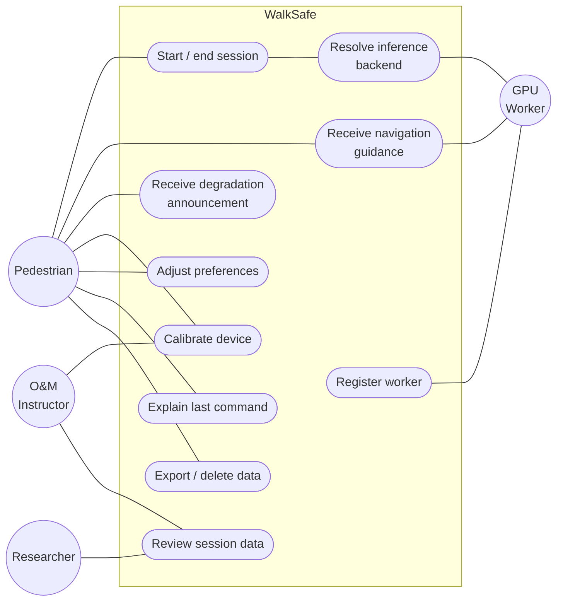
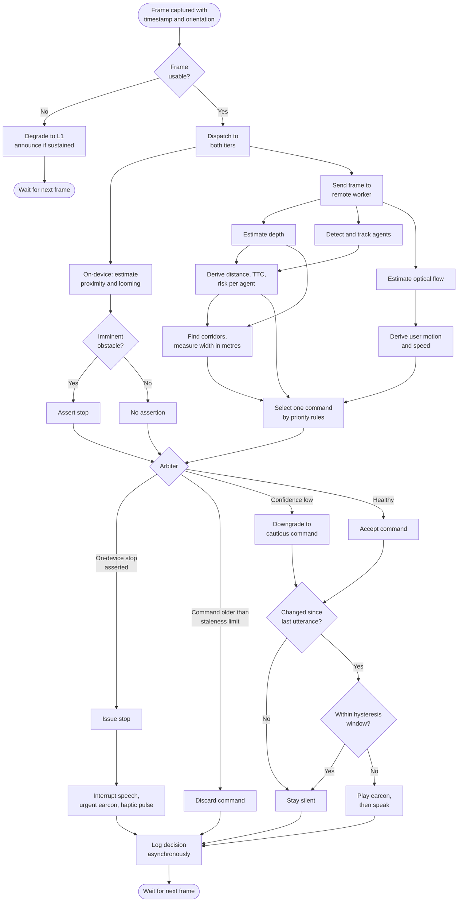
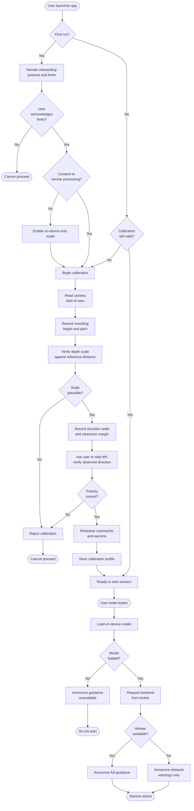
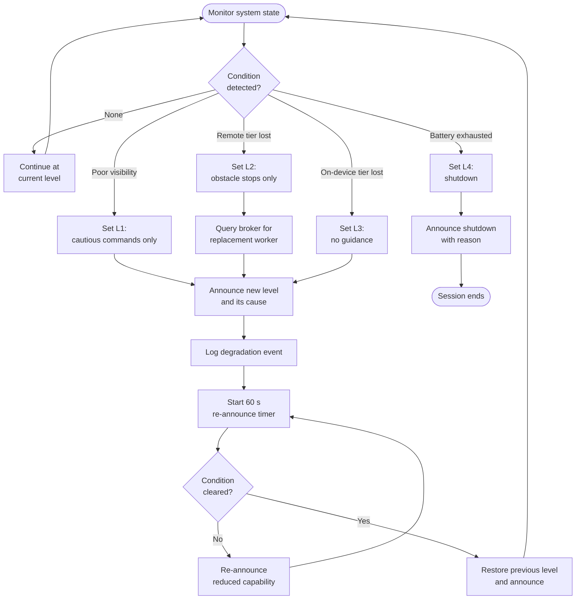
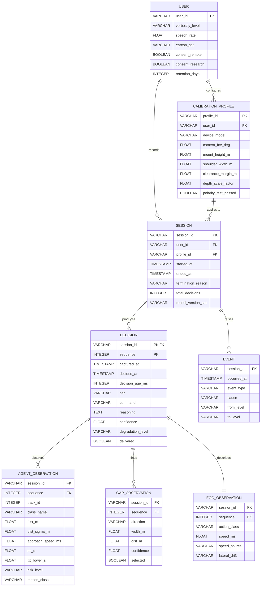
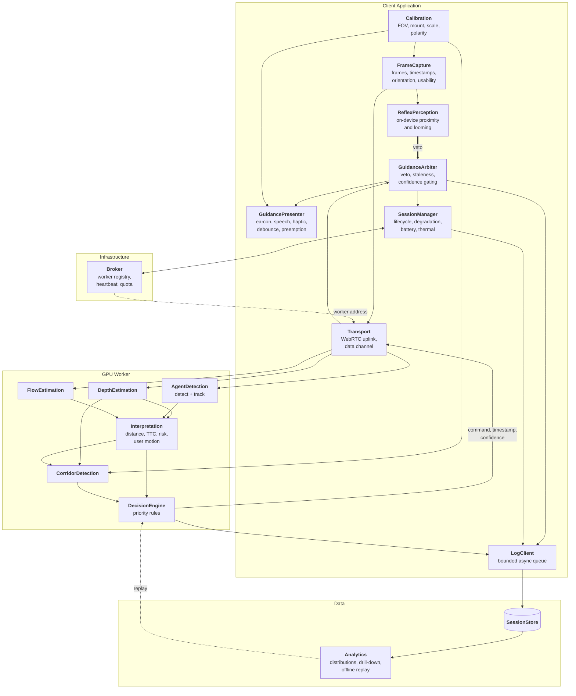
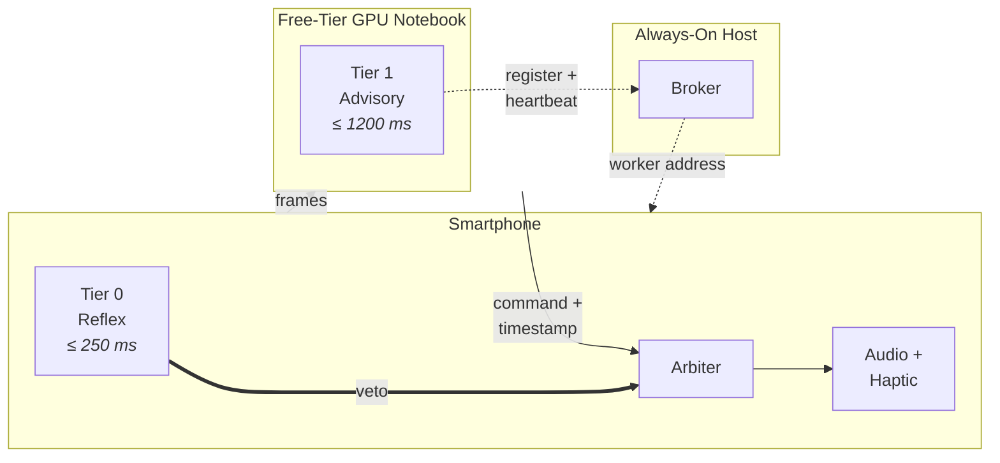
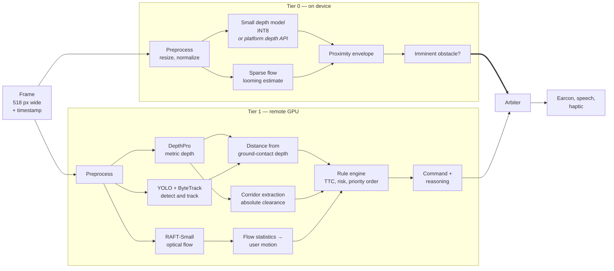
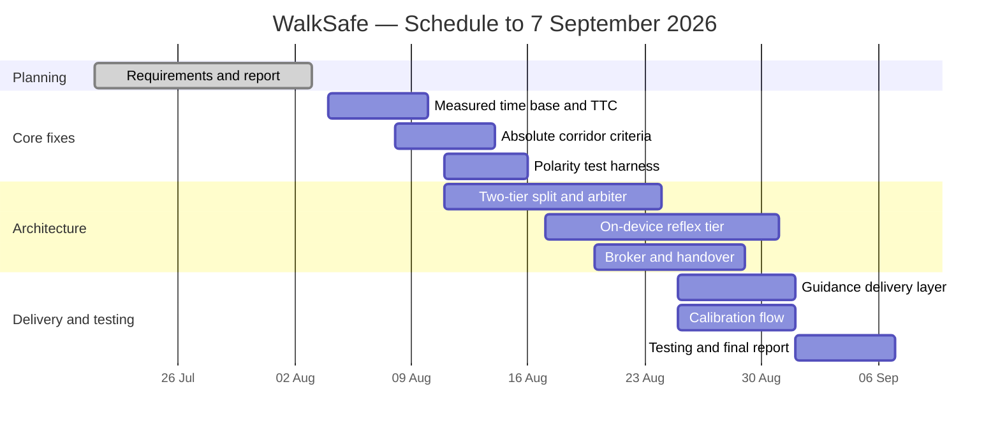

# WalkSafe
## A Real-Time Navigation Assistant for Blind and Low-Vision Pedestrians

**SE-801 Software Project Lab 3 — Midterm Technical Report**

 

**Submitted by**
Shah Alam
BSSE — [Roll]

**Supervised by**
[Supervisor Name], [Designation]

Institute of Information Technology
University of Dhaka

**Date: July 28, 2026**

---

## Table of Contents

1. [Project Overview](#1-project-overview)
2. [Requirements Analysis](#2-requirements-analysis)
3. [System Modeling](#3-system-modeling)
4. [Data and Information Modeling](#4-data-and-information-modeling)
5. [Software Design](#5-software-design)
6. [Software Architecture](#6-software-architecture)
7. [AI Engineering Design](#7-ai-engineering-design)
8. [Preliminary Test Plan](#8-preliminary-test-plan)
9. [Timeline](#9-timeline)
10. [Appendix — Key Risks and Mitigations](#appendix--key-risks-and-mitigations)

**Figures**

| # | Title |
|---|---|
| 1 | Use Case Diagram — Level 0 |
| 2 | Use Case Diagram — Level 1 |
| 3 | Activity Diagram — Per-Frame Guidance Loop |
| 4 | Activity Diagram — Session Start and Calibration |
| 5 | Activity Diagram — Degradation Handling |
| 6 | ER Diagram |
| 7 | Component Diagram |
| 8 | Deployment Architecture |
| 9 | AI Pipeline |
| 10 | Gantt Chart |

---

# 1. Project Overview

## 1.1 Project Title

**WalkSafe — A Real-Time Navigation Assistant for Blind and Low-Vision Pedestrians**

## 1.2 Problem Statement

Blind pedestrians rely on two tools for independent travel. A white cane detects the ground and obstacles within about one step. GPS applications give route-level direction over tens of metres.

Neither covers the range between roughly one and eight metres ahead. A cyclist approaching from the side, a parked scooter blocking the footpath, or a crowd closing the path ten metres away falls outside both. The cane reaches these too late, and the map does not know about them. This is the range in which a pedestrian needs to make anticipatory decisions — slow down, move left, wait for someone to pass.

A smartphone camera can capture the information needed to fill this gap, and current vision models can process it. The difficulty is not perception but delivery: guidance must arrive fast enough to act on, must stay quiet when nothing needs saying, and must clearly announce when it cannot be trusted. A system that gives good advice most of the time and says nothing when it fails is worse than no system, because the user learns to rely on it.

## 1.3 Objectives

1. Detect obstacles and moving agents in the one-to-eight-metre range ahead using a smartphone camera.
2. Estimate distance, approach speed, and time-to-collision for each detected agent.
3. Identify traversable openings ahead and measure their width in metres.
4. Produce one navigation command per decision cycle from a fixed nine-command vocabulary.
5. Deliver imminent-obstacle warnings within 250 ms and routing guidance within 1200 ms.
6. Announce every degradation and failure audibly instead of falling silent.
7. Make the application fully operable without sight.
8. Log every decision with its inputs for later evaluation, storing no images.

## 1.4 Scope

**In scope**

- Smartphone client application plus a remote GPU inference service.
- Depth estimation, agent detection and tracking, and optical flow based motion estimation.
- Per-agent distance, time-to-collision, and risk level.
- Traversable corridor detection with width measured in metres.
- Nine-command navigation vocabulary delivered as speech, earcon, and haptic pulse.
- On-device imminent-obstacle detection that works without a network and overrides remote guidance.
- Audible degradation reporting for connectivity loss, poor visibility, camera occlusion, low battery, and thermal throttling.
- Guided non-visual calibration for camera field of view, mounting geometry, shoulder width, and left/right polarity.
- Screen-reader-compatible operation with the screen off.
- Session logging of derived metrics and an analytics view over them.

**Out of scope**

- Route planning, destination navigation, and map integration.
- Reading text or signs; recognising specific people.
- Interpreting traffic signals or deciding when to cross a road.
- Reliable detection of kerbs, stairs, and drop-offs. Monocular depth is unreliable at downward steps, so this is declared a limitation rather than attempted.
- Indoor mapping.
- Replacing a white cane, guide dog, or orientation-and-mobility training.

**Positioning.** WalkSafe is a supplementary aid. All requirements assume the user is also using a cane or guide dog. It is not designed or tested for use as the only aid.

## 1.5 Deliverables

| # | Deliverable | Status |
|---|---|---|
| D1 | Working prototype: perception pipeline, decision engine, web interface, SQLite logging, analytics dashboard | Complete |
| D2 | This technical report, including requirements, models, architecture, and test plan | In progress |
| D3 | Corrected interpretation layer: measured time base, absolute corridor criteria, verified left/right polarity | Planned |
| D4 | Two-tier guidance: on-device reflex tier plus remote advisory tier with arbitration | Planned |
| D5 | Backend rendezvous broker with worker registration and handover | Planned |
| D6 | Guidance delivery layer: earcons, debouncing, preemption, haptics | Planned |
| D7 | Non-visual calibration flow including polarity self-test | Planned |
| D8 | Test suite covering all safety-critical requirements | Planned |
| D9 | Final report and demonstration | Planned |

---

# 2. Requirements Analysis

## 2.1 Functional Requirements

Requirements marked **SC** are safety-critical: failure can contribute to physical harm. Each maps to a risk in the Appendix.

### Frame Capture

| ID | Requirement | SC |
|---|---|:--:|
| FR-1 | Capture frames continuously from the rear camera, each tagged with a capture timestamp and a device orientation reading. | SC |
| FR-2 | Score each frame for usability based on exposure, motion blur, and texture, and reject frames below threshold. | SC |
| FR-3 | Locate the walkable region using measured device orientation rather than a fixed image region. | SC |
| FR-4 | Detect lens occlusion and mount displacement, and report both. | SC |

### Perception

| ID | Requirement | SC |
|---|---|:--:|
| FR-5 | Estimate obstacle proximity on the device at 10 frames per second or better, without any network dependency. | SC |
| FR-6 | Estimate a dense metric depth map on the remote tier. | SC |
| FR-7 | Reuse a cached depth map across frames, but never one older than 400 ms. | SC |
| FR-8 | Report a reliability value with each depth estimate and pass it to downstream stages. | SC |
| FR-9 | Detect and track agents across frames with stable track identifiers and a bounded position history. | SC |
| FR-10 | Estimate agent distance from depth near the agent's ground-contact region, not the whole bounding box. | SC |
| FR-11 | Estimate dense optical flow between consecutive frames. | |
| FR-12 | Process the newest available frame and discard older queued frames. | SC |

### Interpretation

| ID | Requirement | SC |
|---|---|:--:|
| FR-13 | Classify agent motion as static, approaching, receding, crossing left or right, parallel, starting, stopping, or erratic. | SC |
| FR-14 | Derive all speeds and times from measured frame timestamps. Assuming a fixed frame rate is not permitted. | SC |
| FR-15 | Estimate approach speed per agent from its distance history, rejecting outliers. | SC |
| FR-16 | Compute time-to-collision where approach speed is significant, and record it as undefined otherwise. | SC |
| FR-17 | Attach an uncertainty range to time-to-collision and use its conservative end when assigning risk. | SC |
| FR-18 | Assign each agent a risk level of critical, high, moderate, or low by fixed rules. | SC |
| FR-19 | Classify the user's own motion as standing, stopping, walking at graded speeds, stepping sideways, or turning. | |
| FR-20 | Estimate the user's walking speed, preferring the motion sensor over optical flow when available. | |
| FR-21 | Document the sign conventions linking optical flow, user motion, corridor direction, and spoken direction, and verify them by automated test. | SC |

### Corridor Detection

| ID | Requirement | SC |
|---|---|:--:|
| FR-22 | Identify traversable corridors in the walkable region. | SC |
| FR-23 | Judge traversability against an absolute clearance distance in metres, not a threshold relative to the current frame. | SC |
| FR-24 | Measure corridor width in metres using the calibrated camera field of view. | SC |
| FR-25 | Report direction, width, distance, and confidence for each corridor, and be able to report that no corridor exists. | SC |
| FR-26 | Compare corridor width against the user's calibrated shoulder width plus clearance margin. | SC |
| FR-27 | Exclude corridor regions that overlap a tracked agent's projected path, and keep corridor identity stable across frames. | SC |

### Decision

| ID | Requirement | SC |
|---|---|:--:|
| FR-28 | Produce exactly one command per decision cycle from the nine-command vocabulary in §2.4. | SC |
| FR-29 | Evaluate decision rules in a fixed priority order that places hazard avoidance before route selection, with a conservative default for any unmatched state. | SC |
| FR-30 | Issue `stop` when an agent is at critical risk, when no corridor exists, or when the on-device tier reports an imminent obstacle. | SC |
| FR-31 | Issue `yield` when a crossing or approaching agent's path intersects the user's within the yield window. | SC |
| FR-32 | Restrict output to `stop`, `yield`, `slow_down`, and `walk_forward_slow` when perception confidence is low. | SC |
| FR-33 | Record with each command the rule that produced it and the values it used. | |

### Guidance Delivery

| ID | Requirement | SC |
|---|---|:--:|
| FR-34 | Deliver guidance when the situation changes, not once per frame, and stay silent when nothing has changed. | SC |
| FR-35 | Interrupt any speech in progress for a `stop`, playing an urgent earcon before the speech. | SC |
| FR-36 | Play a distinct earcon for each command, so speech can be turned off entirely. | |
| FR-37 | Hold audio focus during an active session so another application cannot silence guidance. | SC |
| FR-38 | Enforce a minimum gap between non-urgent utterances, and prevent alternation between `step_left` and `step_right` faster than once every two seconds. | SC |
| FR-39 | Deliver a haptic pulse alongside urgent commands. | SC |
| FR-40 | Provide a non-visual mute that confirms itself audibly. | SC |
| FR-41 | Explain the most recent command in plain language on request. | |

### Arbitration and Safety

| ID | Requirement | SC |
|---|---|:--:|
| FR-42 | Never allow remote guidance to override, suppress, or delay an on-device `stop`. | SC |
| FR-43 | Stamp every command with the capture time of its source frame, and discard rather than deliver any command past its staleness limit. | SC |
| FR-44 | Reject commands arriving out of sequence. | SC |
| FR-45 | Announce every degradation level change audibly with its cause, and repeat the reduced-capability announcement at least once a minute. | SC |
| FR-46 | Announce that guidance has stopped on any unhandled fault. Never fail silently. | SC |
| FR-47 | Warn when remaining battery falls below a usable margin, defaulting to 15 minutes of projected runtime. | SC |
| FR-48 | Reduce frame rate and then tier availability under thermal pressure, announcing each step. | SC |

### Session and Backend

| ID | Requirement | SC |
|---|---|:--:|
| FR-49 | Start and end a session by a single action that does not require sight, resetting all tracking state. | |
| FR-50 | Obtain the inference backend address automatically. Never require the user to read or enter a URL or code. | SC |
| FR-51 | Register GPU workers with a broker on startup and heartbeat at five-second intervals; deregister a worker after three missed heartbeats. | |
| FR-52 | Continue the session when the remote tier is lost, degrading to on-device operation and recovering automatically. | SC |
| FR-53 | Track cumulative GPU hours per account and refuse worker registrations that would exceed the platform quota. | |
| FR-54 | Warn when a worker nears its platform session limit and hand over to a standby worker before it ends. | SC |
| FR-55 | Keep the backend interface independent of host and transport, so free-tier and paid workers are interchangeable by configuration. | |

### Calibration and Accessibility

| ID | Requirement | SC |
|---|---|:--:|
| FR-56 | Provide a spoken, self-guided calibration procedure, repeatable on demand. | SC |
| FR-57 | Determine camera field of view from the platform or by measurement. Do not use a hardcoded value in any metric calculation. | SC |
| FR-58 | Record mounting height and pitch, shoulder width, and preferred clearance margin. | SC |
| FR-59 | Verify depth scale against a known reference distance and refuse to proceed if it is grossly wrong. | SC |
| FR-60 | Run a left/right polarity self-test on the user's own device and block use if it fails. | SC |
| FR-61 | Make every user function operable with TalkBack and VoiceOver, with the screen off, and with one hand. | SC |
| FR-62 | State in onboarding that WalkSafe does not replace a cane or guide dog, and require the user to acknowledge this. | SC |
| FR-63 | Re-present the limitations statement after any change to models or thresholds. | SC |
| FR-64 | Provide adjustable verbosity, speech rate, and earcon set, changeable during a session. | |

### Logging and Analytics

| ID | Requirement | SC |
|---|---|:--:|
| FR-65 | Log per decision the command, reasoning, agents, corridors, user motion, confidence, degradation level, and both capture and delivery timestamps. | |
| FR-66 | Write logs asynchronously through a bounded queue. Never block the guidance path. | SC |
| FR-67 | Shed the oldest non-critical records when the queue saturates and record that shedding occurred. Never shed a stop or a degradation event. | SC |
| FR-68 | Store no images at any point, on the device or on the server. | |
| FR-69 | Obtain explicit consent before transmitting camera images, and offer an on-device-only mode. | |
| FR-70 | Allow the user to export and permanently delete their session data without sight. | |
| FR-71 | Finalise every session with an end time and summary counts, including after a crash or battery loss. | |
| FR-72 | Report command, risk, and motion distributions, decision-age distributions against budget, and time spent at each degradation level. | SC |
| FR-73 | Allow drill-down from any command to the reasoning that produced it. | |
| FR-74 | Replay a recorded session through the decision engine offline, so rule changes can be evaluated before deployment. | |
| FR-75 | Provide a visual diagnostic view fusing camera, depth, flow, and detections, disabled by default. | |

## 2.2 Non-Functional Requirements

### Performance

| ID | Requirement |
|---|---|
| NFR-1 | On-device guidance reaches the user within 250 ms at the 95th percentile and 400 ms at the 99th. |
| NFR-2 | Remote guidance reaches the user within 1200 ms at the 95th percentile. Anything older than 2000 ms is discarded. |
| NFR-3 | The on-device tier sustains at least 10 frames per second; below 8, the system degrades. |
| NFR-4 | The remote tier sustains at least 2 decision cycles per second on a T4-class GPU. |
| NFR-5 | Speech begins within 120 ms of a command being issued. |
| NFR-6 | Under load the system drops frames rather than accumulating queue delay. |

The latency budget below shows how NFR-1 and NFR-2 are apportioned. The travel column gives the distance a user covers at 1.4 m/s during the interval, which is what determines whether a budget is acceptable.

| Tier | Breakdown | Total | Travel |
|---|---|---|---|
| On-device | capture 30 ms, preprocess 10 ms, inference 60 ms, decision 5 ms, audio onset 80 ms | 250 ms | 0.35 m |
| Remote | encode 40 ms, uplink 180 ms, queue 100 ms, inference 550 ms, downlink 60 ms, speech onset 120 ms | 1200 ms | 1.7 m |

This is why imminent-obstacle warnings run on the device and routing guidance does not.

### Safety

| ID | Requirement |
|---|---|
| NFR-7 | Every failure resolves to a state at least as cautious as the one before it. No failure produces more permissive guidance. |
| NFR-8 | Missed-hazard rate is at most 2% for static obstacles above 0.3 m within 3 m in normal conditions. |
| NFR-9 | False-stop rate is at most 10% of stop events in normal conditions. Above this, users begin ignoring stops. |
| NFR-10 | Left/right direction is correct on every supported device, with no tolerance for error. |
| NFR-11 | Silence is never the only indication of a fault. |
| NFR-12 | Every safety-critical requirement has an automated test that fails if the behaviour regresses. |

The system degrades in defined steps, each more cautious than the last:

| Level | Condition | Behaviour |
|---|---|---|
| L0 | Both tiers healthy | Full command vocabulary |
| L1 | Low frame usability — glare, rain, blur | Cautious commands only; announce reduced confidence |
| L2 | Remote tier unavailable | Obstacle stops only; announce loss of routing guidance |
| L3 | On-device tier unavailable | Announce withdrawal; issue no guidance |
| L4 | Battery exhausted or user ends session | Announce shutdown with reason |

### Reliability

| ID | Requirement |
|---|---|
| NFR-13 | A two-hour continuous session runs without crash, memory growth, or unannounced degradation. |
| NFR-14 | On-device tier availability is at least 99.5% during an active session. |
| NFR-15 | Remote tier availability is at least 90% on free-tier compute. Loss degrades the session; it never ends it. |
| NFR-16 | Backend handover completes within 5 seconds when a standby worker is registered. |
| NFR-17 | Session data survives abnormal termination to within 5 seconds of the last write. |

### Accessibility and Usability

| ID | Requirement |
|---|---|
| NFR-18 | All user functionality is reachable without sight, verified by screen-reader-only testing on both platforms. |
| NFR-19 | The system conforms to WCAG 2.2 Level AA where a visual interface is present. |
| NFR-20 | No interaction requires audio hardware that blocks the ear canal. Ambient hearing is itself a navigation input. |
| NFR-21 | Utterance rate stays at or below 15 per minute at default verbosity. |
| NFR-22 | A session starts in at most 3 non-visual actions from launch. |
| NFR-23 | Identical situations always produce identical wording. |
| NFR-24 | A blind first-time user completes onboarding unaided within 15 minutes. |

### Security and Privacy

| ID | Requirement |
|---|---|
| NFR-25 | All media and control traffic is encrypted. |
| NFR-26 | Session tokens are short-lived and valid for one session only. |
| NFR-27 | No images are written to storage or logs at any point. |
| NFR-28 | Only derived metrics are stored — no pixels, crops, or biometric data. |
| NFR-29 | Research use of session data requires separate, revocable consent. |
| NFR-30 | No location data is transmitted or stored. |

### Maintainability and Resources

| ID | Requirement |
|---|---|
| NFR-31 | Perception, interpretation, decision, and delivery remain separable. Decision logic depends on neither rendering nor transport. |
| NFR-32 | All tunable thresholds live in one versioned configuration file. No numeric threshold is hardcoded at a call site. |
| NFR-33 | Perception models are replaceable without changing interpretation or decision code. |
| NFR-34 | Model artefacts are pinned by version and checksum. |
| NFR-35 | The remote tier deploys to Colab, Kaggle, and a persistent Linux GPU host from one codebase. |
| NFR-36 | Battery consumption stays at or below 25% of a 4000 mAh battery per hour. |
| NFR-37 | Mobile data stays at or below 250 MB per hour at default settings. |
| NFR-38 | Client memory stays under 500 MB with no growth trend over two hours. |
| NFR-39 | On-device model files total at most 100 MB. |

## 2.3 Stakeholders

| Stakeholder | Interest | Influence on requirements |
|---|---|---|
| **Blind or low-vision pedestrian** | Primary user. Wants timely, brief, trustworthy guidance and no added risk. | All accessibility, latency, and safety requirements |
| **Orientation-and-mobility instructor** | Uses the system as a training aid; reviews sessions with clients. | Diagnostic view, session review, command vocabulary, safety review sign-off |
| **Researcher / developer** | Collects data, evaluates decision quality, tunes thresholds. | Logging, analytics, offline replay |
| **Bystanders** | Appear in camera images without consenting. Not users, but hold privacy interests. | No image retention, minimum sufficient resolution, disclosure |
| **Project supervisor** | Assesses scope, method, and rigour. | Documentation, traceability, test plan |
| **Platform providers** (Google, Apple, Colab, Kaggle) | Set capability limits and usage terms. | Deployment constraints, session limits, quota handling |

## 2.4 Command Vocabulary

The decision engine outputs one of these nine commands, listed from most to least cautious. The order determines how commands are downgraded when confidence is low.

| # | Command | Meaning | Allowed at L1 |
|---|---|---|:--:|
| 1 | `stop` | Stop moving forward now | Yes |
| 2 | `yield` | Wait for an agent to pass | Yes |
| 3 | `slow_down` | Reduce pace | Yes |
| 4 | `walk_forward_slow` | Continue ahead with caution | Yes |
| 5 | `step_left` | Move left, keeping heading | No |
| 6 | `step_right` | Move right, keeping heading | No |
| 7 | `turn_left` | Change heading left | No |
| 8 | `turn_right` | Change heading right | No |
| 9 | `walk_forward` | Continue ahead, path clear | No |

---

# 3. System Modeling

## 3.1 Use Case Diagram and Descriptions

Four actors interact with the system. Three are human; the GPU worker is a secondary system actor that registers itself and serves inference requests.

**Figure 1: Use Case Diagram — Level 0**

**Figure 2: Use Case Diagram — Level 1**

### Use Case Descriptions

**UC-1: Start / End Session**

| | |
|---|---|
| **Actor** | Pedestrian |
| **Goal** | Begin or end guidance with a single non-visual action |
| **Precondition** | Valid calibration profile exists; polarity test passed |
| **Main flow** | 1. User holds the hardware button. 2. System loads the on-device model. 3. System resolves a backend through the broker. 4. System verifies round-trip latency is within budget. 5. System announces "WalkSafe active, full guidance" and turns off the screen. |
| **Alternate flow** | If no backend is available, the system announces reduced capability and starts in on-device-only mode. |
| **Exception** | If the on-device model fails to load, the system announces that guidance is unavailable and does not start. |
| **Postcondition** | Session is active and logged; tracking state is reset |
| **Requirements** | FR-49, FR-50, FR-52, FR-55 |

**UC-2: Receive Navigation Guidance**

| | |
|---|---|
| **Actor** | Pedestrian |
| **Goal** | Receive one timely command describing what to do next |
| **Precondition** | Session is active |
| **Main flow** | 1. System captures a frame with timestamp and orientation. 2. On-device tier checks for an imminent obstacle. 3. Remote tier estimates depth, detects and tracks agents, and estimates flow. 4. System derives agent risk, corridor set, and user motion. 5. Decision engine selects one command. 6. Arbiter applies veto, staleness, and confidence rules. 7. Presenter plays an earcon, then speaks, and pulses for urgent commands. |
| **Alternate flow** | If the command is unchanged from the last, it is suppressed and nothing is spoken. |
| **Exception** | If the command is older than the staleness limit, it is discarded rather than spoken. |
| **Postcondition** | Decision and its inputs are logged |
| **Requirements** | FR-1 to FR-45 |

**UC-3: Receive Degradation Announcement**

| | |
|---|---|
| **Actor** | Pedestrian |
| **Goal** | Know when the system's capability has changed |
| **Precondition** | Session is active |
| **Main flow** | 1. System detects a condition change — network loss, poor visibility, occlusion, low battery, thermal limit. 2. System selects the corresponding degradation level. 3. System announces the new level and its cause in plain language. 4. While degraded, the system repeats the announcement each minute. |
| **Alternate flow** | On recovery, the system announces the restored level. |
| **Requirements** | FR-45, FR-46, FR-47, FR-48 |

**UC-4: Calibrate Device**

| | |
|---|---|
| **Actor** | Pedestrian, O&M Instructor |
| **Goal** | Configure the system for this user and this device |
| **Precondition** | Application installed; screen reader available |
| **Main flow** | 1. System reads camera field of view from the platform. 2. System confirms mounting height and pitch from orientation sensors. 3. User stands at a stated distance from a wall; system verifies depth scale. 4. User provides shoulder width and clearance preference. 5. System asks the user to step left and confirms it observed a left step. 6. User rehearses the nine commands and their earcons. |
| **Exception** | If the depth scale check or polarity test fails, calibration is rejected and the system cannot be used. |
| **Postcondition** | Calibration profile is stored and marked valid |
| **Requirements** | FR-56 to FR-60, FR-62 |

**UC-5: Review Session Data**

| | |
|---|---|
| **Actor** | Researcher, O&M Instructor |
| **Goal** | Understand how the system behaved during recorded sessions |
| **Precondition** | At least one completed session |
| **Main flow** | 1. Actor selects a session. 2. System shows command, risk, and motion distributions. 3. System shows decision-age distribution against budget. 4. System shows time at each degradation level with causes. 5. Actor selects a command and views its reasoning record. |
| **Alternate flow** | Actor replays the session through a modified rule set to compare outcomes. |
| **Requirements** | FR-65, FR-72, FR-73, FR-74 |

**UC-6: Resolve Inference Backend**

| | |
|---|---|
| **Actor** | Pedestrian (indirect), GPU Worker |
| **Goal** | Connect to a live GPU worker without user involvement |
| **Precondition** | Broker reachable |
| **Main flow** | 1. Worker registers with the broker on startup and heartbeats every 5 s. 2. Client requests a backend from the broker's fixed address. 3. Broker returns a live worker URL and a session token. 4. Client connects to the worker. |
| **Alternate flow** | If the primary worker stops heartbeating, the broker promotes a standby and the client reconnects. |
| **Exception** | If no worker is available, the client operates on-device only and announces this. |
| **Requirements** | FR-50, FR-51, FR-52, FR-53, FR-54 |

## 3.2 Activity Diagrams

**Figure 3: Activity Diagram — Per-Frame Guidance Loop**

This is the system's main loop. The two tiers run in parallel and meet at the arbiter.

**Figure 4: Activity Diagram — Session Start and Calibration**

**Figure 5: Activity Diagram — Degradation Handling**

---

# 4. Data and Information Modeling

WalkSafe is an AI-based system that also keeps a conventional relational store. Both are described here: §4.1 covers the database, §4.2 the data the models use.

Two points shape the schema. No images are stored anywhere, so the tables record what the system measured and decided, never what it saw. And time is recorded twice per decision — capture time and delivery time — because their difference is decision age, the system's main safety indicator, and it must be recoverable from the log.

## 4.1 ER Diagram and Database Schema

**Figure 6: ER Diagram**

**Schema notes**

| Table | Purpose | Key points |
|---|---|---|
| `user` | Preferences and consent | Consent for remote processing and for research use are separate and independently revocable |
| `calibration_profile` | Per user and device geometry | `camera_fov_deg` and `depth_scale_factor` are measured, never assumed. `polarity_test_passed` gates use of the app |
| `session` | One journey | `ended_at` and `termination_reason` are set on all paths, including crash and battery loss. Model versions are recorded so results are attributable to a configuration |
| `decision` | One guidance cycle | Both timestamps stored; `decision_age_ms` derived. `delivered` is false for suppressed commands |
| `agent_observation` | One agent in one cycle | `ttc_s` is null when undefined — never a placeholder number. `ttc_lower_s` is the conservative bound used for risk |
| `gap_observation` | One corridor in one cycle | `width_m` computed from the calibrated field of view |
| `ego_observation` | User motion in one cycle | `speed_source` records whether the value came from the motion sensor or optical flow |
| `event` | Degradation, fault, mount, battery, thermal | Never shed under queue pressure |

## 4.2 Dataset Description

WalkSafe does not train models of its own for this release. All perception models are pretrained and used as-is, so there is no training dataset to prepare. Two datasets are nevertheless relevant.

**Reference sequences (test data).** Short recorded clips with known ground truth, used to verify correctness rather than train anything:

| Set | Content | Used for |
|---|---|---|
| Distance references | Obstacles at measured distances from 1 m to 8 m | Depth accuracy, scale verification |
| Direction references | Clips with known left/right motion and known corridor position | Polarity verification (FR-21, NFR-10) |
| Agent motion clips | Pedestrians and cyclists approaching, crossing, and passing | Motion classification, track stability, TTC |
| Adverse conditions | Glare, dusk, light rain, low-texture surfaces | Usability scoring, degradation behaviour |
| Hazard course | Annotated static obstacles above 0.3 m within 3 m, plus clear passages | Missed-hazard and false-stop rates |

**Session logs (generated data).** The tables in §4.1 accumulate a record of real decisions paired with the measurements that produced them. This serves two purposes: it is the evaluation dataset for measuring where the rules are wrong, and it is structured so that a learned guidance policy could be trained on it later without needing imagery. That is not part of this release.

---

# 5. Software Design

## 5.1 Component Diagram

**Figure 7: Component Diagram**

## 5.2 Component Responsibilities

| Component | Responsibility | Interfaces |
|---|---|---|
| **FrameCapture** | Capture frames with timestamp and orientation; score usability; detect occlusion; locate the walkable region | Provides frames to ReflexPerception and Transport; consumes Calibration |
| **ReflexPerception** | Detect imminent obstacles on-device at 10+ FPS; assert stop | Provides veto to GuidanceArbiter |
| **DepthEstimation** | Produce a dense metric depth map with a reliability value | Provides depth to Interpretation and CorridorDetection |
| **AgentDetection** | Detect and track agents with stable identifiers | Provides tracks to Interpretation |
| **FlowEstimation** | Estimate dense optical flow | Provides flow to Interpretation |
| **Interpretation** | Derive distance, approach speed, TTC with uncertainty, risk level, and user motion | Provides interpreted scene to DecisionEngine and CorridorDetection |
| **CorridorDetection** | Find traversable corridors; measure width in metres against calibrated body metrics | Provides corridors to DecisionEngine |
| **DecisionEngine** | Select one command by fixed priority rules; emit a reasoning record | Provides command to Transport; consumed by Analytics for replay |
| **GuidanceArbiter** | Enforce on-device veto, discard stale commands, reject out-of-order commands, downgrade on low confidence | Consumes ReflexPerception and DecisionEngine; provides to GuidancePresenter |
| **GuidancePresenter** | Play earcon, speak, pulse; suppress unchanged commands; apply hysteresis; preempt for urgency; hold audio focus | Consumes GuidanceArbiter and Calibration |
| **SessionManager** | Own session lifecycle and degradation level; monitor battery and thermal state; announce transitions | Consumes GuidanceArbiter; uses Broker |
| **Calibration** | Determine field of view, mounting geometry, shoulder width, depth scale; run polarity test | Provides profile to FrameCapture, CorridorDetection, GuidancePresenter |
| **Broker** | Register workers, monitor heartbeats, track quota, issue tokens, promote standby | Consumed by SessionManager and Transport |
| **Transport** | Stream frames uplink; receive commands with timestamp and sequence | Connects client to worker |
| **LogClient / SessionStore** | Persist derived metrics asynchronously through a bounded queue; never block guidance | Consumed by Analytics |
| **Analytics** | Report distributions, decision age against budget, degradation breakdown; support drill-down and offline replay | Reads SessionStore |

---

# 6. Software Architecture

## 6.1 Architectural Overview

WalkSafe splits guidance across two tiers. The split follows from the latency budget in §2.2 rather than from a preference about structure.

The problem is that the guidance a user needs fastest — `stop` — is the guidance a remote GPU can supply least quickly, while the guidance that genuinely needs scene understanding — which corridor to take — tolerates delay. A single-tier design must either miss the latency requirement or give up the richer analysis.

Splitting by urgency rather than by capability satisfies both:

- **Tier 0 (on-device, reflex).** Answers only "is something about to be hit," at 10+ FPS, with no network dependency. It classifies nothing; dropping classification is what makes it fast enough.
- **Tier 1 (remote, advisory).** Performs full scene analysis — depth, agents, corridors, user motion — and selects a command.

The arbiter combines them under three rules, in order:

1. A Tier 0 `stop` is issued and cannot be overridden by Tier 1 output at any confidence.
2. A Tier 1 command past its staleness limit is discarded, not delivered late.
3. A Tier 1 command with low confidence is downgraded toward the cautious end of the command order.

The asymmetry is deliberate. Tier 0 can only make the system more cautious, never less. A Tier 0 false positive costs an unnecessary pause; a Tier 0 false negative that Tier 1 was allowed to overrule costs a collision.

**Figure 8: Deployment Architecture**

The remote tier runs on free Colab or Kaggle GPU allocations. These end at a platform session limit, time out when idle, are subject to a weekly quota, and change address on every restart. A changing address is unusable for a blind user, who cannot be asked to read a new hostname each day. The broker solves this: it runs on a small always-on free tier with a fixed address, holds a registry of live workers, and hands the client whichever is currently available. Worker churn becomes invisible.

One deployment note. Free notebook platforms do not permit hosting a service for third parties under their usage terms. Free-tier compute is therefore suitable for development and supervised trials, but not for public release. NFR-35 exists so that substituting a persistent host is a configuration change rather than a redesign.

## 6.2 Requirement Traceability Matrix

`SC` marks safety-critical requirements. Test case numbers refer to §8.2.

| Requirement | Component | Use Case | Test Case | SC |
|---|---|---|---|:--:|
| FR-1 Timestamped capture | FrameCapture | UC-2 | T5 | SC |
| FR-2 Frame usability scoring | FrameCapture | UC-3 | T13 | SC |
| FR-3 Orientation-based walkable region | FrameCapture | UC-2 | T2, T7 | SC |
| FR-4 Occlusion and mount detection | FrameCapture | UC-3 | T13 | SC |
| FR-5 On-device proximity at 10 FPS | ReflexPerception | UC-2 | T9, T10 | SC |
| FR-6 Dense metric depth | DepthEstimation | UC-2 | T3 | SC |
| FR-7 Bounded depth reuse | DepthEstimation | UC-2 | T11 | SC |
| FR-8 Depth reliability value | DepthEstimation | UC-2 | T3 | SC |
| FR-9 Agent detection and tracking | AgentDetection | UC-2 | T4 | SC |
| FR-10 Ground-contact distance | Interpretation | UC-2 | T3 | SC |
| FR-11 Optical flow | FlowEstimation | UC-2 | T4 | |
| FR-12 Newest-frame processing | Transport, Interpretation | UC-2 | T11 | SC |
| FR-13 Motion classification | Interpretation | UC-2 | T4 | SC |
| FR-14 Measured time base | Interpretation | UC-2 | T5 | SC |
| FR-15 Approach speed | Interpretation | UC-2 | T5 | SC |
| FR-16 TTC or undefined | Interpretation | UC-2 | T6 | SC |
| FR-17 TTC uncertainty range | Interpretation | UC-2 | T6 | SC |
| FR-18 Risk level assignment | Interpretation | UC-2 | T6 | SC |
| FR-19 User motion classification | Interpretation | UC-2 | T4 | |
| FR-20 Walking speed estimation | Interpretation | UC-2 | T4 | |
| FR-21 Documented sign conventions | Interpretation, Calibration | UC-4 | T2 | SC |
| FR-22 Corridor identification | CorridorDetection | UC-2 | T7 | SC |
| FR-23 Absolute clearance criterion | CorridorDetection | UC-2 | T7 | SC |
| FR-24 Width from calibrated FOV | CorridorDetection | UC-4 | T7 | SC |
| FR-25 No-corridor reporting | CorridorDetection | UC-2 | T7 | SC |
| FR-26 Width vs shoulder width | CorridorDetection | UC-4 | T7 | SC |
| FR-27 Agent path exclusion, corridor continuity | CorridorDetection | UC-2 | T7, T12 | SC |
| FR-28 One command per cycle | DecisionEngine | UC-2 | T8 | SC |
| FR-29 Priority order, conservative default | DecisionEngine | UC-2 | T8 | SC |
| FR-30 Stop conditions | DecisionEngine | UC-2 | T8, T9 | SC |
| FR-31 Yield conditions | DecisionEngine | UC-2 | T8 | SC |
| FR-32 Cautious subset at low confidence | DecisionEngine | UC-3 | T13, T16 | SC |
| FR-33 Reasoning record | DecisionEngine | UC-5 | T17 | |
| FR-34 Change-driven delivery | GuidancePresenter | UC-2 | T12 | SC |
| FR-35 Stop preempts speech | GuidancePresenter | UC-2 | T12 | SC |
| FR-36 Distinct earcons | GuidancePresenter | UC-2 | T12 | |
| FR-37 Audio focus retention | GuidancePresenter | UC-2 | T12 | SC |
| FR-38 Utterance interval, hysteresis | GuidancePresenter | UC-2 | T12 | SC |
| FR-39 Haptic pulse | GuidancePresenter | UC-2 | T12 | SC |
| FR-40 Non-visual mute | GuidancePresenter | UC-1 | T15 | SC |
| FR-41 Explain last command | GuidancePresenter | UC-2 | T17 | |
| FR-42 On-device veto | GuidanceArbiter | UC-2 | T9 | SC |
| FR-43 Staleness discard | GuidanceArbiter | UC-2 | T11 | SC |
| FR-44 Out-of-order rejection | GuidanceArbiter | UC-2 | T11 | SC |
| FR-45 Degradation announcements | SessionManager | UC-3 | T13 | SC |
| FR-46 Audible fault reporting | SessionManager | UC-3 | T13 | SC |
| FR-47 Battery reserve warning | SessionManager | UC-3 | T13 | SC |
| FR-48 Thermal step-down | SessionManager | UC-3 | T13 | SC |
| FR-49 Single-action session control | SessionManager | UC-1 | T15 | |
| FR-50 Automatic backend resolution | Broker, SessionManager | UC-6 | T14, T15 | SC |
| FR-51 Worker registration and heartbeat | Broker | UC-6 | T14 | |
| FR-52 Session survives backend loss | SessionManager, Transport | UC-6 | T14 | SC |
| FR-53 Quota tracking | Broker | UC-6 | T14 | |
| FR-54 Pre-emptive handover | Broker | UC-6 | T14 | SC |
| FR-55 Host-agnostic backend | Transport | UC-6 | T14 | |
| FR-56 Guided calibration | Calibration | UC-4 | T1, T2 | SC |
| FR-57 Measured field of view | Calibration | UC-4 | T2 | SC |
| FR-58 Mount and body metrics | Calibration | UC-4 | T2 | SC |
| FR-59 Depth scale verification | Calibration | UC-4 | T2 | SC |
| FR-60 Polarity self-test | Calibration | UC-4 | T2 | SC |
| FR-61 Screen-reader operability | Client (all UI) | UC-1, UC-4 | T15 | SC |
| FR-62 Limits acknowledgement | Calibration | UC-4 | T1 | SC |
| FR-63 Re-present limits on change | SessionManager | UC-4 | T1 | SC |
| FR-64 Adjustable preferences | GuidancePresenter | UC-4 | T15 | |
| FR-65 Decision logging | LogClient, SessionStore | UC-5 | T17, T18 | |
| FR-66 Non-blocking logging | LogClient | UC-2 | T18 | SC |
| FR-67 Bounded queue with shedding | LogClient | UC-2 | T18 | SC |
| FR-68 No image storage | LogClient, Worker | UC-2 | T19 | |
| FR-69 Consent before transmission | Calibration | UC-4 | T1, T19 | |
| FR-70 Export and delete | Analytics | UC-5 | T19 | |
| FR-71 Session finalisation | SessionStore | UC-1 | T20 | |
| FR-72 Analytics reporting | Analytics | UC-5 | T17 | SC |
| FR-73 Decision drill-down | Analytics | UC-5 | T17 | |
| FR-74 Offline replay | Analytics, DecisionEngine | UC-5 | T21 | |
| FR-75 Diagnostic view | Analytics | UC-5 | T17 | |
| NFR-1, NFR-2 Latency budgets | Arbiter, Transport, ReflexPerception | UC-2 | T10 | SC |
| NFR-3, NFR-4 Throughput | ReflexPerception, Worker | UC-2 | T10 | SC |
| NFR-5 Speech onset | GuidancePresenter | UC-2 | T10 | SC |
| NFR-6 Drop under load | Transport | UC-2 | T11 | SC |
| NFR-7 Conservative degradation | SessionManager, Arbiter | UC-3 | T13 | SC |
| NFR-8, NFR-9 Hazard and false-stop rates | Interpretation, DecisionEngine | UC-2 | T22 | SC |
| NFR-10 Direction correctness | Interpretation, Calibration | UC-4 | T2 | SC |
| NFR-11 No silent faults | SessionManager | UC-3 | T13 | SC |
| NFR-12 Regression tests for SC | All | — | T8, T9, T13 | SC |
| NFR-13 Two-hour endurance | Client | UC-1 | T23 | SC |
| NFR-14, NFR-15 Tier availability | ReflexPerception, Transport | UC-6 | T14, T23 | SC |
| NFR-16 Handover time | Broker | UC-6 | T14 | |
| NFR-17 Data durability | SessionStore | UC-1 | T20 | |
| NFR-18, NFR-19 Accessibility conformance | Client (all UI) | UC-1, UC-4 | T15 | SC |
| NFR-20 No ear occlusion | GuidancePresenter | UC-2 | T15 | SC |
| NFR-21 Utterance rate | GuidancePresenter | UC-2 | T12 | SC |
| NFR-22, NFR-23, NFR-24 Usability targets | Client, GuidancePresenter | UC-1, UC-4 | T1, T15 | |
| NFR-25 to NFR-30 Security and privacy | Transport, LogClient, Broker | UC-6 | T19 | |
| NFR-31 to NFR-35 Maintainability | All | — | T21 | |
| NFR-36 to NFR-39 Resource limits | Client | UC-1 | T23 | SC |

---

# 7. AI Engineering Design

## 7.1 AI Pipeline

**Figure 9: AI Pipeline**

The pipeline has a deliberate division: **models perceive, rules decide.** All four learned components produce measurements — depth in metres, bounding boxes with identities, a flow field. Everything downstream is deterministic code. This is not a limitation to be removed later; it is the reason a command can be explained after the fact from the log, which FR-33 and FR-73 require.

## 7.2 Model Selection

No models are trained or fine-tuned for this release. All are pretrained and used as-is.

| Stage | Model | Why chosen | Alternatives considered |
|---|---|---|---|
| Tier 1 depth | **Apple DepthPro** | Produces metric depth from a single image, so distances come out in metres without a scale assumption. Sharp boundaries matter for narrow obstacles like poles | MiDaS and Depth Anything V2 give relative depth needing a separate scale step; ZoeDepth is metric but less sharp at edges |
| Tier 1 detection | **YOLOv8n + ByteTrack** | Fast enough to leave GPU budget for depth and flow. ByteTrack gives stable identities across frames, which motion classification and TTC both need | Larger YOLO variants raise accuracy but push the tier past its latency budget; DETR variants are slower without stable tracking |
| Tier 1 flow | **RAFT-Small** | Dense flow with a good accuracy-to-cost ratio. Dense flow is needed because user motion is derived from field statistics, not sparse points | Farnebäck is cheaper but too noisy for reliable rotation estimates; full RAFT is more accurate but too slow alongside the other two |
| Tier 0 depth | **Depth Anything V2 Small (INT8)**, or platform depth API where available | Must run at 10+ FPS on a mobile NPU within a 100 MB artefact budget. Relative depth is sufficient because Tier 0 only needs proximity, not metres | ARCore and ARKit depth are preferred where present — no model download, better latency, hardware-assisted. See open issue 1 in §7.5 |
| Tier 0 looming | Classical sparse optical flow expansion | No model needed, runs on CPU, and does not depend on absolute scale. Provides a second signal that fails differently from the depth model | Learned time-to-contact models add size and latency for little gain at this scope |

**Model governance.** Models are pinned by version and checksum (NFR-34) and accessed through a versioned interface declaring input geometry and output units (NFR-33), so a model can be swapped without touching interpretation code.

## 7.3 Inference Optimisation

| Technique | Applied to | Effect |
|---|---|---|
| Depth amortisation | Tier 1 depth | Depth is the most expensive stage. Reusing a cached map across frames raises throughput, bounded so no map older than 400 ms is used (FR-7) |
| INT8 quantisation | Tier 0 depth | Brings the model within the artefact and latency budget on mobile hardware |
| Newest-frame queue | Tier 1 input | A bounded queue that discards older frames. A first-in-first-out queue would convert load into latency, which is worse than dropping frames (FR-12) |
| Reduced uplink resolution | Transport | 518 px wide is sufficient for all four models and keeps data use within NFR-37 |
| Adaptive frame rate | Both tiers | Under thermal or bandwidth pressure the system lowers frame rate and announces it, rather than being killed by the platform (FR-48) |

## 7.4 Prompt Design

Not applicable. WalkSafe contains no language model or generative component. All four models are vision models taking fixed image tensors and returning numeric outputs, so there is no prompt to design. The decision layer is hand-written rules, not a prompted model.

This is a deliberate choice rather than an omission. A prompted model in the decision path would be non-deterministic, would add latency well beyond the budget in §2.2, and would make FR-33 — reconstructing exactly why a command was issued — impractical.

## 7.5 AI-Specific Open Issues

| # | Issue | Blocks |
|---|---|---|
| 1 | Whether platform depth APIs cover enough devices, or a bundled INT8 model is required as the baseline for Tier 0 | Whether NFR-3 and NFR-39 are jointly achievable |
| 2 | Whether DepthPro's cost is justified at Tier 1 versus a lighter model at higher frame rate | Tier 1 latency budget |
| 3 | Empirical calibration of all risk and corridor thresholds. Current values are untested placeholders | NFR-8 and NFR-9 |
| 4 | Annotation method and tooling for missed-hazard and false-stop ground truth | Both rate targets are unmeasurable without it |

---

# 8. Preliminary Test Plan

## 8.1 Testing Objectives

1. Verify each functional requirement in §2.1 and each non-functional requirement in §2.2.
2. Verify that depth estimates are accurate against known distances and that reliability values fall appropriately on difficult surfaces.
3. Verify that all speeds and times are derived from measured timestamps and do not change with frame rate.
4. Verify that time-to-collision carries an uncertainty range and that risk uses its conservative end.
5. Verify that corridors are judged against absolute clearance and that "no corridor" is reachable.
6. Verify that exactly one command is produced per cycle, that every rule branch is reachable, and that unmatched states reach the conservative default.
7. Verify that left and right are never reversed, on every supported device.
8. Verify that guidance meets the latency budgets and that nothing past the staleness limit is spoken.
9. Verify that an on-device stop cannot be overridden by remote guidance at any confidence.
10. Verify that guidance is change-driven and that the system is silent when nothing has changed.
11. Verify that every fault and degradation is announced audibly and that no failure is silent.
12. Verify that each degradation step is at least as cautious as the previous one.
13. Verify that backend loss degrades the session instead of ending it, and that recovery is automatic.
14. Verify that all user functions are operable with a screen reader and without sight.
15. Verify that no images are stored anywhere and that consent precedes transmission.
16. Verify that logging never blocks guidance and that safety events are never shed.
17. Verify that sessions are finalised on every termination path.
18. Measure missed-hazard and false-stop rates against annotated ground truth.
19. Verify battery, memory, and thermal behaviour over a continuous two-hour session.

## 8.2 Features to be Tested

| # | Feature | Test Scenario | Expected Outcome |
|---|---|---|---|
| T1 | Onboarding and consent | Install with a screen reader active; complete onboarding unaided | Fully narrated; limits acknowledged before use; consent requested with an on-device-only alternative |
| T2 | Calibration and polarity | Run calibration on each device; repeat with a build having deliberately reversed signs | Geometry recorded; correct build passes polarity test; reversed build fails and is blocked |
| T3 | Depth accuracy | Obstacles at measured distances from 1 m to 8 m; include glass and low-texture surfaces | Estimates within the error band; reliability degrades on difficult surfaces instead of reporting false confidence |
| T4 | Detection and tracking | Recorded pedestrians and cyclists crossing, approaching, passing, and occluded | Agents detected; track identity stable across occlusion; motion classified correctly |
| T5 | Time base independence | Run the same recorded input at 1.5, 5, and 15 FPS | Approach speeds and TTC agree across frame rates; no dependence on nominal rate |
| T6 | TTC and uncertainty | Present static, marginal, and clearly closing agents | Undefined TTC stored as null; uncertainty range present; risk uses conservative bound |
| T7 | Corridor detection | Face a wall, a blocked path, a narrow gap, an open path; vary calibrated shoulder width | "No corridor" reported for wall and blocked path; widths match physical measurement; traversability changes with shoulder width |
| T8 | Decision rules | Drive the engine with fixtures covering every branch, including states matching no rule | One command per cycle; every branch exercised; unmatched states reach the conservative default |
| T9 | On-device veto | Assert an imminent obstacle while the remote tier emits `walk_forward` at maximum confidence, arriving before, during, and after | `stop` delivered in every case; the remote command never spoken, delayed, or blended |
| T10 | Latency measurement | Instrument capture-to-speech timing on target hardware over representative networks | Tier 0 within 250 ms p95 and 400 ms p99; Tier 1 within 1200 ms p95; nothing delivered past 2000 ms |
| T11 | Staleness and ordering | Inject network delay past the staleness limit; deliver commands out of sequence | Stale commands discarded, not spoken late; out-of-order commands rejected |
| T12 | Guidance delivery | Hold a static scene 60 s; then a rapidly changing scene with a stop during speech; start audio in another app | No repeats during the static scene; rate within 15 per minute; stop preempts with earcon first; guidance not silenced by the other app; no left/right alternation faster than 2 s |
| T13 | Degradation and fault handling | Inject each in turn: network loss, high latency, worker crash, GPU unavailable, quota exhausted, session limit, camera permission revoked, lens occluded, mount displaced, thermal throttle, battery reserve, audio disconnect, audio focus loss, speech engine failure, implausible depth, tracker collapse, log queue saturation, clock jump | Each produces the specified level; each transition announced with its cause; reduced capability repeated each minute; no silent failure; no failure more permissive than before |
| T14 | Backend handover and quota | Kill the primary worker with a standby registered; then kill all workers and later restore one; drive the quota ledger to its limit | Handover within 5 s; session continues; with no worker, degrades to on-device with announcement; recovery announced; over-quota registrations refused |
| T15 | Accessibility | Complete every user function screen-reader-only, screen off, one-handed while holding a cane, on both platforms | All functions complete without sight; no URL or code ever required; one-handed operation succeeds |
| T16 | Degraded visibility | Operate against low-sun glare, dusk, light rain, low-texture surfaces | Condition detected; reduced confidence announced; output restricted to the cautious subset |
| T17 | Analytics and reasoning | Run sessions, then review distributions, decision-age charts, and degradation breakdown; drill into individual commands | Reports match logged data; any command's reasoning is reconstructable |
| T18 | Logging under load | Saturate the log queue while guidance continues; include stops and degradation events during saturation | Guidance latency unaffected; oldest non-critical records shed and recorded; no stop or degradation event lost |
| T19 | Privacy audit | Run a full session, then audit device storage, worker filesystem, and all logs; exercise export and delete | No images found anywhere; only derived metrics stored; export and permanent deletion succeed non-visually |
| T20 | Session finalisation | End sessions by user action, forced kill, simulated battery death, and unhandled fault | Every session finalised with end time, reason, and counts; none left incomplete |
| T21 | Offline replay | Replay recorded sessions unchanged, then through a modified rule set | Unchanged replay reproduces identical decisions; rule change measurable against real recorded scenes |
| T22 | Hazard and false-stop rates | Run the annotated hazard course including clear passages | Missed-hazard rate at or below 2%; false-stop rate at or below 10% of stop events |
| T23 | Endurance and resources | Two-hour continuous session on target hardware | No crash, no memory growth, no unannounced degradation; battery, memory, thermal, and data within budget |

## 8.3 Validation with Users

Testing confirms the system matches this specification. Confirming the specification is right needs the intended users.

| Stage | Activity | Gate |
|---|---|---|
| 1 | An orientation-and-mobility professional reviews the command vocabulary, phrasing, announcements, and risk table | Sign-off on all SC requirements before Stage 2 |
| 2 | Controlled course with instrumented obstacles: sighted operators first, then blind participants with an instructor present | Missed-hazard and false-stop rates measured |
| 3 | Supervised field trial on familiar routes, participants using their usual primary aid | Utterance rate, degradation frequency, real decision ages |
| 4 | Extended trial on unfamiliar routes and in adverse conditions | Only route to observing over-trust and degraded-perception behaviour |

Institutional ethics approval is required before Stage 2, along with informed consent covering physical risk and the right to withdraw. Free-tier GPU compute is acceptable through Stage 3 because trials are supervised.

---

# 9. Timeline

Deadline: **7 September 2026**.

**Figure 10: Gantt Chart**

| Phase | Dates | Output |
|---|---|---|
| Planning | 21 Jul – 3 Aug | Requirements and this report |
| Core fixes | 4 Aug – 16 Aug | Corrected time base, absolute corridor criteria, polarity test |
| Architecture | 11 Aug – 31 Aug | Two-tier split with arbiter, on-device reflex tier, broker |
| Delivery and testing | 25 Aug – 7 Sep | Guidance delivery, calibration flow, test suite, final report |

Stages 2 to 4 of the user validation in §8.3 fall after this deadline. They depend on ethics approval and on the availability of an orientation-and-mobility professional and blind participants, so they are scheduled separately.

---

# Appendix — Key Risks and Mitigations

| # | Risk | Cause | Severity | Mitigation | Requirements |
|---|---|---|---|---|---|
| R1 | User walks into an undetected obstacle after a permissive command | Missed detection; relative corridor threshold; depth failure on thin or transparent objects | High | On-device veto; absolute corridor criteria; reachable no-corridor outcome; conservative default; cane in use | FR-23, FR-25, FR-30, FR-42 |
| R2 | User acts on guidance describing a scene that has already changed | Network latency; queue backlog; stale cached depth | High | Timestamps on every command; staleness discard; newest-frame queue; bounded depth reuse | FR-7, FR-12, FR-43, NFR-2 |
| R3 | User steps off a kerb or stair the system did not detect | Monocular depth is unreliable at downward steps; out of scope | High | Declared limitation; stated in onboarding; cane requirement reinforced; no guidance implying the ground is safe | §1.4, FR-62 |
| R4 | User is directed into a hazard by a reversed left/right instruction | Sign convention error anywhere between flow and speech | High | Documented conventions; automated test on known-direction clips; per-device polarity self-test; no tolerance | FR-21, FR-60, NFR-10 |
| R5 | User misses a vehicle or spoken warning because audio blocks their hearing | Occluding headphones required or assumed | High | Occluding audio never required; bone conduction supported; haptic channel | FR-39, NFR-20 |
| R6 | User over-trusts the system and reduces cane use or attention | Confident presentation; good performance; limits invisible day to day | High | Supplementary framing throughout; acknowledged onboarding; limits re-presented on change; degradation always announced | FR-45, FR-62, FR-63 |
| R7 | Guidance stops without the user noticing and they keep walking | Silent crash; audio focus loss; battery death; thermal kill; backend loss | High | Audible fault reporting; minute-interval reminders; audio focus retention; battery and thermal warnings | FR-45 to FR-48, FR-52 |
| R8 | Frequent false stops lead the user to ignore real ones | Collapsed TTC from an assumed time base; untested thresholds | High | Measured time base; uncertainty-aware risk; false-stop budget; hysteresis | FR-14, FR-17, FR-38, NFR-9 |
| R9 | Poor visibility produces confident wrong guidance | No confidence gating on input quality | High | Frame usability scoring; confidence propagation; restriction to cautious commands | FR-2, FR-8, FR-32 |
| R10 | Guidance is wrong because the camera shifted or is covered | Mount slippage; lens covered; wrong pitch | Medium | Orientation monitoring; mount alert; occlusion detection; orientation-based walkable region | FR-3, FR-4 |
| R11 | Metric estimates are wrong because device geometry was assumed | Hardcoded field of view or mount height | Medium | Calibrated field of view and mount geometry; depth scale check | FR-57, FR-58, FR-59 |
| R12 | Constant talking masks an important command or trains the user to ignore audio | Frame-driven delivery; no preemption | Medium | Change-driven delivery; silence when unchanged; rate ceiling; urgent preemption | FR-34, FR-35, NFR-21 |
| R13 | Bystanders are recorded and transmitted without consent | Continuous video to third-party compute | Medium | No images stored anywhere; derived metrics only; buffers released after inference; minimum resolution; on-device-only mode | FR-68, FR-69, NFR-27 |
| R14 | Session ends mid-journey when free-tier quota or session limit is reached | Platform limits reached without warning | Low | Quota tracking at the broker; session-limit warning; pre-emptive handover; degrade instead of terminate | FR-53, FR-54, FR-52 |

**Residual risk.** R3, and the transparent and thin-obstacle part of R1, are not removed by design. They are limited only by the user also using a cane or guide dog, and by stating them clearly. This is why WalkSafe is specified as a supplementary aid throughout. If it were positioned as usable on its own, this risk table would no longer hold.

---

*End of document.*

