

# WalkSafe
## A Real-Time Navigation Assistant for Blind and Low-Vision Pedestrians

**SE-801 Software Project Lab 3 — Midterm Technical Report**

 

**Submitted by**

Shah Alam Abir

Roll: BSSE-1439

**Supervised by**

Dr. Md. Nurul Ahad Tawhid

Associate Professor

Institute of Information Technology
University of Dhaka

**Date: August 01, 2026**

---

## Table of Contents

1. [Project Overview](#1-project-overview)
2. [Requirements Analysis](#2-requirements-analysis)
3. [System Modeling](#3-system-modeling)
4. [Data and Information Modeling](#4-data-and-information-modeling)
5. [Software Design](#5-software-design)
6. [Software Architecture](#6-software-architecture)
7. [AI Engineering Design](#7-ai-engineering-design)
8. [Preliminary Test Plan](#8-preliminary-test-plan)
9. [Timeline](#9-timeline)
10. [Appendix — Key Risks and Mitigations](#appendix--key-risks-and-mitigations)

**Figures**

| # | Title |
|---|---|
| 1 | Use Case Diagram — Level 0 |
| 2 | Use Case Diagram — Level 1 |
| 3 | Activity Diagram — Per-Frame Guidance Loop |
| 4 | Activity Diagram — Session Start and Calibration |
| 5 | Activity Diagram — Degradation Handling |
| 6 | ER Diagram |
| 7 | Component Diagram |
| 8 | Deployment Architecture |
| 9 | AI Pipeline |
| 10 | Gantt Chart |

---

# 1. Project Overview

## 1.1 Project Title

**WalkSafe — A Real-Time Navigation Assistant for Blind and Low-Vision Pedestrians**

## 1.2 Problem Statement

Blind pedestrians rely on two tools for independent travel. A white cane finds the ground and obstacles within about one step. GPS applications give route-level direction like which street, which turn, etc. But say nothing about what is physically in the way.

This leaves the space from roughly one to eight metres ahead unserved. A cyclist approaching from the side, a parked scooter across the footpath, a crowd closing the path that the cane reaches these too late, and the map does not know they exist. This is the range in which a pedestrian needs to make anticipatory decisions like slow down, move left, wait for someone to pass.

A smartphone camera can capture the information needed to fill this gap, and current vision models can process it. The difficulty is not perception but delivery: guidance must arrive fast enough to act on, must stay quiet when nothing needs saying, and must clearly announce when it cannot be trusted. A system that gives good advice most of the time and says nothing when it fails is worse than no system, because the user learns to rely on it.

## 1.3 Objectives

1. Detect obstacles and moving agents in the one-to-eight-metre range ahead using a smartphone camera.
2. Estimate distance, approach speed, and time-to-collision for each detected agent.
3. Identify traversable openings ahead and measure their width in metres.
4. Produce one navigation command per decision cycle from a fixed nine-command vocabulary.
5. Deliver imminent-obstacle warnings within 250 ms and routing guidance within 1200 ms.
6. Announce every degradation and failure audibly instead of falling silent.
7. Make the application fully operable without sight.
8. Log every decision with its inputs for later evaluation, storing no images.

## 1.4 Scope

**In scope**

- Smartphone client application plus a remote GPU inference service.
- Depth estimation, agent detection and tracking, and optical flow based motion estimation.
- Per-agent distance, time-to-collision, and risk level.
- Traversable corridor detection with width measured in metres.
- Nine-command navigation vocabulary delivered as speech, earcon, and haptic pulse.
- On-device imminent-obstacle detection that works without a network and overrides remote guidance.
- Audible degradation reporting for connectivity loss, poor visibility, camera occlusion, low battery, and thermal throttling.
- Guided non-visual calibration for camera field of view, mounting geometry, shoulder width, and left/right polarity.
- Screen-reader-compatible operation with the screen off.
- Session logging of derived metrics and an analytics view over them.

**Out of scope**

- Route planning, destination navigation, and map integration.
- Reading text or signs; recognising specific people.
- Interpreting traffic signals or deciding when to cross a road.
- Reliable detection of kerbs, stairs, and drop-offs. Monocular depth is unreliable at downward steps, so this is declared a limitation rather than attempted.
- Indoor mapping.
- Replacing a white cane, guide dog, or orientation-and-mobility training.

**Positioning.** WalkSafe is a supplementary aid. All requirements assume the user is also using a cane or guide dog. It is not designed or tested for use as the only aid.

## 1.5 Deliverables

| # | Deliverable | Contents | Status |
|---|---|---|---|
| D1 | **Working prototype** | Depth, object detection, and motion models running together on a Colab GPU; rule-based decision engine; browser interface | Complete |
| D2 | **Logging and dashboard** | SQLite record of every decision and the values behind it; dashboard showing command, risk, and speed summaries | In Progress |
| D3 | **Smartphone application** | The app the user runs. Captures video, checks for close obstacles on the phone itself, gets guidance from the server, and speaks it. Includes first-time setup and works with a screen reader | In Progress |
| D4 | **Test suite and test clips** | Automated tests for the safety requirements, plus recorded clips with known distances and directions to test against | Planned |
| D5 | **Final report and demonstration** | Final report and a working demonstration | Planned |

**Device scope.** The smartphone is the only device, and its camera is the only sensor. Commands are heard through the phone speaker or earphones plugged into it. The heavy models run on a Colab GPU, which is remote compute rather than something the user carries. Earphones are supported but not required, since a blind traveller needs to hear their surroundings (NFR-20).

**Not separate deliverables.** The server-side pipeline is part of D1 and continues to serve D3. The fixes listed in §9 under *Core fixes* are work inside D1 and D3. Module-level status is reported in the implementation progress report.

---

# 2. Requirements Analysis

## 2.1 Functional Requirements

Requirements marked **SC** are safety-critical: failure can contribute to physical harm. Each maps to a risk in the Appendix.

### Capture and Perception

| ID | Requirement | SC |
|---|---|:--:|
| FR-1 | Capture video from the rear camera, tagging every frame with the time it was taken, and reject frames too dark, bright, or blurred to use. | SC |
| FR-2 | Estimate the distance to obstacles and to the ground ahead. | SC |
| FR-3 | Detect and track people, cyclists, and vehicles across frames. | SC |

### Interpretation

| ID | Requirement | SC |
|---|---|:--:|
| FR-4 | Classify each tracked agent's motion: approaching, receding, crossing, or static. | SC |
| FR-5 | Estimate each agent's distance, approach speed, and time to collision, using measured frame times rather than an assumed frame rate. | SC |
| FR-6 | Assign each agent a risk level of critical, high, moderate, or low. | SC |

### Navigation Decision

| ID | Requirement | SC |
|---|---|:--:|
| FR-7 | Find openings ahead wide enough to walk through, and measure their width in metres. | SC |
| FR-8 | Compare each opening against the user's shoulder width plus a clearance margin, and report when no safe opening exists. | SC |
| FR-9 | Produce exactly one command per cycle from the nine commands, applying rules in a fixed order that puts hazard avoidance before route choice, with a cautious default when no rule matches. | SC |
| FR-10 | Restrict output to the cautious commands when confidence in what the camera is showing is low. | SC |
| FR-11 | Record with each command the rule and the values that produced it. | |

### Guidance Delivery

| ID | Requirement | SC |
|---|---|:--:|
| FR-12 | Speak each command and play a distinct sound for it, reinforcing urgent commands with a vibration. | SC |
| FR-13 | Speak only when the situation changes, and stay silent otherwise. | SC |
| FR-14 | Interrupt speech in progress immediately for a `stop`. | SC |
| FR-15 | Let the user mute guidance and adjust verbosity and speech rate during a session. | |

### Safety and Failure Handling

| ID | Requirement | SC |
|---|---|:--:|
| FR-16 | Never let guidance from the server override or delay a `stop` produced on the phone. | SC |
| FR-17 | Discard guidance that has become too old instead of speaking it late. | SC |
| FR-18 | Announce every loss of capability with its cause, and repeat the announcement while capability is reduced. | SC |
| FR-19 | Announce that guidance has stopped on any fault. Never fail silently. | SC |
| FR-20 | Warn before low battery or overheating ends the session. | SC |

### Setup, Session, and Accessibility

| ID | Requirement | SC |
|---|---|:--:|
| FR-21 | Start and end a session with a single action that does not require sight. | |
| FR-22 | Find the server automatically. Never ask the user to read or enter a link. | SC 
| FR-23 | Guide the user through setup by voice: camera field of view, mounting position, a depth check against a known distance, and a left/right test that blocks use if it fails. | SC |

### Logging and Review

| ID | Requirement | SC |
|---|---|:--:|
| FR-24 | Record every decision with the values behind it, and store no images at any point. | |
| FR-25 | Write logs without delaying guidance. | SC |
| FR-26 | Show command, risk, and speed summaries, guidance delay against target, and time spent in each reduced state. | |

## 2.2 Non-Functional Requirements

### Performance

| ID | Requirement |
|---|---|
| NFR-1 | Warnings produced on the phone reach the user within 250 ms. |
| NFR-2 | Guidance from the server reaches the user within 1.2 s. Anything older than 2 s is discarded. |
| NFR-3 | The on-phone obstacle check runs at 10 frames per second or better. |
| NFR-4 | The server produces at least 2 decisions per second on a Colab T4 GPU. |

### Safety

| ID | Requirement |
|---|---|
| NFR-5 | Every failure leaves the system more cautious, never less. |
| NFR-6 | Left and right are never reversed. |
| NFR-7 | No fault is signalled by silence alone. |
| NFR-8 | Every safety-critical requirement has an automated test. |

Capability is reduced in defined steps, each more cautious than the last:

| Level | Condition | Behaviour |
|---|---|---|
| L0 | Everything working | Full command vocabulary |
| L1 | Poor visibility — glare, rain, blur | Cautious commands only; announce reduced confidence |
| L2 | Server unreachable | Obstacle warnings only; announce loss of route guidance |
| L3 | On-phone check unavailable | Announce that guidance has stopped; issue none |
| L4 | Battery exhausted or user ends session | Announce shutdown with reason |

### Reliability

| ID | Requirement |
|---|---|
| NFR-9 | A two-hour session runs without crash or unannounced loss of capability. |
| NFR-10 | Losing the server reduces capability; it never ends the session. |

### Accessibility and Usability

| ID | Requirement |
|---|---|
| NFR-11 | All functionality is reachable without sight. |
| NFR-12 | Earphones are supported but never required, since the user needs to hear their surroundings. |
| NFR-13 | At most 15 spoken messages per minute. |

### Resources and Maintainability

| ID | Requirement |
|---|---|
| NFR-14 | Battery use stays at or below 25% of a 4000 mAh battery per hour. |
| NFR-15 | Mobile data stays at or below 250 MB per hour. |
| NFR-16 | All tunable thresholds live in one configuration file, and perception models can be replaced without changing the decision rules. |

## 2.3 Stakeholders

| Stakeholder | Interest | Influence on requirements |
|---|---|---|
| **Blind or low-vision pedestrian** | Primary user. Wants timely, brief, trustworthy guidance and no added risk. | All accessibility, latency, and safety requirements |
| **Orientation-and-mobility instructor** | Uses the system as a training aid; reviews sessions with clients. | Diagnostic view, session review, command vocabulary, safety review sign-off |
| **Researcher / developer** | Collects data, evaluates decision quality, tunes thresholds. | Logging, analytics, session review |
| **Bystanders** | Appear in camera images without consenting. Not users, but hold privacy interests. | No image retention, minimum sufficient resolution, disclosure |
| **Project supervisor** | Assesses scope, method, and rigour. | Documentation, traceability, test plan |
| **Platform providers** (Google, Apple, Colab, Kaggle) | Set capability limits and usage terms. | Deployment constraints, session limits, quota handling |

## 2.4 Command Vocabulary

The decision engine outputs one of these nine commands, listed from most to least cautious. The order determines how commands are downgraded when confidence is low.

| # | Command | Meaning |
|---|---|---|
| 1 | `stop` | Stop moving forward now |
| 2 | `yield` | Wait for an agent to pass |
| 3 | `slow_down` | Reduce pace |
| 4 | `walk_forward_slow` | Continue ahead with caution |
| 5 | `step_left` | Move left, keeping heading |
| 6 | `step_right` | Move right, keeping heading |
| 7 | `turn_left` | Change heading left |
| 8 | `turn_right` | Change heading right |
| 9 | `walk_forward` | Continue ahead, path clear |

---

# 3. Scenario-Based Modeling

Scenario-based modeling is a method used in software development and design to create models that illustrate how a system behaves or responds to different real-world situations. These scenarios are based on user interactions, events, or conditions, and they help developers visualise how the software will function in various contexts. By working through these scenarios, developers can identify potential issues, make informed design choices, and check that the software meets user needs in the situations it will actually meet.

## 3.1 Use Case Diagram

A use case diagram is a visual tool in software engineering that shows how a system interacts with external entities, called actors, to accomplish specific tasks or goals. It shows the connections between use cases, which represent system functions, and actors, which represent external users or systems. Use case diagrams are drawn during requirements gathering, once system functions and user interactions have been identified.

### 3.1.1 Level 0

**Figure 1: Level 0 (WalkSafe)**

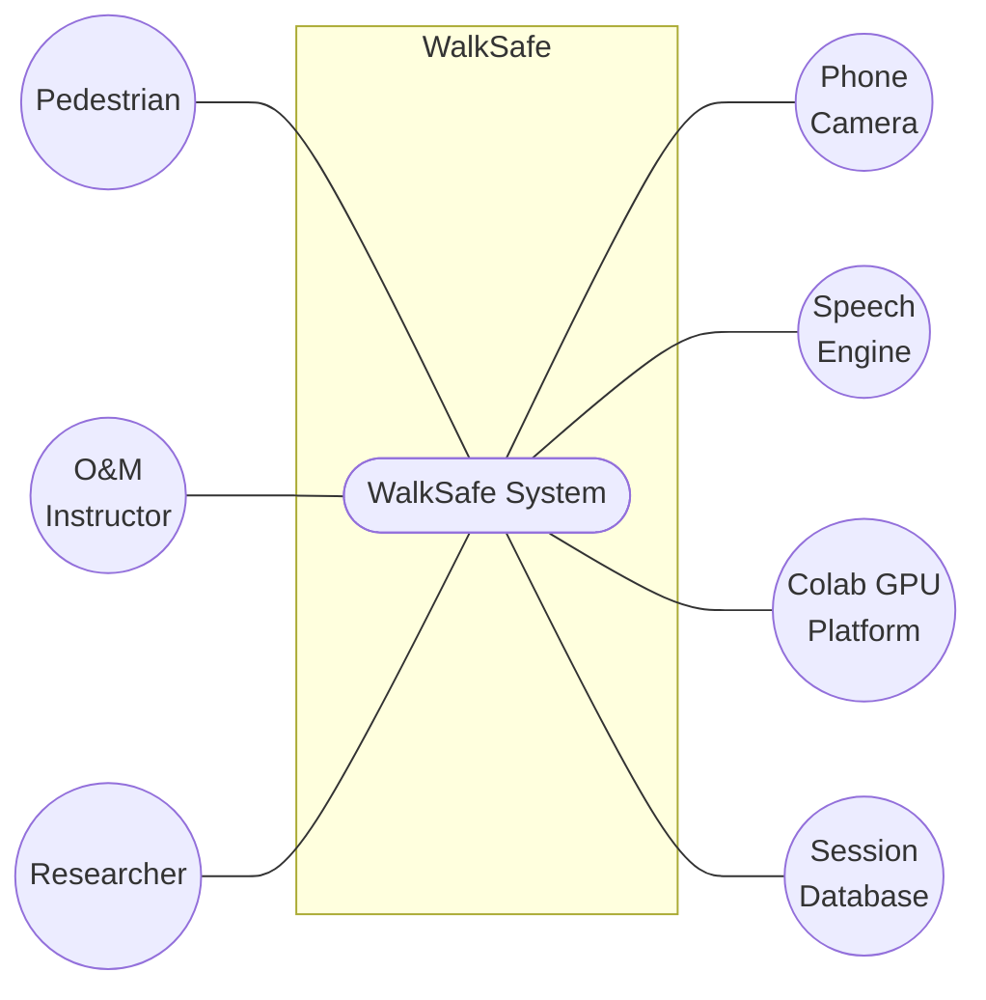

**Use Case Name:** WalkSafe System
**Use Case ID:** 0
**Primary Actors:** Pedestrian, O&M Instructor, Researcher
**Secondary Actors:** Phone Camera, Speech Engine, Colab GPU Platform, Session Database
**Goal in Context:** The diagram above shows the complete system overview for WalkSafe, a tool that gives blind and low-vision pedestrians spoken guidance about obstacles and openings one to eight metres ahead while they walk.

**Description:** This is the high-level, or level 0, view of the WalkSafe system. The pedestrian is the main primary actor. The O&M instructor and researcher are also primary actors, but use only the setup and review sides. The secondary actors are the phone camera, which supplies frames, the speech engine, which speaks the commands, the Colab GPU platform, which provides the compute the heavy models run on, and the session database, which stores what the app decided so it can be reviewed afterwards.

### 3.1.2 Level 1

**Figure 2: Level 1 (Modules of WalkSafe)**

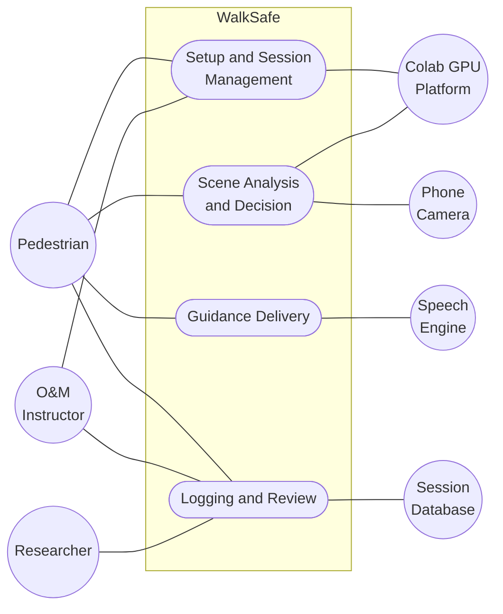

**Use Case Name:** Modules of WalkSafe
**Use Case ID:** 1
**Primary Actors:** Pedestrian, O&M Instructor, Researcher
**Secondary Actors:** Phone Camera, Speech Engine, Colab GPU Platform, Session Database
**Goal in Context:** The diagram above shows the modules of WalkSafe. It consists of 4 modules, which are described below and elaborated in the following levels.

**Description:**

**1. Setup and Session Management**

- **Functionality:** Runs the spoken setup, starts and ends sessions, finds the server, and announces how much capability the system currently has.
- **Purpose:** Gets the app ready for this user and this phone, and keeps the user told about what it can currently do.
- **Key Role:** Acts as the starting point for all other operations. Nothing else runs until setup has passed.

**2. Scene Analysis and Decision**

- **Functionality:** Captures frames, checks on the phone whether something is closing in, analyses the scene on the server, and applies fixed rules to settle on one command, letting a phone warning override the server.
- **Purpose:** Turns camera frames into a single instruction.
- **Key Dependencies:** Depends on the phone camera for frames and on the Colab GPU platform for the depth, detection, and motion models.
- **Output:** One command per cycle, with the rule and values that produced it.

**3. Guidance Delivery**

- **Functionality:** Speaks the chosen command with its own short sound and a vibration for urgent ones, and controls when to speak so the app stays quiet unless something has changed.
- **Purpose:** Gets the instruction to the user in time, without talking so much that the user stops listening.
- **Key Dependencies:** Depends on the speech engine.
- **Key Role:** This is the only module the pedestrian directly experiences.

**4. Logging and Review**

- **Functionality:** Records every decision with the values behind it, and shows summaries and drill-down on a dashboard.
- **Purpose:** Makes it possible to check afterwards why the app said what it said, and to find where the thresholds are wrong.
- **Output:** Session summaries and a record of what was decided on each walk.

### 3.1.3 Level 1.1

**Figure 3: Level 1.1 (Setup and Session Management System)**

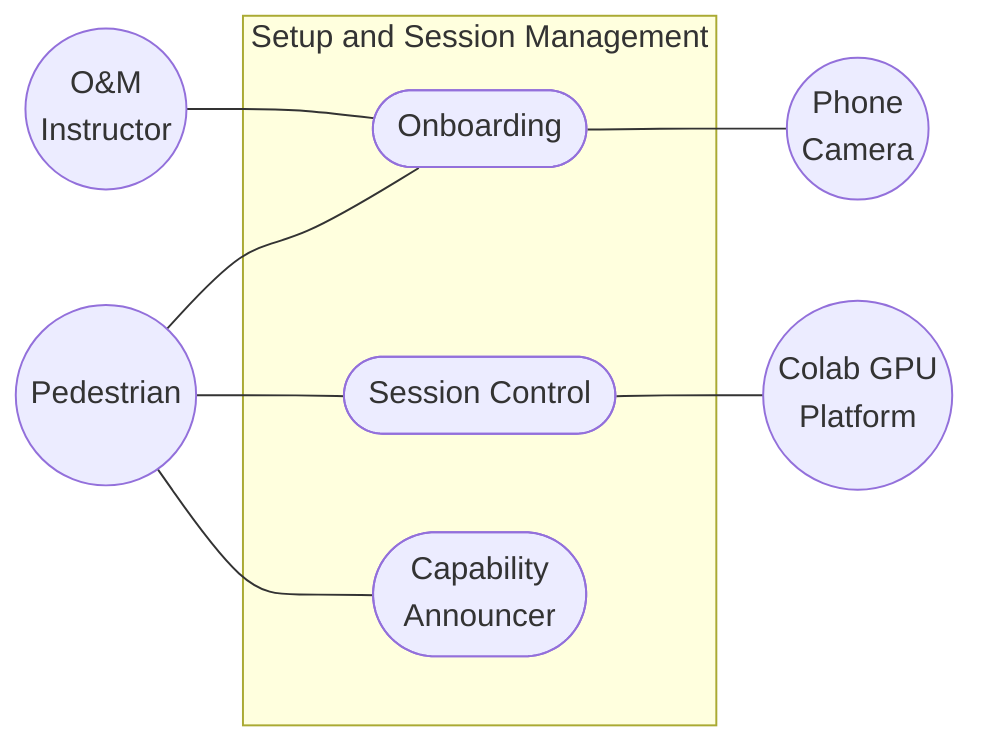

**Use Case Name:** Setup and Session Management System
**Use Case ID:** 2
**Primary Actors:** Pedestrian, O&M Instructor
**Secondary Actors:** Phone Camera, Colab GPU Platform
**Goal in Context:** Configures the app for one user and one phone, then runs sessions and keeps the user told about what the app can currently do.

**Description:**

1. **Onboarding:** states that WalkSafe does not replace a cane or guide dog and takes the user's acknowledgement, then asks consent to send camera images to the server, offering a phone-only mode if the user declines. It then calibrates the app to this phone and this user: reads the camera field of view, checks the app's depth estimate against a known distance, runs a left/right test in which the user steps left and the app confirms it saw a left step, and records the user's shoulder width. Onboarding is rejected if the depth check or the direction test fails, because both would otherwise produce wrong guidance the user has no way to detect. An O&M instructor may assist, but the whole procedure is spoken and can be completed without sighted help.
2. **Session Control:** starts and ends a session with one action that needs no sight, and finds the current server from a fixed address so the user never handles a link.
3. **Capability Announcer:** says out loud whenever the app loses or regains capability, with the reason, and repeats it while capability is reduced. It also warns before low battery or overheating ends the session.

### 3.1.4 Level 1.2

**Figure 4: Level 1.2 (Scene Analysis and Decision System)**

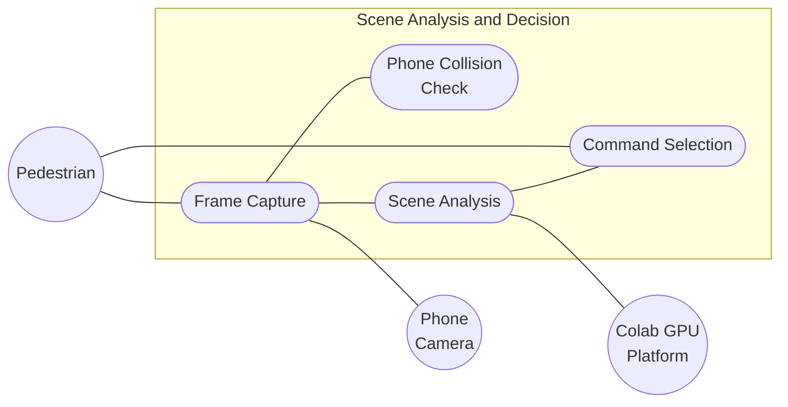

**Use Case Name:** Scene Analysis and Decision System
**Use Case ID:** 3
**Primary Actors:** Pedestrian
**Secondary Actors:** Phone Camera, Colab GPU Platform
**Goal in Context:** Turns camera frames into one command, using a fast check on the phone and a fuller analysis on the server.

**Description:**

1. **Frame Capture:** captures frames from the rear camera, records the time each was taken, and discards frames too dark, bright, or blurred to trust.
2. **Phone Collision Check:** measures how fast the image is spreading outward. Things that get closer get bigger, so rapid expansion means something is closing in. This runs on the phone with no model and no network, which is what makes it fast enough to warn in time.
3. **Scene Analysis:** on the server, estimates depth in metres, detects and tracks people, cyclists and vehicles, and works out each one's approach speed, time to collision, and risk level, along with walkable openings and the user's walking speed.
4. **Command Selection:** applies the rules in a fixed order that puts hazard avoidance before route choice and picks one command from the nine in §2.4. A `stop` from the phone collision check overrides whatever the server chose, and a command that has become too old is discarded rather than passed on. Records the rule and values behind the command it issues.

### 3.1.5 Level 1.3

**Figure 5: Level 1.3 (Guidance Delivery System)**

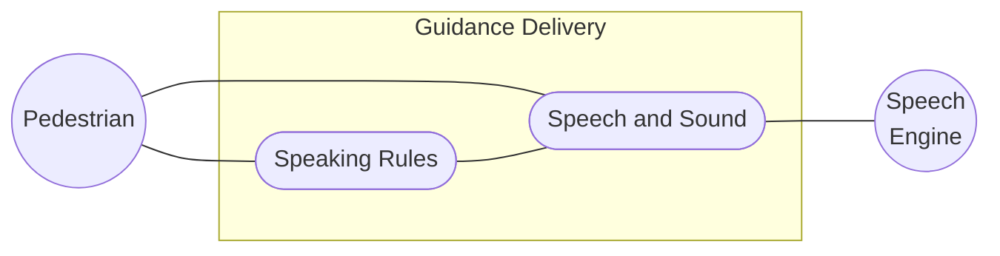

**Use Case Name:** Guidance Delivery System
**Use Case ID:** 4
**Primary Actors:** Pedestrian
**Secondary Actors:** Speech Engine
**Goal in Context:** Gets one clear instruction to the user in time, without talking so much that the user stops listening.

**Description:**

1. **Speech and Sound:** plays the command's own short sound, then speaks it, and adds a vibration for urgent commands so they get through in noisy places. Speaks at the verbosity and speech rate the user has chosen, both adjustable during a session without sight.
2. **Speaking Rules:** decides when to speak at all. A command that has not changed is not repeated, so silence is the normal state. Speech is capped at fifteen messages a minute, `step_left` and `step_right` cannot alternate faster than once every two seconds, an urgent command interrupts whatever is being said, and the user can mute guidance entirely at any time.

### 3.1.6 Level 1.4

**Figure 6: Level 1.4 (Logging and Review System)**

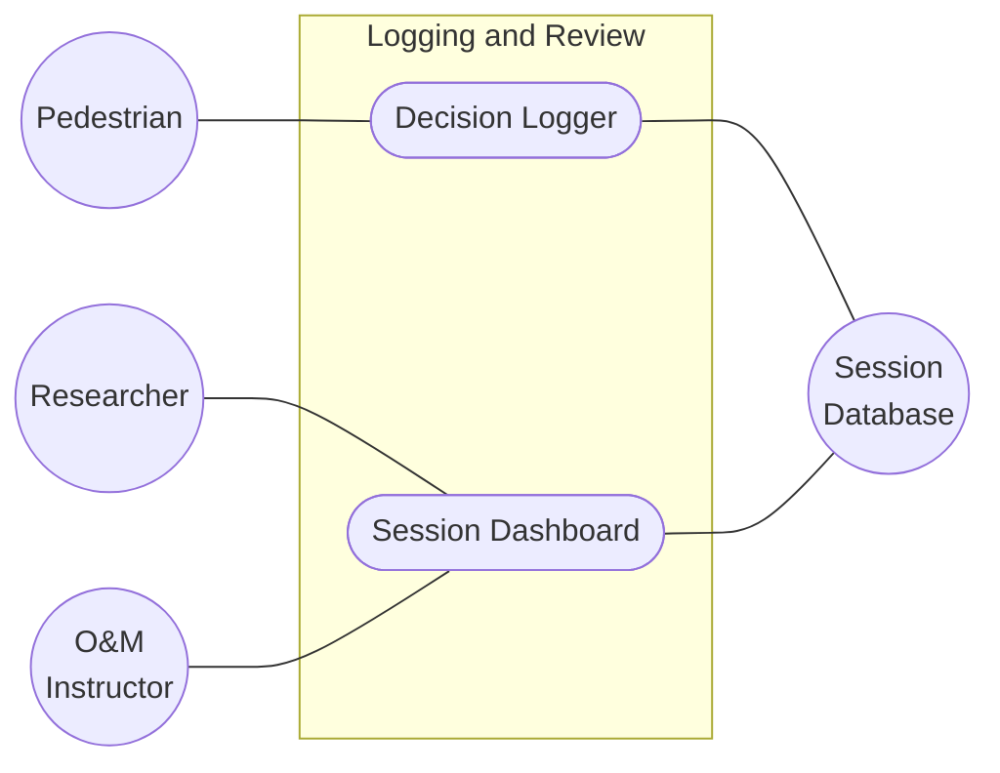

**Use Case Name:** Logging and Review System
**Use Case ID:** 5
**Primary Actors:** Pedestrian, Researcher, O&M Instructor
**Secondary Actors:** Session Database
**Goal in Context:** Keeps a record of what the app decided and why, so its behaviour can be checked after a walk.

**Description:**

1. **Decision Logger:** records every decision with the values behind it, storing no images. It runs during the pedestrian's walk and writes in the background, so guidance is never delayed.
2. **Session Dashboard:** shows command, risk, and speed summaries, guidance delay against target, time spent at each reduced level, and drill-down into any single command.

## 3.2 Activity Diagram

An activity diagram shows the order in which a system's steps happen, including the points where it chooses between alternatives. The three diagrams below cover the parts of WalkSafe where the ordering matters most: the loop that runs on every frame, how a session begins, and what happens when the app loses capability part-way through a walk.

**Figure 7: Activity Diagram (Guidance Loop)**

This runs once per frame. The phone check and the server work at the same time and meet at the arbitration step. The double-bordered box is where this loop hands over to the capability check in Figure 9: an unusable frame, a phone check that has stopped running, or a server that does not answer all become inputs to that flow.

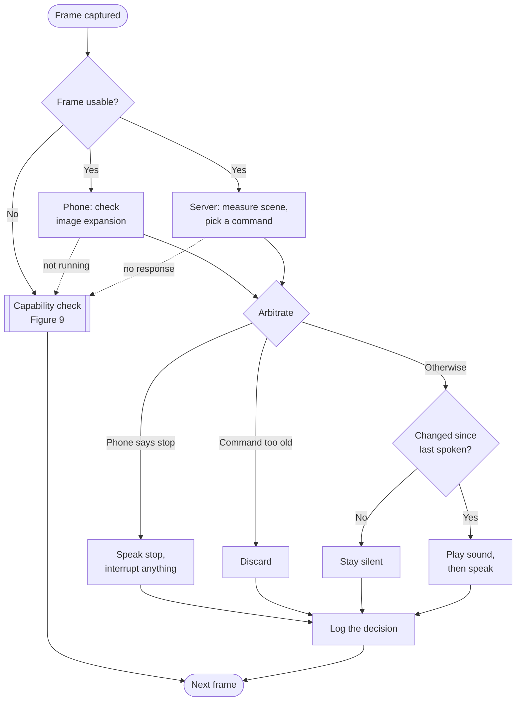

**Figure 8: Activity Diagram (Setup and Session Start)**

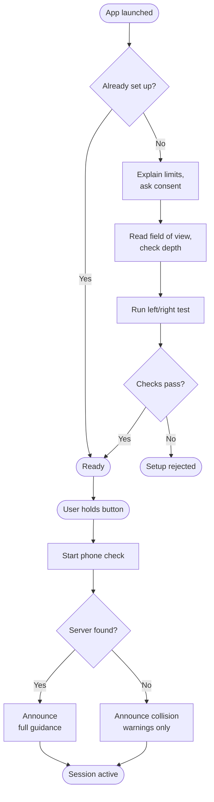

---

**Figure 9: Activity Diagram (Capability Change and Recovery)**

This runs alongside the guidance loop for the whole session. Its inputs come from the double-bordered box in Figure 7, plus the battery and temperature readings. Every step down is announced with its reason, and the announcement repeats while capability stays reduced, so silence is never mistaken for everything being fine.

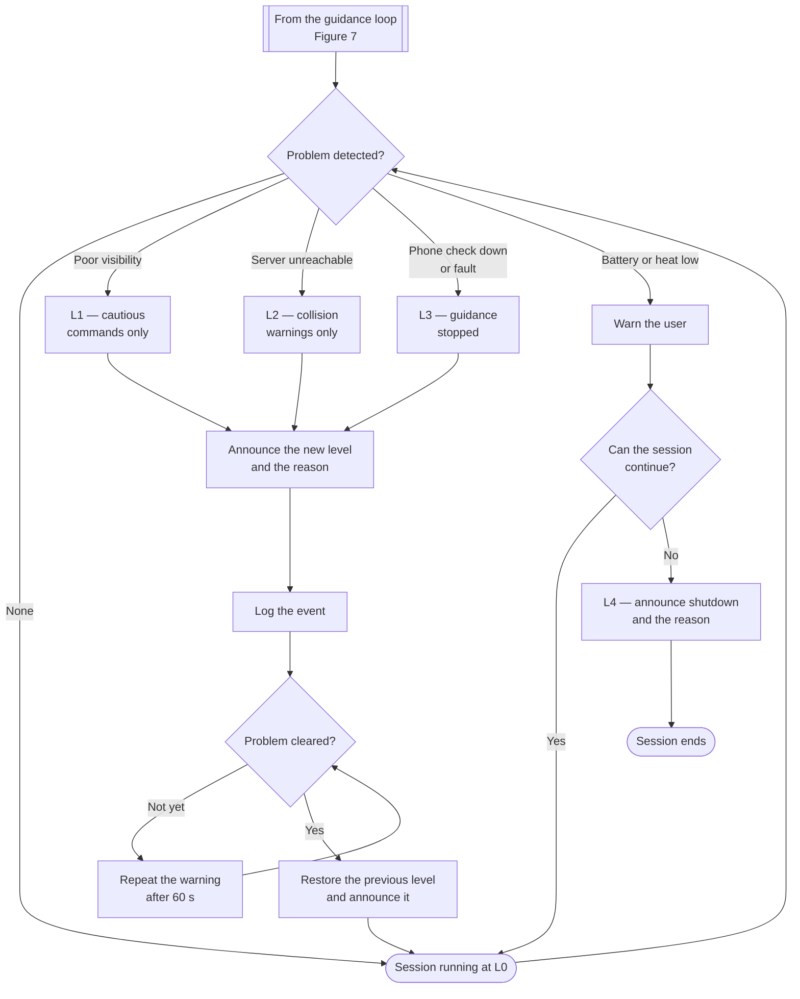

---

# 4. Data and Information Modeling

WalkSafe keeps a small relational store. Two rules shape it. **No images are stored anywhere**, so the tables hold what the app measured and decided, not what it saw. And **each decision records two times** — when the frame was captured and when the command was spoken — because the gap between them is the guidance delay that NFR-1 and NFR-2 are about.

**Figure 10: ER Diagram**

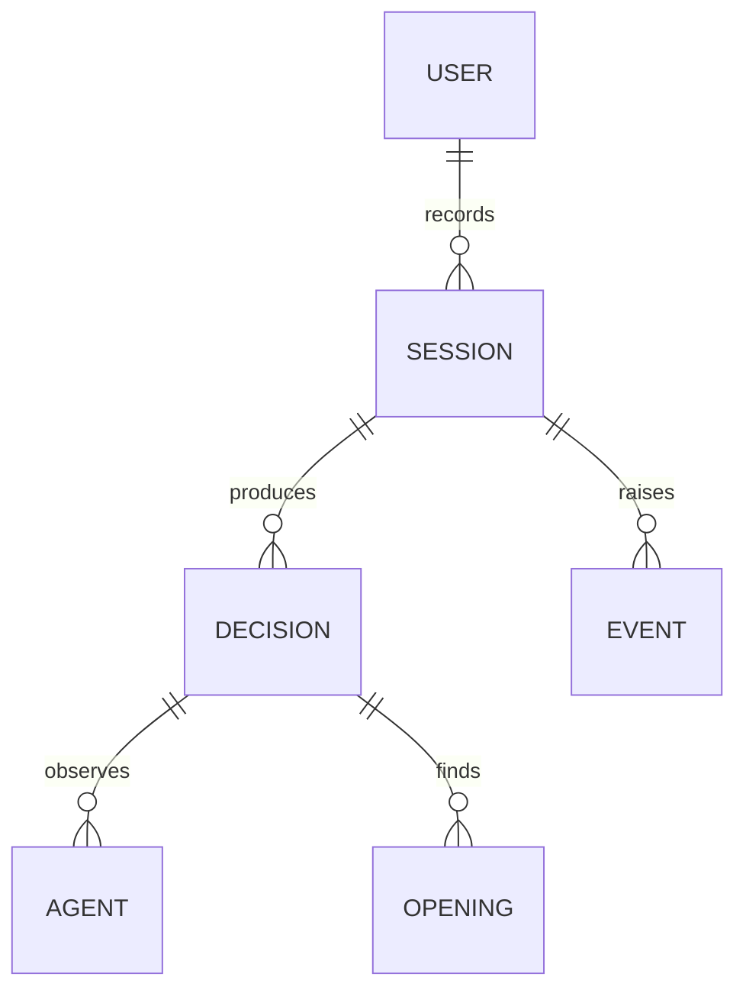

The schemas derived from the ER diagram are as follows.

| Schema | Attribute | Type |
|---|---|---|
| **user** | user_id | VARCHAR(64) PK |
| | phone_model | VARCHAR(128) |
| | verbosity | VARCHAR(16) |
| | speech_rate | FLOAT |
| | consent_send_images | BOOLEAN |
| | camera_fov_deg | FLOAT |
| | mount_height_m | FLOAT |
| | mount_pitch_deg | FLOAT |
| | clearance_margin_m | FLOAT |
| | depth_scale | FLOAT |
| | depth_check_passed | BOOLEAN |
| | direction_test_passed | BOOLEAN |
| | created_at | TIMESTAMP |
| **session** | session_id | VARCHAR(64) PK |
| | user_id | VARCHAR(64) FK |
| | started_at | TIMESTAMP |
| | ended_at | TIMESTAMP |
| | end_reason | VARCHAR(32) |
| | total_decisions | INTEGER |
| **decision** | session_id | VARCHAR(64) PK, FK |
| | sequence | INTEGER PK |
| | captured_at | TIMESTAMP |
| | spoken_at | TIMESTAMP |
| | delay_ms | INTEGER |
| | source | VARCHAR(8) |
| | command | VARCHAR(24) |
| | detail | TEXT |
| | reason | TEXT |
| | confidence | FLOAT |
| | level | VARCHAR(4) |
| | spoken | BOOLEAN |
| | user_speed_ms | FLOAT |
| **agent** | session_id | VARCHAR(64) FK |
| | sequence | INTEGER FK |
| | track_id | INTEGER |
| | type | VARCHAR(32) |
| | dist_m | FLOAT |
| | approach_speed_ms | FLOAT |
| | ttc_s | FLOAT |
| | risk | VARCHAR(16) |
| | motion | VARCHAR(24) |
| **opening** | session_id | VARCHAR(64) FK |
| | sequence | INTEGER FK |
| | direction | VARCHAR(8) |
| | width_m | FLOAT |
| | dist_m | FLOAT |
| | chosen | BOOLEAN |
| **event** | session_id | VARCHAR(64) FK |
| | occurred_at | TIMESTAMP |
| | type | VARCHAR(32) |
| | cause | VARCHAR(64) |
| | from_level | VARCHAR(4) |
| | to_level | VARCHAR(4) |

*Table 1: Schema table*

A few points worth noting. `camera_fov_deg`, `depth_scale`, and the mount figures are measured during setup, never assumed, and `depth_check_passed` and `direction_test_passed` must both be true before the app can be used. Each decision stores two times, because `delay_ms` between them is what NFR-1 and NFR-2 are measured against. `ttc_s` is left empty when it cannot be computed rather than filled with a placeholder. The `event` rows are what `time spent in each reduced state` in FR-26 is computed from, and they are never dropped when the log queue is busy. There is no separate profile table: WalkSafe has no accounts and no sign-in, so the `user` row holds both preferences and the setup measurements for that phone.

---

# 5. Software Design

## 5.1 Component Diagram

**Figure 11: Component Diagram**

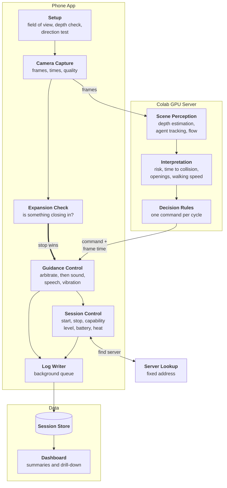

## 5.2 Component Responsibilities

| Component | Does | Talks to |
|---|---|---|
| **Camera Capture** | Captures frames, notes the time of each, discards frames too dark, bright, or blurred | Expansion Check, server |
| **Expansion Check** | Measures how fast the image is spreading outward; asserts a stop when something is closing in. Runs on the phone with no network | Guidance Control |
| **Depth Estimation** | Produces a depth map for the frame | Interpretation |
| **Agent Tracking** | Detects people, cyclists, and vehicles and follows them across frames | Interpretation |
| **Flow Estimation** | Estimates image motion, used for the user's walking speed | Interpretation |
| **Interpretation** | Works out each agent's distance, approach speed, time to collision and risk, finds walkable openings, and estimates walking speed | Decision Rules |
| **Decision Rules** | Applies the rules in fixed order and returns one command with the reason for it | Guidance Control, Log Writer |
| **Guidance Control** | Lets a phone stop override the server, drops guidance that is too old, suppresses repeats, then plays the sound, speaks, and vibrates | Session Control, Log Writer |
| **Session Control** | Starts and ends sessions, tracks the capability level, watches battery and temperature, and announces every change | Server Lookup, Log Writer |
| **Setup** | Runs the spoken setup: field of view, depth check, shoulder width, direction test | Camera Capture, Interpretation, Guidance Control |
| **Server Lookup** | A fixed address the phone asks for the current server, so the user never handles a link | Session Control |
| **Log Writer / Session Store** | Writes decisions and events in the background so guidance is never delayed | Dashboard |
| **Dashboard** | Shows session summaries and allows drill-down into any command | Session Store |

---

# 6. Software Architecture

## 6.1 Architectural Overview

The system runs in two places: the phone and a Colab GPU server. What goes where is decided by how fast the answer is needed, not by how hard it is to compute.

A round trip to a shared Colab GPU takes about a second. At walking pace that is well over a metre of travel, which is fine for "step right" and useless for "stop". So the split is:

- **On the phone.** One cheap question: is something closing in? It compares consecutive frames and measures how fast the image is expanding. No model, no network, and fast enough to answer within 250 ms.
- **On the server.** Everything that needs real understanding of the scene: depth, agents, risk, openings, and the choice of command.

When the two disagree, the phone wins. A stop from the phone is never overridden or delayed by the server (FR-16). The reason for the asymmetry is that a wrong stop from the phone costs the user a needless pause, while a wrong "walk forward" from the server that the phone was not allowed to veto costs a collision.

**Figure 12: Where Things Run**

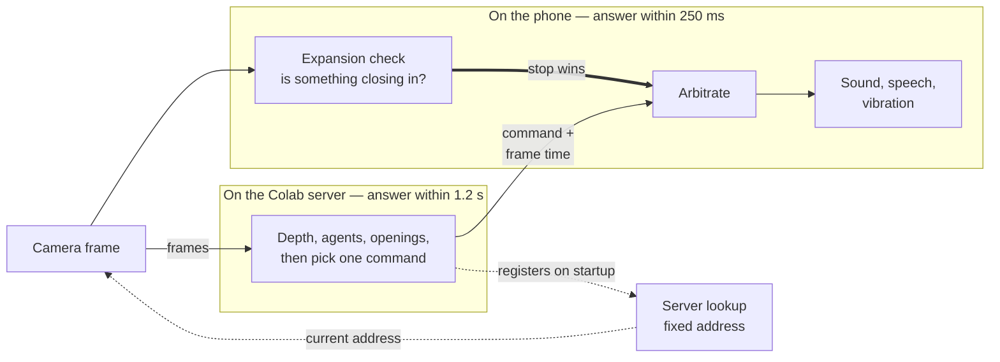

The server address changes every time the Colab session restarts, and a blind user cannot be asked to read a new link each day. A small always-on lookup service solves this: the notebook tells it where it is on startup, and the phone always asks the same fixed address (FR-22).

Free Colab sessions also end after a few hours and may not get a GPU at all. This is why losing the server has to be normal rather than exceptional: capability drops to collision warnings on the phone, the user is told, and the app reconnects on its own when a server comes back (NFR-10).

## 6.2 Requirement Traceability Matrix

| Requirement | Component | Use Case | Test |
|---|---|---|---|
| FR-1 Capture and reject bad frames | Camera Capture | UC-3 | T2 |
| FR-2 Distance to obstacles and ground | Depth Estimation | UC-3 | T2 |
| FR-3 Detect and track agents | Agent Tracking | UC-3 | T3 |
| FR-4 Classify agent motion | Interpretation | UC-3 | T3 |
| FR-5 Approach speed and time to collision | Interpretation | UC-3 | T4 |
| FR-6 Assign risk level | Interpretation | UC-3 | T3 |
| FR-7 Find and measure openings | Interpretation | UC-3 | T5 |
| FR-8 Compare against shoulder width | Interpretation, Setup | UC-1 | T5 |
| FR-9 One command by fixed rules | Decision Rules | UC-3 | T6 |
| FR-10 Cautious commands when unsure | Decision Rules | UC-3 | T6 |
| FR-11 Record the rule and values | Decision Rules | UC-5 | T13 |
| FR-12 Speak, sound, vibrate | Guidance Control | UC-3 | T9 |
| FR-13 Silent when nothing changes | Guidance Control | UC-3 | T9 |
| FR-14 Interrupt speech for a stop | Guidance Control | UC-3 | T9 |
| FR-15 Mute and adjust during a session | Guidance Control | UC-2 | T12 |
| FR-16 Phone stop overrides the server | Guidance Control | UC-3 | T7 |
| FR-17 Discard guidance that is too old | Guidance Control | UC-3 | T8 |
| FR-18 Announce loss of capability | Session Control | UC-4 | T10 |
| FR-19 Announce faults, never fail silently | Session Control | UC-4 | T10 |
| FR-20 Warn on low battery or overheating | Session Control | UC-4 | T10 |
| FR-21 One-action session start and end | Session Control | UC-2 | T12 |
| FR-22 Find the server automatically | Session Control, Server Lookup | UC-2 | T11 |
| FR-23 Spoken setup with direction test | Setup | UC-1 | T1 |
| FR-24 Record decisions, store no images | Log Writer, Session Store | UC-5 | T13 |
| FR-25 Logging never delays guidance | Log Writer | UC-3 | T13 |
| FR-26 Session summaries | Dashboard | UC-5 | T13 |
| NFR-1 Phone warnings within 250 ms | Expansion Check, Guidance Control | UC-3 | T7 |
| NFR-2 Server guidance within 1.2 s | Guidance Control | UC-3 | T8 |
| NFR-3 Phone check at 10 frames per second | Expansion Check | UC-3 | T7 |
| NFR-4 Two server decisions per second | Server pipeline | UC-3 | T2 |
| NFR-5 Failures leave the system cautious | Session Control | UC-4 | T10 |
| NFR-6 Left and right never reversed | Setup, Interpretation | UC-1 | T1 |
| NFR-7 No fault signalled by silence | Session Control | UC-4 | T10 |
| NFR-8 Every safety requirement tested | All | — | T1 to T14 |
| NFR-9 Two-hour session without crash | Phone App | UC-2 | T14 |
| NFR-10 Losing the server never ends it | Session Control | UC-2 | T11 |
| NFR-11 Usable without sight | Phone App | UC-1, UC-2 | T12 |
| NFR-12 Earphones optional | Guidance Control | UC-3 | T12 |
| NFR-13 At most 15 messages a minute | Guidance Control | UC-3 | T9 |
| NFR-14 Battery within budget | Phone App | UC-2 | T14 |
| NFR-15 Data within budget | Camera Capture | UC-3 | T14 |
| NFR-16 One config file, swappable models | All | — | T6 |

---

# 7. AI Engineering Design

## 7.1 AI Pipeline

**Figure 13: AI Pipeline**

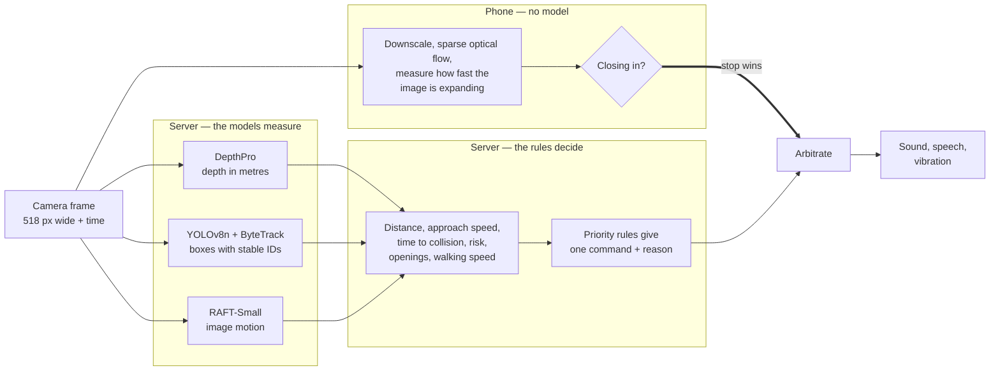

The split is deliberate: **the models measure, the rules decide.** Every AI component produces a number — depth in metres, boxes with identities, a motion field. Everything after that is ordinary code. That is what makes it possible to say afterwards exactly why a command was issued, which FR-11 requires.

## 7.2 Model Selection

Nothing is trained or fine-tuned. All models are pretrained and used as they are.

| Where | Model | Why this one | Also considered |
|---|---|---|---|
| Server, depth | **DepthPro** | Gives depth in metres from one image, so distances need no separate scaling step. Sharp edges matter for narrow things like poles | MiDaS and Depth Anything give relative depth, needing an extra scaling step |
| Server, detection | **YOLOv8n + ByteTrack** | Small enough to leave GPU time for depth and flow. ByteTrack keeps the same identity across frames, which time to collision depends on | Larger YOLO models are more accurate but push past the 1.2 s budget |
| Server, motion | **RAFT-Small** | Reasonable accuracy for the cost; used for the user's walking speed in the session summaries | Farnebäck is cheaper but too noisy |
| Phone | **No model — sparse optical flow expansion** | Must run at 10 frames per second on an ordinary phone. Measuring how fast the image spreads outward gives a collision warning without needing depth or scale, using a few hundred points of arithmetic and no model file | A small quantized depth model would work but needs a download, a GPU delegate, and support that varies by device |

The last row is the important one. The phone does not need to know how far away something is to know it is about to hit you. Expansion rate alone gives that, which is why the phone side needs no neural network at all.

**Its weak spot:** a blank untextured wall produces almost no flow, so expansion will not see it closing. Textured scenes — people, vehicles, foliage, patterned pavement — work well. This is the same blind spot depth estimation has, so it adds no new kind of risk, but the phone-only mode is weaker indoors than out.

## 7.3 Making It Fast Enough

| Technique | Where | Effect |
|---|---|---|
| Reuse the depth map for a few frames | Server | Depth is the slowest step. Reusing it raises throughput, capped so it is never more than 400 ms old |
| Work on the newest frame, drop older ones | Server input | A normal queue turns load into delay, which is worse than skipping frames |
| Small frames | Uplink | 518 px wide is enough for all three server models and keeps data use within NFR-15 |
| Lower the frame rate under pressure | Both | On overheating or a weak connection, slow down and say so rather than being killed by the phone |

## 7.4 Prompt Design

Not applicable. WalkSafe contains no language model and nothing generative. All three server models take an image and return numbers, so there is no prompt to design. The decision layer is hand-written rules.

This is on purpose. A prompted model in the decision path would be unpredictable, far too slow for the budgets in §2.2, and would make it impractical to say exactly why a command was issued.

## 7.5 Open Questions

| # | Question | Blocks |
|---|---|---|
| 1 | Is DepthPro worth its cost, or would a lighter depth model at a higher frame rate be better? | The 1.2 s server budget |
| 2 | What expansion threshold avoids firing on camera shake and head turns? | Whether the phone check is usable |
| 3 | All risk and opening thresholds are untested placeholders and need calibrating against real walks | Trusting any of the safety behaviour |

---

# 8. Preliminary Test Plan

The plan has an unusual balance. For most software, testing checks that features work. Here a good part of it checks that **failures** behave correctly: that a lost server announces itself, that old guidance is dropped instead of spoken late, that a stop from the phone cannot be overruled.

## 8.1 Testing Objectives

1. Check each functional requirement in §2.1 and each non-functional requirement in §2.2.
2. Check that depth estimates match known distances, and that setup rejects a phone whose depth is badly wrong.
3. Check that agents keep the same identity across frames, including after being briefly hidden.
4. Check that speeds and times do not change when the frame rate changes.
5. Check that openings are judged in metres and that "no opening" actually gets reported.
6. Check that exactly one command comes out per cycle, that every rule can fire, and that unmatched states fall back to a cautious command.
7. Check that left and right are never reversed, on every phone used.
8. Check that phone warnings arrive within 250 ms and server guidance within 1.2 s, and that nothing older than 2 s is spoken.
9. Check that a stop from the phone always wins, whatever the server says and whenever it arrives.
10. Check that the app is silent when nothing changes and never exceeds 15 messages a minute.
11. Check that every fault and capability change is announced, and that nothing fails silently.
12. Check that losing the server reduces capability but never ends the session, and that recovery is automatic.
13. Check that everything is usable with a screen reader and without sight.
14. Check that no images are stored anywhere and that consent comes before any image is sent.
15. Check that logging never delays guidance and that sessions are closed even after a crash.
16. Check battery and data use over a continuous two-hour session.

## 8.2 Features to be Tested

| # | Feature | What we do | What should happen |
|---|---|---|---|
| T1 | Setup and direction test | Run setup on each phone, then repeat with a build whose left and right are deliberately swapped | Normal build passes; swapped build fails the direction test and is blocked from use |
| T2 | Depth accuracy | Obstacles at measured 1, 2, 3, 5, and 8 m, plus glass and a blank wall | Estimates within the error band; confidence drops on difficult surfaces instead of staying high |
| T3 | Detection and tracking | Recorded people and cyclists approaching, crossing, passing, and briefly hidden | Agents found, identity kept, motion and risk classified correctly |
| T4 | Frame rate independence | Same recorded clip at 1.5, 5, and 15 frames per second | Speeds and times to collision agree across all three |
| T5 | Openings | Blank wall, blocked path, narrow gap, clear path; vary the shoulder width setting | "No opening" reported for wall and blocked path; widths match a tape measure; result changes with shoulder width |
| T6 | Decision rules | Fixture scenes covering every rule, including states that match none | One command per cycle; every rule fires; unmatched states give a cautious command |
| T7 | Phone stop wins | Assert a phone stop while the server sends `walk_forward` at full confidence, arriving before, during, and after | Stop is spoken every time; the server command is never spoken or blended |
| T8 | Old guidance | Add network delay past 2 s; send commands out of order | Old commands discarded, not spoken late; out-of-order commands ignored |
| T9 | Guidance delivery | Hold a static scene for a minute, then a fast-changing one with a stop during speech; play music in another app | Nothing repeated during the static scene; under 15 messages a minute; stop interrupts, sound first; music does not silence guidance |
| T10 | Capability changes | Cause each in turn: server unreachable, camera covered, poor light, low battery, overheating, speech engine failure | Correct level each time, announced with its cause, repeated while reduced, and never silent |
| T11 | Server loss and recovery | Kill the server mid-session, then bring it back | Session continues on the phone with an announcement; reconnects and announces full guidance when it returns |
| T12 | Accessibility | Do every task with a screen reader only, one-handed, while holding a cane | Everything completes without sight; no link ever needs typing |
| T13 | Logging and privacy | Run a session, then search phone storage, server files, and logs; export and delete data | No images anywhere; decisions and events all present; guidance not delayed; export and delete work without sight |
| T14 | Two hours continuous | Full session on the target phone | No crash, no unannounced capability loss, battery and data within budget |

## 8.3 Validation with Users

Testing shows the app matches this document. Showing that the document is right needs the people it is for.

| Stage | What happens |
|---|---|
| 1 | An orientation-and-mobility instructor reviews the nine commands, the wording, and the announcements |
| 2 | Closed course with obstacles at known positions: sighted testers first, then blind participants with an instructor present |
| 3 | Supervised walks on familiar routes, participants using their usual cane or guide dog |
| 4 | Unfamiliar routes and poor conditions, which is the only way to see whether users start over-trusting the app |

Stages 2 to 4 need ethics approval and an instructor present, so they are scheduled after the deadline in §9.

---

# 9. Timeline

Deadline: **7 September 2026**. The prototype is working, so the remaining work is correcting what it gets wrong and building the parts it does not have yet.

**Where the 26 functional requirements stand**

| | Count | Requirements |
|---|---|---|
| Working now | 8 | FR-2, FR-3, FR-4, FR-6, FR-9, FR-11, FR-24, FR-25 |
| Partly working | 7 | FR-1, FR-5, FR-7, FR-12, FR-14, FR-21, FR-26 |
| Not started | 11 | FR-8, FR-10, FR-13, FR-15 to FR-20, FR-22, FR-23 |

The partly-working ones are the risky group. The pipeline computes time to collision, finds openings, and speaks commands, but it assumes a fixed frame rate, judges openings against a relative threshold, and speaks on every frame. Each produces plausible output that is wrong, so they are scheduled first.

**Figure 14: Gantt Chart**

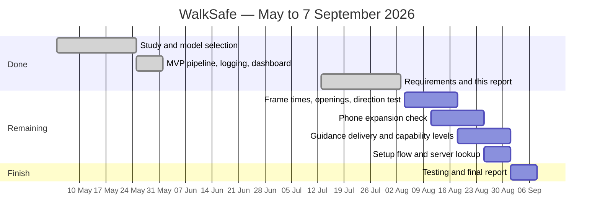

The user trials in §8.3 need ethics approval and an instructor present, so they are planned separately and fall after this deadline.

---

# Appendix — Key Risks and Mitigations

| # | Risk | Cause | Mitigation | Requirements |
|---|---|---|---|---|
| R1 | User walks into something the app missed after being told to go | Missed detection; openings judged too generously; depth fails on thin or glass objects | Phone stop overrides the server; openings judged in metres; "no opening" is reportable; cautious default; cane still in use | FR-7, FR-8, FR-9, FR-16 |
| R2 | User acts on guidance describing a scene that has already changed | Network delay; queued frames; stale depth | Frame time on every command; discard anything too old; work on the newest frame only | FR-17, NFR-2 |
| R3 | User steps off a kerb or stair the app cannot see | Depth from one camera is unreliable at downward steps; out of scope | Stated as a limitation in setup and §1.4; cane requirement repeated | §1.4, FR-23 |
| R4 | User is sent into a hazard because left and right are swapped | A sign error anywhere between the camera and the speech | Direction test on the user's own phone that blocks use on failure; automated test on clips of known direction | FR-23, NFR-6 |
| R5 | User misses a vehicle because earphones block their hearing | Earphones assumed or required | Earphones optional; phone speaker and bone conduction supported; vibration for urgent commands | FR-12, NFR-12 |
| R6 | User over-trusts the app and relies less on the cane | It works well most of the time, so its limits stay invisible | Stated plainly in setup and acknowledged; capability changes always announced | FR-18, FR-23 |
| R7 | Guidance stops and the user keeps walking without noticing | Crash, flat battery, overheating, lost server, another app taking the audio | Every fault announced; reduced capability repeated each minute; battery and heat warnings | FR-18, FR-19, FR-20, NFR-7 |
| R8 | Too many false stops, so real ones get ignored | Times to collision computed from an assumed frame rate; untested thresholds; expansion check firing on camera shake | Frame times measured, not assumed; expansion threshold tuned against recorded clips; false stops counted during trials | FR-5, NFR-6 |
| R9 | Poor light or rain produces confident but wrong guidance | No check on whether the image is usable | Bad frames rejected; cautious commands only when unsure | FR-1, FR-10 |
| R10 | Bystanders are filmed and sent to a server without consent | Continuous video going to Colab | No images stored anywhere; only measurements kept; consent asked before sending; phone-only mode offered | FR-24 |
| R11 | Session ends mid-walk when the free Colab session expires | Colab time limits reached with no warning | Capability drops to phone-only rather than stopping; automatic reconnection; user told either way | FR-22, NFR-10 |

**Residual risk.** R3, and the glass and thin-obstacle part of R1, are not removed by design. They are limited only by the user also carrying a cane, and by saying so plainly. This is why WalkSafe is described throughout as something used alongside a cane, not instead of one.

---

*End of document.*

