<div align="center">

# WalkSafe
## A Real-Time Navigation Assistant for Blind and Low-Vision Pedestrians

### SE-801 Software Project Lab 3 — Technical Report (SRS)

<br/>

**Supervised by**

*[Supervisor Name]*
*[Designation]*
Institute of Information Technology
University of Dhaka

<br/>

**Submitted by**

**Shah Alam**

**BSSE — [Roll]**

Institute of Information Technology
University of Dhaka

<br/>

**Submission Date: July 27, 2026**

</div>

---

## Letter of Transmittal

July 27, 2026

BSSE 4th Year Exam Committee
Institute of Information Technology
University of Dhaka

**Subject:** Submission of Technical Report — *WalkSafe: A Real-Time Navigation Assistant for Blind and Low-Vision Pedestrians*

Sir,

I am pleased to submit the technical report for my Software Project Lab 3 project, "WalkSafe: A Real-Time Navigation Assistant for Blind and Low-Vision Pedestrians."

This report documents the requirements analysis, scenario-based modeling, data and class modeling, architectural design, and preliminary test plan for the system. Because WalkSafe is intended for use by blind pedestrians while walking, the report additionally includes a hazard analysis and an explicit latency and degradation specification, which I judged necessary for a system whose failures carry physical consequences.

I have tried to be thorough and honest about both the capabilities and the limitations of the proposed system. I would welcome your feedback for improvement.

Sincerely,

**Shah Alam**
BSSE — [Roll]
Institute of Information Technology
University of Dhaka

<br/>

`--------------------------------`
Supervisor's Signature

---

## Acknowledgement

I am grateful to the Institute of Information Technology, University of Dhaka, for the opportunity to work on WalkSafe. I would like to express my sincere gratitude to my supervisor for continuous guidance, patience, and constructive criticism throughout the project.

I am indebted to the open-source research community whose work this project builds directly upon — the authors of DepthPro, YOLO, RAFT, and Depth Anything — without whose published models a project of this scope would be infeasible within a single lab course.

I would also like to thank my classmates for their insights and feedback during design discussions, and to acknowledge in advance the orientation-and-mobility professionals and blind participants whose review is essential to validating this system. A tool intended for blind travellers cannot be designed responsibly without them, and their involvement is built into the plan in Section 7.

---

## Abstract

Independent travel for blind and low-vision pedestrians rests on two established tools. A white cane reliably reveals the ground and obstacles within about one step. GPS navigation applications provide route-level direction over tens of metres. Between these lies a band of roughly one to eight metres — an approaching cyclist, a parked scooter, an overhanging branch, a crowd closing a footpath — that the cane reaches too late and the map does not model at all. This is the gap WalkSafe addresses, and nothing else.

WalkSafe is a real-time navigation assistant that converts a live monocular camera stream from a consumer smartphone into concise spoken guidance while the user walks. It combines three deep learning models — DepthPro for dense metric depth, YOLO with ByteTrack for agent detection and tracking, and RAFT for optical flow — with deterministic, auditable rule logic that reduces the perceived scene to a single instruction drawn from a nine-value command vocabulary: *stop*, *yield*, *slow down*, *walk forward*, *step left*, and so on. Every decision is logged as derived metrics, without imagery, forming an evaluation dataset for measuring the system's field behaviour.

The central engineering finding of this work is that guidance of this kind cannot be delivered from a single computational tier. Round-trip latency to a shared remote GPU is on the order of one second, which at walking pace corresponds to well over a metre of travel — acceptable for advising which corridor to take, unacceptable for saying *stop*. WalkSafe therefore adopts a two-tier architecture: a lightweight on-device reflex tier issues imminent-obstacle stops within 250 milliseconds and holds unconditional veto authority, while a remote GPU tier performs the full scene analysis on a more generous budget. The remote tier is designed to run on free-tier notebook GPU allocations, with a rendezvous broker absorbing the resulting session churn so that the user never encounters a changing address.

WalkSafe is specified throughout as a *supplementary* aid, used alongside a cane or guide dog, never as a replacement. This report presents the complete requirements model, scenario-based and class-based models, architectural design with four identified archetypes, a preliminary test plan, and a hazard analysis of fifteen identified hazards with their mitigating requirements.

---

## Table of Contents

**[1. Introduction](#1-introduction)**
&nbsp;&nbsp;&nbsp;&nbsp;[1.1 Motivation](#11-motivation)
&nbsp;&nbsp;&nbsp;&nbsp;[1.2 Scope](#12-scope)
&nbsp;&nbsp;&nbsp;&nbsp;[1.3 Project Timeline](#13-project-timeline)
&nbsp;&nbsp;&nbsp;&nbsp;[1.4 Purpose of Document](#14-purpose-of-document)

**[2. Project Description](#2-project-description)**
&nbsp;&nbsp;&nbsp;&nbsp;[2.1 Background](#21-background)
&nbsp;&nbsp;&nbsp;&nbsp;[2.2 Quality Function Deployment](#22-quality-function-deployment)
&nbsp;&nbsp;&nbsp;&nbsp;&nbsp;&nbsp;&nbsp;&nbsp;[2.2.1 Normal Requirements](#221-normal-requirements)
&nbsp;&nbsp;&nbsp;&nbsp;&nbsp;&nbsp;&nbsp;&nbsp;[2.2.2 Expected Requirements](#222-expected-requirements)
&nbsp;&nbsp;&nbsp;&nbsp;&nbsp;&nbsp;&nbsp;&nbsp;[2.2.3 Exciting Requirements](#223-exciting-requirements)
&nbsp;&nbsp;&nbsp;&nbsp;[2.3 Usage Scenario](#23-usage-scenario)

**[3. Scenario-Based Modeling](#3-scenario-based-modeling)**
&nbsp;&nbsp;&nbsp;&nbsp;[3.1 Use Case Diagram](#31-use-case-diagram)
&nbsp;&nbsp;&nbsp;&nbsp;&nbsp;&nbsp;&nbsp;&nbsp;[Level 0](#level-0-walksafe)
&nbsp;&nbsp;&nbsp;&nbsp;&nbsp;&nbsp;&nbsp;&nbsp;[Level 1](#level-1-walksafe-detailed)
&nbsp;&nbsp;&nbsp;&nbsp;&nbsp;&nbsp;&nbsp;&nbsp;[Level 1.1 — Navigation Guidance](#level-11--navigation-guidance)
&nbsp;&nbsp;&nbsp;&nbsp;&nbsp;&nbsp;&nbsp;&nbsp;[Level 1.2 — Session and Backend Management](#level-12--session-and-backend-management)
&nbsp;&nbsp;&nbsp;&nbsp;&nbsp;&nbsp;&nbsp;&nbsp;[Level 1.3 — Calibration and Personalization](#level-13--calibration-and-personalization)
&nbsp;&nbsp;&nbsp;&nbsp;&nbsp;&nbsp;&nbsp;&nbsp;[Level 1.4 — Review and Analytics](#level-14--review-and-analytics)

**[4. Data-Based Modeling](#4-data-based-modeling)**

**[5. Class-Based Modeling](#5-class-based-modeling)**
&nbsp;&nbsp;&nbsp;&nbsp;[5.1 Analysis Classes](#51-analysis-classes)
&nbsp;&nbsp;&nbsp;&nbsp;[5.2 Class Cards](#52-class-cards)
&nbsp;&nbsp;&nbsp;&nbsp;[5.3 Class-Responsibility-Collaborator Diagram](#53-class-responsibility-collaborator-diagram)

**[6. Software Design Architecture](#6-software-design-architecture)**
&nbsp;&nbsp;&nbsp;&nbsp;[6.1 Architectural Context Diagram](#61-architectural-context-diagram)
&nbsp;&nbsp;&nbsp;&nbsp;[6.2 Define Archetypes](#62-define-archetypes)
&nbsp;&nbsp;&nbsp;&nbsp;[6.3 Refining the Architecture into Components](#63-refining-the-architecture-into-components)
&nbsp;&nbsp;&nbsp;&nbsp;&nbsp;&nbsp;&nbsp;&nbsp;[6.3.1 Top Level Components](#631-top-level-components)
&nbsp;&nbsp;&nbsp;&nbsp;&nbsp;&nbsp;&nbsp;&nbsp;[6.3.2 Instantiation of the Architecture](#632-instantiation-of-the-architecture)
&nbsp;&nbsp;&nbsp;&nbsp;[6.4 Mapping Requirements to Software Architecture](#64-mapping-requirements-to-software-architecture)

**[7. Preliminary Test Plan](#7-preliminary-test-plan)**
&nbsp;&nbsp;&nbsp;&nbsp;[7.1 High-Level Description of Testing Goals](#71-high-level-description-of-testing-goals)
&nbsp;&nbsp;&nbsp;&nbsp;[7.2 Test Cases](#72-test-cases)
&nbsp;&nbsp;&nbsp;&nbsp;[7.3 Validation Programme](#73-validation-programme)

**[8. Conclusion](#8-conclusion)**

**[References](#references)**

**[Appendix A — Hazard Analysis](#appendix-a--hazard-analysis)**
**[Appendix B — Latency Budget and Degradation Ladder](#appendix-b--latency-budget-and-degradation-ladder)**
**[Appendix C — Requirement Register](#appendix-c--requirement-register)**
**[Appendix D — Taxonomies](#appendix-d--taxonomies)**
**[Appendix E — Configuration Parameters](#appendix-e--configuration-parameters)**
**[Appendix F — Open Issues](#appendix-f--open-issues)**

---

## List of Figures

| Figure | Title |
|---|---|
| Figure 1 | Timeline for WalkSafe |
| Figure 2 | Use Case Diagram Level 0 |
| Figure 3 | Use Case Diagram Level 1 |
| Figure 4 | Use Case Diagram Level 1.1 — Navigation Guidance |
| Figure 5 | Use Case Diagram Level 1.2 — Session and Backend Management |
| Figure 6 | Use Case Diagram Level 1.3 — Calibration and Personalization |
| Figure 7 | Use Case Diagram Level 1.4 — Review and Analytics |
| Figure 8 | ER Diagram of WalkSafe |
| Figure 9 | CRC Diagram of WalkSafe |
| Figure 10 | Architectural Context Diagram of WalkSafe |
| Figure 11 | Pipe and Filter Archetype |
| Figure 12 | Client–Server Archetype |
| Figure 13 | Hierarchical Safety Control Archetype |
| Figure 14 | Data-Centered Archetype |
| Figure 15 | Top Level Components of WalkSafe |
| Figure 16 | Architecture Instantiation on Component *Perception and Interpretation* |
| Figure 17 | Architecture Instantiation on Component *Guidance and Delivery* |
| Figure 18 | Architecture Instantiation on Component *Session and Infrastructure Management* |
| Figure 19 | Architecture Instantiation on Component *Data and Analytics* |
| Figure 20 | Combined Architecture of WalkSafe |
| Figure 21 | Session Lifecycle State Diagram |

## List of Tables

| Table | Title |
|---|---|
| Table 1 | Normal Requirements |
| Table 2 | Expected Requirements |
| Table 3 | Exciting Requirements |
| Table 4 | Schemas of WalkSafe |
| Table 5 | CRC Card of FrameAcquirer |
| Table 6 | CRC Card of ReflexPerceiver |
| Table 7 | CRC Card of DepthEstimator |
| Table 8 | CRC Card of AgentTracker |
| Table 9 | CRC Card of FlowEstimator |
| Table 10 | CRC Card of AgentInterpreter |
| Table 11 | CRC Card of EgoMotionInterpreter |
| Table 12 | CRC Card of GapFinder |
| Table 13 | CRC Card of DecisionEngine |
| Table 14 | CRC Card of GuidanceArbiter |
| Table 15 | CRC Card of GuidancePresenter |
| Table 16 | CRC Card of SessionManager |
| Table 17 | CRC Card of BackendRegistry |
| Table 18 | CRC Card of CalibrationProfile |
| Table 19 | CRC Card of SessionLogger |
| Table 20 | CRC Card of AnalyticsReporter |
| Table 21 | Mapping of Components with Requirements |
| Table 22 | Hazard Analysis of WalkSafe |
| Table 23 | Tier Latency Budgets |
| Table 24 | Degradation Ladder |

---

# 1. Introduction

This chapter introduces WalkSafe, a real-time navigation assistant for blind and low-vision pedestrians. It presents the motivation behind the project, the boundaries of what the system will and will not attempt, the development timeline, and the objectives of this document.

WalkSafe processes a live camera stream from a smartphone worn at chest height and speaks short navigation instructions while the user walks. It detects obstacles and moving agents, estimates how far away they are and how much time they allow, locates traversable openings ahead, and reduces all of this to a single instruction such as *stop*, *step left*, or *walk forward*. It is designed to be used together with a white cane or guide dog, and is specified on that assumption throughout.

## 1.1 Motivation

There are an estimated 43 million blind people and 295 million people with moderate-to-severe visual impairment worldwide. For most of them, independent travel depends on a white cane and on orientation-and-mobility training. Both are effective and neither is being displaced by technology.

What the cane cannot do is see ahead. It reveals the ground and obstacles within roughly one step — a fraction of a second of warning at walking speed. That is sufficient for a kerb or a pole, but not for a cyclist approaching from the side, a car reversing out of a driveway, or a crowd that has closed the footpath ten metres ahead. Conversely, GPS applications like BlindSquare and Soundscape describe the environment at the scale of streets and intersections; they know a junction is approaching, but nothing about the scooter parked across the pavement.

The band between one and eight metres is therefore poorly served, and it is precisely the band in which a pedestrian must make anticipatory decisions — slow down, veer left, wait for that person to pass. Sighted pedestrians make these decisions continuously and without conscious effort, using exactly the information a camera can capture.

Three developments now make it plausible to close this gap on consumer hardware. Monocular metric depth estimation has advanced to the point where a single RGB image yields usable absolute distances; DepthPro is one such model. Real-time object detection with stable multi-frame tracking runs on modest hardware. And dense optical flow estimation allows a system to infer the user's own motion from the camera alone, without additional sensors.

What has been missing is not the perception models but the engineering discipline around them: a defensible latency budget, honest handling of the moments when perception fails, and a decision layer conservative enough to be trustworthy. A system that is right ninety percent of the time and silent about the other ten percent is more dangerous than no system at all, because it teaches the user to rely on it. That concern, more than any perception challenge, shaped the design in this report.

The secondary motivation is research. Every decision WalkSafe makes is logged with the inputs that produced it. This yields a dataset of real pedestrian scenes paired with the guidance a deterministic rule engine produced, which is both an evaluation instrument for measuring where the rules are wrong and a foundation for later learning a policy directly.

## 1.2 Scope

The scope of WalkSafe is as follows:

- The system will consist of a smartphone client application and a remote GPU inference service.
- The client will capture video from the rear camera while the user walks, with the phone mounted at chest height and the screen off.
- The system will estimate dense depth, detect and track moving agents, and estimate the user's own motion, using deep learning models.
- The system will compute, for each tracked agent, its distance, approach speed, time-to-collision, and a risk level.
- The system will identify traversable corridors ahead and measure their width in metres.
- The system will reduce the perceived scene to exactly one navigation command per decision cycle, drawn from a defined vocabulary of nine commands.
- The system will deliver that command as speech and as a distinct non-speech earcon, with haptic reinforcement for urgent commands.
- Imminent-obstacle stops will be produced on the device itself, independently of network availability, and will override all remote guidance.
- The system will detect and audibly announce its own degradation — loss of connectivity, poor visibility, camera occlusion, low battery, thermal throttling — rather than failing silently.
- The system will provide a guided, non-visual calibration procedure covering camera field of view, mounting geometry, the user's shoulder width, and a left/right polarity self-test.
- The system will be fully operable without sight, using platform screen readers, and will never require the user to read or enter a URL or code.
- The system will log all derived metrics — distances, risk levels, commands, timings — to a local database, storing no imagery.
- The system will provide an analytics interface over that log for researchers and orientation-and-mobility instructors.

The following are explicitly **outside** the scope of this project:

- Wayfinding, route planning, destination navigation, or map integration. WalkSafe answers *"is the next step safe, and where is the opening?"*, not *"how do I get to the pharmacy?"*
- Reading text, signs, or currency; recognising faces or identifying specific people.
- Interpreting traffic signal state or authorising road crossings.
- Reliable detection of kerbs, stairs, drop-offs, and holes. Monocular depth is unreliable at negative discontinuities, and this limitation is declared rather than worked around. See hazard H-03.
- Indoor mapping or floor-level localisation.
- Replacing a white cane, a guide dog, or orientation-and-mobility training.

**Positioning.** WalkSafe is a supplementary aid. Every requirement in this document assumes the user is simultaneously using a primary mobility aid. This is not a disclaimer appended for safety; it is a load-bearing premise. The hazard analysis in Appendix A is valid only while it holds, and Appendix A states explicitly that if the product is ever positioned or perceived as usable alone, the analysis is void and the system must not ship.

## 1.3 Project Timeline

*Figure 1: Timeline for WalkSafe*

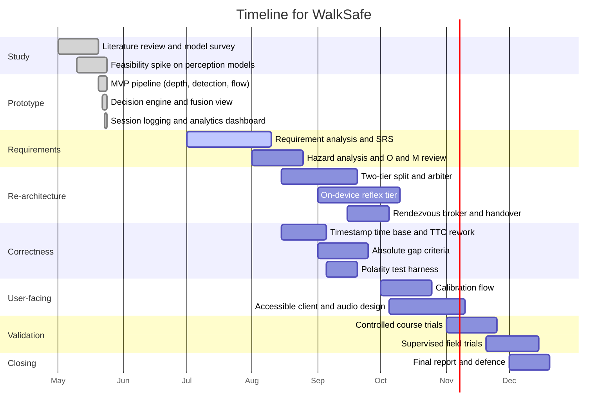

Dates for the validation phases are contingent on institutional ethics approval and on the availability of an orientation-and-mobility professional and blind participants. These are dependencies on people rather than on software, and are historically the most common cause of schedule slippage in projects of this kind.

## 1.4 Purpose of Document

The purposes of this document are as follows:

- Identify and analyse the complete requirements for WalkSafe as a production system intended for public use.
- Establish the boundary of the system explicitly, including a clear statement of what it will not attempt.
- Model the system's behaviour through scenario-based, data-based, and class-based models.
- Design the architectural framework, identify the archetypes it rests on, and instantiate the architecture at component level.
- Specify a latency budget and a degradation ladder, since for this system timing and failure behaviour are correctness properties rather than performance concerns.
- Identify the hazards the system can contribute to, and trace each to the requirements that mitigate it.
- Develop a preliminary test plan and validation programme sufficient to judge release readiness.
- Establish a shared understanding among supervisor, developer, accessibility reviewer, and orientation-and-mobility consultant.
- Reduce development effort and rework by resolving design questions before implementation.

---

# 2. Project Description

This chapter describes the background against which WalkSafe was conceived, applies Quality Function Deployment to categorise its requirements, and presents the scenarios in which the system will be used.

## 2.1 Background

The project began with a review of the assistive-navigation literature and of the tools blind travellers actually use. Three observations shaped the design.

**First, the perception problem is largely solved; the delivery problem is not.** A considerable body of work demonstrates obstacle detection and depth estimation for the visually impaired. Comparatively little addresses what should be said, when, and what happens when the system is unsure. Reports of systems that describe the scene continuously are common, and continuous narration is close to unusable while walking: it masks ambient sound the traveller depends on, and it trains the user to tune the channel out. WalkSafe therefore treats guidance delivery — silence when nothing has changed, preemption for urgency, hysteresis against oscillation — as a first-class design concern rather than a presentation detail.

**Second, latency is a correctness property.** A guidance system that reports what was true one second ago is not a slower version of a correct system; it is describing a scene that no longer exists. At 1.4 m/s the user has travelled 1.4 m. This reframes the architecture question. Rather than asking how fast the pipeline can be made, the design asks which decisions tolerate which delay, and places each where it can be met.

**Third, monocular depth has a specific and dangerous failure profile.** It is good at large textured surfaces, unreliable at thin structures, and effectively blind to glass and to negative discontinuities such as a step down. These are not uniformly distributed errors that a confidence threshold smooths over; they are systematic blind spots. The honest response is to declare them, to keep the cane in the loop, and to build the system so that low confidence produces caution rather than confident nonsense.

An initial prototype was built to test feasibility, integrating DepthPro, YOLOv8 with ByteTrack, and RAFT-Small behind a browser-based interface, with SQLite logging and an analytics dashboard. It confirmed that the models compose and that rule-based decisions over their outputs are sensible. It also exposed the three problems above concretely, and surfaced several specific defects — an assumed rather than measured frame rate corrupting all time-derived quantities, a relative gap threshold that made "no traversable corridor" logically unreachable, and frame-driven rather than event-driven speech. Each of those has become a requirement in this document.

WalkSafe is intended for public use, which introduces constraints the prototype never faced: the interface must be operable by a blind user without sighted help, the compute backend must be reachable without the user handling addresses, imagery of non-consenting bystanders must be handled responsibly, and every failure must announce itself.

## 2.2 Quality Function Deployment

Quality Function Deployment is a technique that translates customer needs into technical requirements, categorising them by the value they deliver. Requirements are grouped into three classes: *normal* requirements, which the customer states explicitly and whose presence produces satisfaction; *expected* requirements, which are so fundamental that the customer does not think to state them but whose absence produces immediate dissatisfaction; and *exciting* requirements, which go beyond expectation and produce delight when present.

For WalkSafe, the categorisation carries an unusual weight. Several requirements that would ordinarily be *exciting* extras — announcing one's own failure, detecting stale data — are *expected* here, because a mobility aid that omits them is not a lesser product but an unsafe one. Requirements marked **`SC`** are safety-critical: their failure can plausibly contribute to physical harm. Each traces to a hazard in Appendix A.

### 2.2.1 Normal Requirements

These are the capabilities a user or supervisor would name when asked what WalkSafe should do.

*Table 1: Normal Requirements*

| ID | Requirement | SC |
|---|---|:--:|
| NR-1 | **Live obstacle and agent perception.** The system must capture the scene ahead continuously and identify obstacles and moving agents such as people, cyclists, and vehicles. | SC |
| NR-2 | **Distance estimation.** The system must estimate the distance in metres to each detected obstacle and agent, using the region where the object meets the ground rather than the bounding box as a whole. | SC |
| NR-3 | **Motion classification.** The system must classify each tracked agent's motion — approaching, receding, crossing left or right, moving in parallel, starting, stopping, or erratic. | SC |
| NR-4 | **Time-to-collision estimation.** The system must estimate, for each approaching agent, the time remaining before it reaches the user, and must assign a risk level from *critical*, *high*, *moderate*, or *low*. | SC |
| NR-5 | **Traversable corridor detection.** The system must identify openings ahead through which the user can walk, and report each opening's direction, traversable width in metres, and distance. | SC |
| NR-6 | **Own-motion awareness.** The system must determine what the user themselves is doing — standing still, walking at graded speeds, stepping sideways, or turning — and estimate their forward speed. | |
| NR-7 | **Single navigation command.** The system must produce exactly one command per decision cycle from the nine-value vocabulary in Appendix D, chosen by deterministic rules evaluated in a documented priority order that places hazard avoidance strictly before route optimisation. | SC |
| NR-8 | **Spoken guidance.** The system must speak the selected command through the device's speech synthesiser, with a short context phrase at higher verbosity levels. | SC |
| NR-9 | **On-device imminent-stop.** The system must detect an imminent obstacle on the device itself, without network involvement, and must issue a stop that no remote guidance can override. | SC |
| NR-10 | **Non-visual operation.** Every function needed to start, run, calibrate, and end a session must be operable without sight, through platform screen readers or voice control, with the screen off. | SC |
| NR-11 | **Guided calibration.** The system must provide a spoken, self-guided calibration covering camera field of view, mounting height and pitch, the user's shoulder width and clearance preference, a depth-scale sanity check, and a left/right polarity self-test. | SC |
| NR-12 | **Session logging.** The system must record every decision with its inputs, timings, and reasoning as derived metrics, retaining no imagery. | |
| NR-13 | **Analytics interface.** The system must provide an interface presenting per-session and aggregate statistics — command distribution, risk distribution, decision-age distribution, degradation time — for researchers and orientation-and-mobility instructors. | |
| NR-14 | **Session control.** The user must be able to start and end a session by a single non-visual action, resetting all tracking and motion state. | |
| NR-15 | **Diagnostic view.** The system must provide a visual diagnostic display fusing camera, depth, flow, and detection with an annotated advisory strip, disabled by default, for instructor and developer use. | |

### 2.2.2 Expected Requirements

These are requirements the user would not think to state, because their absence would not read as a missing feature but as the product being broken or unsafe.

*Table 2: Expected Requirements*

| ID | Requirement | SC |
|---|---|:--:|
| ER-1 | **Guidance arrives in time to act on.** Imminent-stop guidance must reach the user's ear within 250 ms of the frame that triggered it; routing guidance within 1200 ms. Guidance older than 2000 ms must be discarded rather than spoken late. | SC |
| ER-2 | **No guidance from a stale scene.** Every command must carry the capture timestamp of the frame that produced it, and must be discarded if its tier's staleness budget has elapsed. | SC |
| ER-3 | **Time is measured, not assumed.** All speed, approach-speed, and time-to-collision computation must derive its time base from measured frame timestamps. Assuming a nominal frame rate is prohibited: a system running at 1.5 FPS while assuming 30 FPS overstates approach speed roughly twentyfold and collapses every time-to-collision estimate, flooding the user with false alarms while appearing internally consistent. | SC |
| ER-4 | **Failure is audible.** The system must never fail silently. Every degradation, fault, disconnection, or withdrawal of guidance must be announced in plain spoken language with its cause, and reduced capability must be re-announced at least once a minute so silence is never mistaken for safety. | SC |
| ER-5 | **Degradation is always toward caution.** Every failure mode must resolve to a state at least as conservative as the one before it. No failure may produce more permissive guidance. Under reduced confidence, output must be restricted to the conservative subset of the command vocabulary. | SC |
| ER-6 | **The system is quiet when nothing changes.** Guidance must be delivered on change of state, not once per frame. Unchanged commands must be suppressed, and utterance rate must not exceed fifteen per minute at default verbosity. | SC |
| ER-7 | **Urgency preempts.** A stop must interrupt any utterance in progress immediately, preceded by a distinct earcon that begins before the speech, and must not be silenced by another application taking audio focus. | SC |
| ER-8 | **Left and right are never reversed.** The sign conventions relating optical flow, the user's lateral motion, gap direction, and the spoken command must be documented and verified by automated test on reference sequences of known direction, and by a per-device self-test during calibration. Correctness must be total; no tolerance is permitted. | SC |
| ER-9 | **Hearing is never occluded.** The system must never require audio hardware that blocks the ear canal, since ambient sound is itself a primary navigation input for a blind traveller. Bone-conduction output must be supported and recommended. | SC |
| ER-10 | **Guidance does not oscillate.** Lateral commands must be damped by hysteresis so the system cannot alternate between *step left* and *step right* faster than once every two seconds, and corridor identity must persist across frames. | SC |
| ER-11 | **Camera state is monitored.** The system must detect lens occlusion, mount displacement, and incorrect pitch, and must locate the walkable region using measured device attitude rather than a fixed assumption about the image. | SC |
| ER-12 | **Metric estimates use the actual device.** Field of view, mounting height, and depth scale must come from calibration. Hardcoded nominal values must not be used in any computation that yields a distance or width in metres. | SC |
| ER-13 | **Uncertainty is carried, not discarded.** Depth reliability and approach-speed variance must propagate into time-to-collision as an interval, and risk assignment must use the conservative bound. Undefined quantities must remain undefined rather than being replaced by a sentinel number. | SC |
| ER-14 | **The backend is invisible to the user.** The system must obtain the address of its inference backend automatically and must never require the user to read, transcribe, or enter a URL, code, or identifier. | SC |
| ER-15 | **Backend loss does not end the journey.** Loss of the remote tier must degrade the session to on-device operation with an announcement, not terminate it, and the session must recover automatically when a backend becomes available. | SC |
| ER-16 | **Resource exhaustion is anticipated.** The system must warn of low battery with enough margin to complete or abandon a journey safely, and must manage thermal load by stepped degradation rather than being killed by the platform without warning. | SC |
| ER-17 | **Logging never delays guidance.** Persistence must be asynchronous with a bounded queue that sheds the oldest non-critical records under pressure and records that it did so. Safety-relevant events must never be shed. | SC |
| ER-18 | **No imagery is retained.** Camera frames must not be written to disk or logs at any point, on the device or on the server. Only derived metrics may persist. Server-side buffers must be released immediately after inference. | |
| ER-19 | **Consent is informed and revocable.** Before first use the system must obtain spoken, acknowledged consent stating that imagery is transmitted to a remote server for processing, and must offer an on-device-only mode for users who decline. | |
| ER-20 | **Limits are stated, not implied.** Onboarding must state explicitly that WalkSafe supplements and does not replace a cane or guide dog, require positive acknowledgement, and re-present the limitations statement whenever models or thresholds change. | SC |
| ER-21 | **Precision is honest.** The system must not present distances, times, or confidence values with more precision than the underlying estimate supports. | SC |
| ER-22 | **Sessions are always closed.** Every session must be finalised with an end time and summary counts on all termination paths, including crash, battery death, and backend loss. | |

### 2.2.3 Exciting Requirements

These go beyond what the user would expect and constitute the project's distinguishing contributions.

*Table 3: Exciting Requirements*

| ID | Requirement | SC |
|---|---|:--:|
| XR-1 | **Two-tier guidance with veto.** A fast on-device reflex tier and a rich remote advisory tier operate concurrently, with the reflex tier holding unconditional veto authority. This resolves what would otherwise be an unsatisfiable single-tier latency requirement, and guarantees structurally that the fast path can only ever make the system more cautious. | SC |
| XR-2 | **Guidance from free-tier GPU compute.** The advisory tier runs on free notebook GPU allocations. A rendezvous broker absorbs the resulting churn — changing addresses, session ceilings, quota limits, sudden disappearance — with warm standby workers and pre-emptive handover, so that ephemeral compute becomes invisible to the user. | |
| XR-3 | **Navigation by earcon alone.** Each command carries a distinct non-speech earcon, rehearsed during onboarding, allowing an experienced user to disable speech entirely and navigate by tone — far faster than speech and far less intrusive on ambient hearing. | |
| XR-4 | **Explain-the-last-decision.** On request, the system explains why it issued its most recent command, in plain language, reconstructed from the reasoning record. This makes the system inspectable by the person relying on it. | |
| XR-5 | **Offline replay and rule evaluation.** Recorded sessions can be replayed deterministically through the decision engine, so a proposed rule change can be evaluated against real historical scenes before it reaches a user. | |
| XR-6 | **Practice mode.** The user can rehearse the command vocabulary and earcons against recorded scenarios while seated, learning the system without exposure to traffic. | |
| XR-7 | **Personal profiles.** Named profiles capture verbosity, risk tolerance, and clearance preferences per context, so a familiar commute and an unfamiliar area can be treated differently. | |
| XR-8 | **Haptic urgency channel.** Urgent commands are reinforced by a distinct vibration pattern, preserving usability in high ambient noise where speech would be lost. | SC |
| XR-9 | **Research-grade decision corpus.** The logging schema is sufficient to reconstruct any decision without imagery, and therefore to train a learned guidance policy on real field data later — a dataset that does not currently exist publicly. | |
| XR-10 | **Decision-age telemetry as a first-class metric.** The analytics interface reports the distribution of guidance latency against budget as its primary safety indicator, making the system's timing behaviour continuously visible rather than assumed. | SC |

## 2.3 Usage Scenario

WalkSafe is used as a wearable assistant during ordinary pedestrian travel. The following scenarios describe its operation.

### A. First-Time Setup and Calibration

A newly blind user installs WalkSafe and launches it with VoiceOver active. The application narrates its own onboarding without requiring any sighted assistance. It explains what WalkSafe does and, equally, what it cannot do — it will not find kerbs or stairs, it will not read signs, it will not tell them when to cross a road, and it does not replace their cane. The user must acknowledge this explicitly before continuing.

The application then explains that camera imagery is sent to a remote server for processing, and requests consent, offering an on-device-only mode for a user who prefers not to transmit.

Calibration follows. The user is guided to mount the phone at chest height, and the application confirms the camera's orientation from the device's motion sensors. It reads the camera's field of view from the platform. It asks the user to stand a stated distance from a wall and verifies its depth estimate against that reference, refusing to proceed if the scale is grossly wrong. It asks the user's shoulder width and preferred clearance margin, so that "wide enough to walk through" means something specific to this person. Finally it runs a polarity self-test: it asks the user to step to their left, and confirms that the system observed a step to the left. That test exists because a reversed sign convention would send this user into traffic, and it is the one error that is invisible to inspection.

Last, the user rehearses the nine commands and their earcons until they can identify each reliably.

### B. Starting a Journey

The user attaches the phone to their chest mount, presses and holds a hardware button, and hears "WalkSafe active, full guidance." The screen turns itself off. They set out with their cane in the usual way.

Behind that single announcement, the client has confirmed the on-device reflex model is loaded, queried the rendezvous broker for a live GPU worker, opened a connection to it, and verified that round-trip guidance latency is within budget. None of this is exposed to the user; had any of it failed, the announcement would have named the reduced capability instead.

### C. Walking with Full Guidance

The user walks along a footpath. WalkSafe is silent, because nothing requires their attention — this silence is the system working correctly, not idling.

A cyclist approaches from the front-left. The remote tier detects and tracks them, estimates their distance closing at speed, computes a time-to-collision inside the yield window, and finds their projected path crossing the user's. A soft two-tone earcon sounds, followed by "yield, cyclist crossing, two seconds." The user stops. The cyclist passes. A moment later: "walk forward."

Further on, the footpath narrows between a parked car and a wall. The system finds a single corridor slightly right of centre, measures it at 0.7 m — wider than the user's calibrated shoulder width plus margin, but not comfortably so — and says "step right, tight corridor." The user adjusts.

A pedestrian then stops abruptly directly ahead, two metres away. The remote tier is still processing the previous frame, but the on-device reflex tier has seen the region ahead expand rapidly. It issues an urgent earcon and "stop" within a quarter of a second, together with a sharp vibration. The user halts. The remote tier's own assessment, arriving four hundred milliseconds later, cannot countermand it.

### D. Degraded Operation

The user walks into an area with poor mobile coverage. The connection to the GPU worker drops. Within five seconds WalkSafe announces: "Routing guidance unavailable. Obstacle warnings only." It continues to warn about imminent obstacles from the device alone, and repeats the reduced-capability announcement every minute so the user is never lulled by silence into assuming full coverage. When coverage returns, the client re-queries the broker, reconnects, and announces "full guidance restored."

Later the sun drops low and shines directly into the lens. Frame usability collapses. The system announces "reduced visibility, cautious guidance only" and restricts itself to stop, yield, slow down, and cautious forward movement — it will no longer suggest which way to veer, because it cannot see well enough to be trusted with that.

Approaching home, the phone reports fifteen minutes of battery remaining. WalkSafe announces the reserve so the user can decide whether to continue or complete the journey on the cane alone.

### E. Ending and Reviewing a Session

The user holds the hardware button; WalkSafe announces "session ended" and finalises the log. No imagery was ever stored — only what it measured and what it decided.

The next week, an orientation-and-mobility instructor reviews the sessions with the user. The analytics interface shows which commands were issued and how often, how the recorded latency compared with budget, how much time was spent in degraded operation and why, and where risk assessments clustered. Selecting any stop reveals the reasoning behind it. The instructor notices the system issued a stop on a familiar corner where nothing was actually in the way, inspects the record, and finds it consistently misjudging a low wall. That observation goes back to the developers as a threshold adjustment, and is re-evaluated offline against the recorded session before any change reaches a user.

---

# 3. Scenario-Based Modeling

Scenario-based modeling represents system behaviour as it responds to requests from its stakeholders, under the range of conditions it will actually meet. For WalkSafe the scenarios cover not only the nominal walking case but the degraded ones, since a mobility aid's behaviour when it is impaired is as much a part of its specification as its behaviour when healthy.

## 3.1 Use Case Diagram

A use case describes system behaviour under various conditions as the system responds to a request from one of its stakeholders. A use case diagram visualises the system from the end user's perspective, showing the actors who take part and the goals they pursue, in a form that remains understandable to non-technical readers.

Four actors participate in WalkSafe:

- **Pedestrian** — the blind or low-vision traveller; the primary actor and beneficiary.
- **O&M Instructor** — an orientation-and-mobility professional using the system as a training adjunct and reviewing sessions with a client.
- **Researcher** — operates the system to collect data, evaluate decision quality, and tune thresholds.
- **GPU Worker** — a secondary, non-human actor: the remote inference service that registers itself, serves scene analysis, and may disappear.

### Level 0: WalkSafe

**Name:** WalkSafe
**Primary Actor:** Pedestrian
**Goal in Context:** To provide a blind or low-vision pedestrian with timely spoken guidance about obstacles and traversable openings in the one-to-eight-metre band ahead of them while they walk.

*Figure 2: Use Case Diagram Level 0*

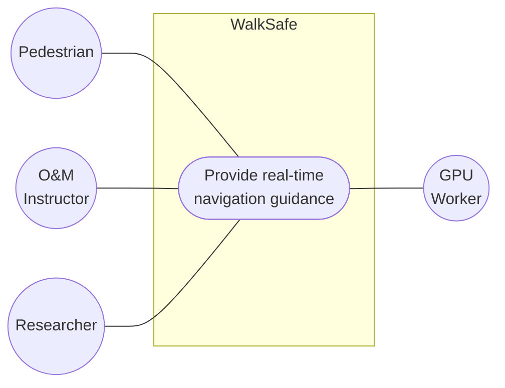

### Level 1: WalkSafe (Detailed)

**Name:** WalkSafe (Detailed)
**Primary Actor:** Pedestrian
**Goal in Context:** The diagram shows the four modules of WalkSafe:

- Receiving navigation guidance while walking
- Managing the session and its compute backend
- Calibrating the system and personalising its behaviour
- Reviewing recorded sessions and analysing system behaviour

*Figure 3: Use Case Diagram Level 1*

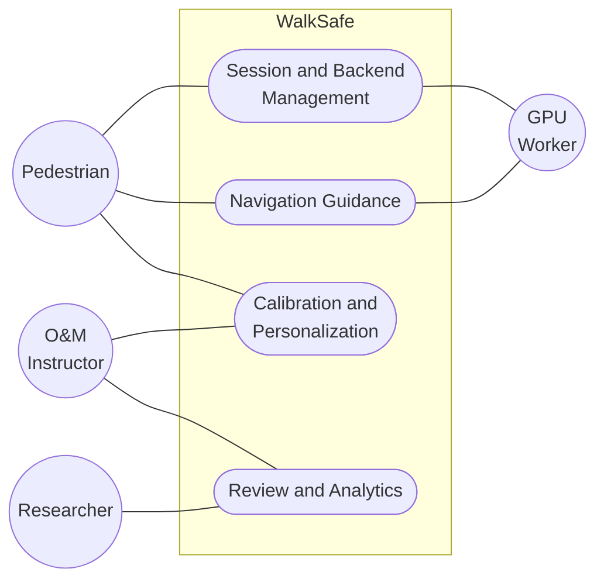

### Level 1.1 — Navigation Guidance

**Name:** Navigation Guidance
**Primary Actor:** Pedestrian
**Goal in Context:** The diagram shows the sub-modules of the navigation guidance module:

- Capturing the scene ahead with usable image quality
- Perceiving depth, agents, and the user's own motion
- Interpreting agent risk and locating traversable corridors
- Deciding a single navigation command
- Arbitrating between the reflex and advisory tiers
- Delivering guidance as earcon, speech, and haptic output
- Requesting an explanation of the most recent decision

*Figure 4: Use Case Diagram Level 1.1 — Navigation Guidance*

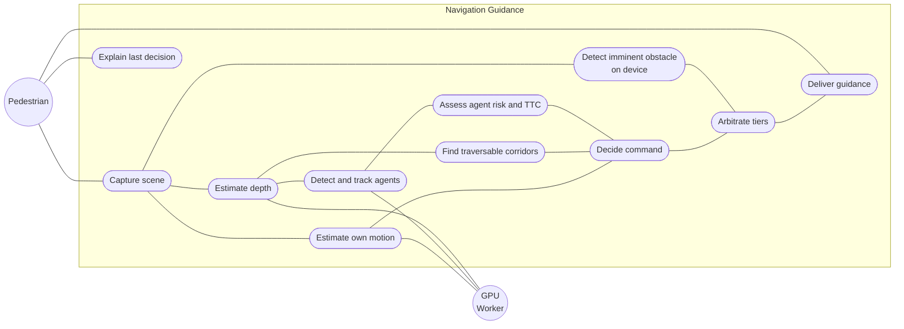

### Level 1.2 — Session and Backend Management

**Name:** Session and Backend Management
**Primary Actor:** Pedestrian
**Goal in Context:** The diagram shows the sub-modules of the session and backend management module:

- Starting and ending a session by a single non-visual action
- Discovering a live compute backend without user involvement
- Registering and heartbeating workers, and tracking their quota
- Handing over to a standby worker before a session ceiling is reached
- Detecting degradation and announcing it audibly
- Monitoring battery and thermal state

*Figure 5: Use Case Diagram Level 1.2 — Session and Backend Management*

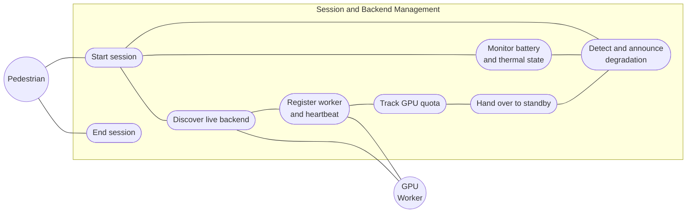

### Level 1.3 — Calibration and Personalization

**Name:** Calibration and Personalization
**Primary Actor:** Pedestrian
**Goal in Context:** The diagram shows the sub-modules of the calibration and personalisation module:

- Completing spoken onboarding and acknowledging system limits
- Granting or declining consent for remote processing
- Determining camera field of view and mounting geometry
- Verifying depth scale against a known reference
- Recording shoulder width and clearance preference
- Running the left/right polarity self-test
- Adjusting verbosity, speech rate, earcon set, and risk tolerance
- Rehearsing the command vocabulary in practice mode

*Figure 6: Use Case Diagram Level 1.3 — Calibration and Personalization*

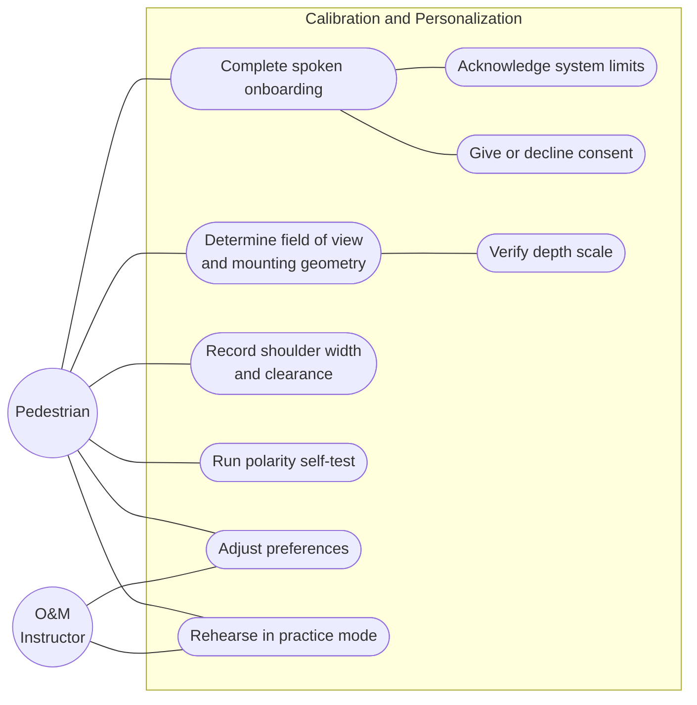

### Level 1.4 — Review and Analytics

**Name:** Review and Analytics
**Primary Actor:** Researcher
**Goal in Context:** The diagram shows the sub-modules of the review and analytics module:

- Browsing recorded sessions
- Viewing command, risk, and action distributions
- Viewing decision-age distributions against budget
- Viewing time spent in each degradation level and its causes
- Drilling into any single decision's reasoning record
- Replaying a session offline through a modified decision engine
- Exporting or permanently deleting session data

*Figure 7: Use Case Diagram Level 1.4 — Review and Analytics*

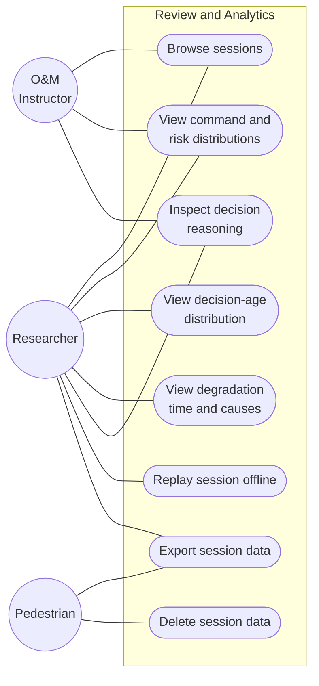

---

# 4. Data-Based Modeling

Data-based modeling is a visual representation of a database structure showing how data is organised within the system. It involves creating an entity-relationship diagram depicting entities, their attributes, and the relationships between them. The process begins by analysing the system's data requirements, identifying entities and attributes, and designing the ERD as a blueprint for implementation.

Two properties distinguish WalkSafe's data model from a conventional application's.

First, **no imagery is stored anywhere.** The entities below record what the system measured and what it decided, never what it saw. This is the structural mitigation for the bystander-privacy hazard: there is no store of public-space video to leak, because none is created.

Second, **time is recorded twice.** Every decision carries both the capture timestamp of the frame that produced it and the timestamp at which guidance was delivered. Their difference is decision age, the system's primary safety indicator, and it must be recoverable from the log rather than merely monitored at runtime.

After analysing the data requirements of WalkSafe, the following entities have been identified:

- **User** — the pedestrian, their preferences, and their consent record
- **CalibrationProfile** — per user and per device geometry and verification results
- **Session** — one journey
- **Decision** — one guidance cycle
- **AgentObservation** — one tracked agent within one cycle
- **GapObservation** — one traversable corridor within one cycle
- **EgoObservation** — the user's own motion within one cycle
- **Event** — a notable occurrence such as a degradation transition or fault

*Figure 8: ER Diagram of WalkSafe*

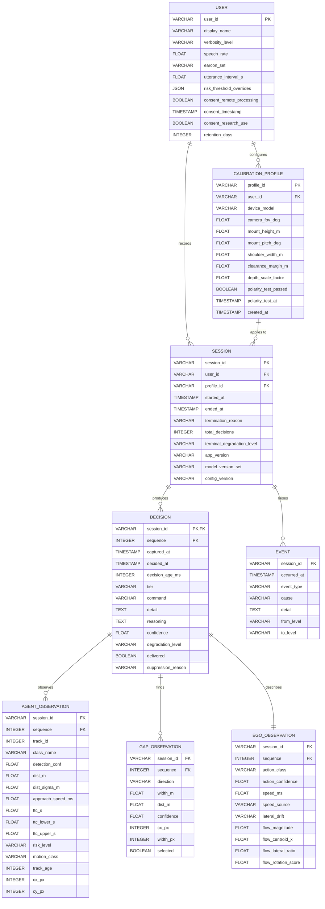

The schemas derived from the ER diagram are as follows.

*Table 4: Schemas of WalkSafe*

| Schema | Attribute | Type | Note |
|---|---|---|---|
| **User** | user_id | VARCHAR(64) | PK |
| | display_name | VARCHAR(255) | |
| | verbosity_level | VARCHAR(16) | terse / normal / learning |
| | speech_rate | FLOAT | multiple of platform nominal |
| | earcon_set | VARCHAR(32) | |
| | utterance_interval_s | FLOAT | minimum gap between non-urgent utterances |
| | risk_threshold_overrides | JSON | per-user tuning |
| | consent_remote_processing | BOOLEAN | |
| | consent_timestamp | TIMESTAMP | |
| | consent_research_use | BOOLEAN | separate, revocable |
| | retention_days | INTEGER | 0 = keep until deleted |
| **CalibrationProfile** | profile_id | VARCHAR(64) | PK |
| | user_id | VARCHAR(64) | FK → User |
| | device_model | VARCHAR(128) | |
| | camera_fov_deg | FLOAT | measured, never assumed |
| | mount_height_m | FLOAT | |
| | mount_pitch_deg | FLOAT | nominal attitude envelope |
| | shoulder_width_m | FLOAT | basis for gap traversability |
| | clearance_margin_m | FLOAT | user comfort preference |
| | depth_scale_factor | FLOAT | from reference-distance check |
| | polarity_test_passed | BOOLEAN | blocks use if false |
| | polarity_test_at | TIMESTAMP | |
| | created_at | TIMESTAMP | |
| **Session** | session_id | VARCHAR(64) | PK |
| | user_id | VARCHAR(64) | FK → User |
| | profile_id | VARCHAR(64) | FK → CalibrationProfile |
| | started_at | TIMESTAMP | |
| | ended_at | TIMESTAMP | set on all termination paths |
| | termination_reason | VARCHAR(32) | user / battery / thermal / fault |
| | total_decisions | INTEGER | |
| | terminal_degradation_level | VARCHAR(8) | L0 … L4 |
| | app_version | VARCHAR(32) | |
| | model_version_set | VARCHAR(255) | pinned model identities |
| | config_version | VARCHAR(32) | threshold set in force |
| **Decision** | session_id | VARCHAR(64) | PK, FK → Session |
| | sequence | INTEGER | PK |
| | captured_at | TIMESTAMP | frame capture time |
| | decided_at | TIMESTAMP | guidance delivery time |
| | decision_age_ms | INTEGER | primary safety indicator |
| | tier | VARCHAR(8) | reflex / advisory |
| | command | VARCHAR(24) | one of nine |
| | detail | TEXT | spoken context phrase |
| | reasoning | TEXT | triggering rule and values |
| | confidence | FLOAT | |
| | degradation_level | VARCHAR(8) | L0 … L4 |
| | delivered | BOOLEAN | false if suppressed |
| | suppression_reason | VARCHAR(32) | unchanged / stale / debounced |
| **AgentObservation** | session_id | VARCHAR(64) | FK |
| | sequence | INTEGER | FK |
| | track_id | INTEGER | stable across frames |
| | class_name | VARCHAR(32) | |
| | detection_conf | FLOAT | |
| | dist_m | FLOAT | from ground-contact region |
| | dist_sigma_m | FLOAT | reliability measure |
| | approach_speed_ms | FLOAT | from measured timestamps |
| | ttc_s | FLOAT | NULL when undefined |
| | ttc_lower_s | FLOAT | conservative bound |
| | ttc_upper_s | FLOAT | |
| | risk_level | VARCHAR(16) | critical / high / moderate / low |
| | motion_class | VARCHAR(24) | see Appendix D |
| | track_age | INTEGER | frames observed |
| | cx_px, cy_px | INTEGER | image-plane position |
| **GapObservation** | session_id | VARCHAR(64) | FK |
| | sequence | INTEGER | FK |
| | direction | VARCHAR(8) | left / ahead / right |
| | width_m | FLOAT | from calibrated FOV |
| | dist_m | FLOAT | |
| | confidence | FLOAT | |
| | cx_px, width_px | INTEGER | |
| | selected | BOOLEAN | chosen by decision engine |
| **EgoObservation** | session_id | VARCHAR(64) | FK |
| | sequence | INTEGER | FK |
| | action_class | VARCHAR(24) | see Appendix D |
| | action_confidence | FLOAT | calibrated, not nominal |
| | speed_ms | FLOAT | |
| | speed_source | VARCHAR(8) | imu / flow |
| | lateral_drift | VARCHAR(16) | |
| | flow_magnitude | FLOAT | |
| | flow_centroid_x | FLOAT | |
| | flow_lateral_ratio | FLOAT | |
| | flow_rotation_score | FLOAT | |
| **Event** | session_id | VARCHAR(64) | FK |
| | occurred_at | TIMESTAMP | |
| | event_type | VARCHAR(32) | degradation / mount / thermal / battery / mute / fault |
| | cause | VARCHAR(64) | |
| | detail | TEXT | |
| | from_level, to_level | VARCHAR(8) | for degradation transitions |

---

# 5. Class-Based Modeling

This chapter describes the class-based modeling of WalkSafe. Class-based modeling is a visual representation illustrating the structure of a software system through its classes, their attributes, responsibilities, and collaborations. It is the standard vehicle for object-oriented analysis and design.

## 5.1 Analysis Classes

After identifying candidate entities from the usage scenarios, I filtered them using General Classification — external entities, things, occurrences, roles, organisational units, places, and structures — and applied the standard selection criteria: retained information, needed services, multiple attributes, common attributes, common operations, and essential requirements.

Candidates such as *Earcon*, *Frame*, and *Command* were rejected as classes: they carry no behaviour and no retained state beyond a value, and are better modelled as attributes or value types. *Cane* was rejected as outside the system boundary despite being central to the concept of operation.

The identified classes for WalkSafe are:

- **FrameAcquirer** — captures frames with timestamps and attitude, and judges their usability
- **ReflexPerceiver** — the on-device Tier 0 imminent-obstacle detector
- **DepthEstimator** — dense metric depth from a single frame
- **AgentTracker** — detects and tracks agents with stable identity
- **FlowEstimator** — dense optical flow between consecutive frames
- **AgentInterpreter** — derives distance, approach speed, time-to-collision, and risk per agent
- **EgoMotionInterpreter** — derives the user's own action, speed, and drift
- **GapFinder** — locates and measures traversable corridors
- **DecisionEngine** — reduces the interpreted scene to one command by deterministic rules
- **GuidanceArbiter** — enforces tier precedence, staleness, and confidence gating
- **GuidancePresenter** — delivers earcon, speech, and haptic output with debounce and preemption
- **SessionManager** — owns the session lifecycle and the degradation ladder
- **BackendRegistry** — the rendezvous broker: worker registry, heartbeat, quota, handover
- **CalibrationProfile** — per user and device geometry, scale, and polarity verification
- **SessionLogger** — asynchronous, bounded, shedding persistence of derived metrics
- **AnalyticsReporter** — queries and summarises recorded sessions

## 5.2 Class Cards

*Table 5: CRC Card of FrameAcquirer*

| **FrameAcquirer** | |
|---|---|
| **Attributes** | **Methods** |
| Camera handle<br/>Target resolution<br/>Capture timestamp<br/>IMU attitude sample<br/>Usability score<br/>Occlusion state<br/>Mount envelope | +StartCapture()<br/>+StopCapture()<br/>+AcquireFrame()<br/>+ScoreUsability()<br/>+DetectOcclusion()<br/>+CheckMountAttitude()<br/>+LocateWalkableRegion() |
| **Responsibility** | **Collaborators** |
| Capture frames continuously with a monotonic timestamp and concurrent IMU sample.<br/>Resize frames to the geometry the active models require.<br/>Score each frame for exposure, motion blur, and texture density.<br/>Reject unusable frames and report persistent rejection.<br/>Detect lens occlusion and mount displacement.<br/>Locate the walkable region from measured attitude rather than a fixed image fraction. | ReflexPerceiver<br/>DepthEstimator<br/>FlowEstimator<br/>CalibrationProfile<br/>SessionManager |

*Table 6: CRC Card of ReflexPerceiver*

| **ReflexPerceiver** | |
|---|---|
| **Attributes** | **Methods** |
| Quantized depth model<br/>Platform depth source<br/>Proximity envelope<br/>Looming threshold<br/>Frame rate<br/>Last assertion timestamp | +LoadModel()<br/>+EstimateProximity()<br/>+ComputeLooming()<br/>+AssertImminentObstacle()<br/>+ReportHealth()<br/>+CurrentFrameRate() |
| **Responsibility** | **Collaborators** |
| Answer the single question "is something about to be hit", at ten frames a second or better, entirely on the device.<br/>Prefer the platform depth API where available; fall back to a quantized model or flow-based looming.<br/>Assert an imminent-obstacle stop that no remote guidance may override.<br/>Report its own frame rate and health so the session can degrade when it cannot keep up.<br/>Classify nothing — identity is irrelevant to a stop and omitting it is what buys the latency. | FrameAcquirer<br/>GuidanceArbiter<br/>SessionManager |

*Table 7: CRC Card of DepthEstimator*

| **DepthEstimator** | |
|---|---|
| **Attributes** | **Methods** |
| Depth model handle<br/>Model version and checksum<br/>Depth array<br/>Reliability measure<br/>Last estimate timestamp<br/>Reuse interval<br/>Depth scale factor | +LoadModel()<br/>+Estimate()<br/>+ReliabilityOf()<br/>+ValidatePlausibility()<br/>+ApplyScaleFactor()<br/>+IsStale() |
| **Responsibility** | **Collaborators** |
| Produce a dense metric depth map for a frame.<br/>Attach a per-estimate reliability measure and propagate it downstream.<br/>Permit amortisation across frames but refuse to serve a map older than the staleness bound.<br/>Validate output for physical plausibility and report implausible results.<br/>Apply the calibrated depth scale factor. | FrameAcquirer<br/>AgentInterpreter<br/>GapFinder<br/>CalibrationProfile |

*Table 8: CRC Card of AgentTracker*

| **AgentTracker** | |
|---|---|
| **Attributes** | **Methods** |
| Detection model handle<br/>Confidence threshold<br/>Tracker state<br/>Active track identities<br/>Trajectory history per track<br/>History window | +LoadModel()<br/>+Detect()<br/>+Track()<br/>+HistoryOf(trackId)<br/>+PruneStaleTracks()<br/>+ResetTracking() |
| **Responsibility** | **Collaborators** |
| Detect agents — people, cyclists, vehicles, animals — above a confidence threshold.<br/>Maintain stable identity across frames and a bounded trajectory history per identity.<br/>Retire tracks that have left the scene.<br/>Reset all tracking state when a session ends. | FrameAcquirer<br/>AgentInterpreter<br/>SessionManager |

*Table 9: CRC Card of FlowEstimator*

| **FlowEstimator** | |
|---|---|
| **Attributes** | **Methods** |
| Flow model handle<br/>Previous frame<br/>Flow field<br/>Background row fraction<br/>Sign convention | +LoadModel()<br/>+Compute()<br/>+ExtractSignals()<br/>+BackgroundMagnitude()<br/>+CentroidX()<br/>+LateralRatio()<br/>+RotationScore() |
| **Responsibility** | **Collaborators** |
| Estimate dense optical flow between consecutive frames.<br/>Reduce the flow field to the scalar signals ego-motion interpretation needs.<br/>Hold and document the sign convention relating flow direction to physical motion, so that it is inspectable and testable rather than implicit. | FrameAcquirer<br/>EgoMotionInterpreter |

*Table 10: CRC Card of AgentInterpreter*

| **AgentInterpreter** | |
|---|---|
| **Attributes** | **Methods** |
| Time base source<br/>TTC thresholds<br/>Close-distance threshold<br/>Uncertainty margins<br/>Motion taxonomy | +EstimateDistance()<br/>+ClassifyMotion()<br/>+ApproachSpeed()<br/>+TimeToCollision()<br/>+TTCInterval()<br/>+AssignRisk() |
| **Responsibility** | **Collaborators** |
| Estimate each agent's distance from the depth distribution near its ground-contact region.<br/>Classify motion into the taxonomy in Appendix D using measured timestamp deltas, never an assumed frame rate.<br/>Estimate approach speed with outlier rejection, and derive time-to-collision as an interval carrying depth and speed uncertainty.<br/>Leave time-to-collision undefined rather than substituting a sentinel value.<br/>Assign a risk level using the conservative bound of the interval. | DepthEstimator<br/>AgentTracker<br/>DecisionEngine<br/>SessionLogger |

*Table 11: CRC Card of EgoMotionInterpreter*

| **EgoMotionInterpreter** | |
|---|---|
| **Attributes** | **Methods** |
| Action taxonomy<br/>Flow magnitude thresholds<br/>Lateral and rotation thresholds<br/>Speed history<br/>IMU speed estimate<br/>Preferred speed source | +DeriveAction()<br/>+EstimateSpeed()<br/>+SpeedTrend()<br/>+LateralDrift()<br/>+PreferImuSpeed()<br/>+VerifyPolarity() |
| **Responsibility** | **Collaborators** |
| Classify what the user themselves is doing — still, stopping, walking at graded speeds, stepping sideways, turning.<br/>Estimate forward speed, preferring the IMU where reliable and falling back to flow.<br/>Report lateral drift relative to heading.<br/>Expose a polarity verification entry point so the calibration self-test can confirm sign correctness end to end on the user's own device. | FlowEstimator<br/>CalibrationProfile<br/>DecisionEngine<br/>SessionLogger |

*Table 12: CRC Card of GapFinder*

| **GapFinder** | |
|---|---|
| **Attributes** | **Methods** |
| Walkable region geometry<br/>Clearance criterion (metres)<br/>Minimum traversable width<br/>Agent exclusion margin<br/>Previous gap set<br/>Calibrated field of view | +Find()<br/>+MeasureWidthMetres()<br/>+ClassifyDirection()<br/>+ExcludeAgentPaths()<br/>+MaintainContinuity()<br/>+HasTraversableGap() |
| **Responsibility** | **Collaborators** |
| Identify laterally contiguous traversable corridors in the walkable region.<br/>Judge traversability against absolute physical clearance in metres, never a relative threshold over the current frame — a relative criterion makes "no gap" unreachable by construction and disables the stop-on-no-corridor rule.<br/>Measure width using the calibrated field of view and compare it against the user's shoulder width plus margin.<br/>Exclude regions overlapping a tracked agent's projected path.<br/>Maintain corridor identity across frames to prevent guidance oscillation.<br/>Be capable of reporting that no traversable corridor exists. | DepthEstimator<br/>AgentInterpreter<br/>CalibrationProfile<br/>DecisionEngine |

*Table 13: CRC Card of DecisionEngine*

| **DecisionEngine** | |
|---|---|
| **Attributes** | **Methods** |
| Command vocabulary<br/>Rule priority order<br/>Conservatism ordering<br/>Risk thresholds<br/>Conservative subset<br/>Reasoning record | +Decide()<br/>+EvaluateRules()<br/>+SelectGap()<br/>+DowngradeForConfidence()<br/>+BuildReasoning()<br/>+ConservativeDefault() |
| **Responsibility** | **Collaborators** |
| Reduce the interpreted scene to exactly one command from the nine-value vocabulary.<br/>Evaluate rules in documented priority order, hazard avoidance strictly before route optimisation.<br/>Be total: every reachable input state maps to a defined command, with a conservative default.<br/>Downgrade toward the conservative end of the ordering when confidence is low, rather than emitting an unqualified command.<br/>Emit a machine-readable reasoning record sufficient to reconstruct the decision from the log alone.<br/>Remain free of any dependency on rendering or transport, so it can be replayed offline. | AgentInterpreter<br/>EgoMotionInterpreter<br/>GapFinder<br/>GuidanceArbiter<br/>SessionLogger |

*Table 14: CRC Card of GuidanceArbiter*

| **GuidanceArbiter** | |
|---|---|
| **Attributes** | **Methods** |
| Reflex assertion<br/>Advisory command<br/>Staleness budget per tier<br/>Confidence gate<br/>Last delivered sequence<br/>Current degradation level | +Arbitrate()<br/>+ApplyVeto()<br/>+CheckStaleness()<br/>+GateOnConfidence()<br/>+RejectOutOfOrder()<br/>+CurrentLevel() |
| **Responsibility** | **Collaborators** |
| Enforce that a reflex-tier stop is issued and is never overridden, suppressed, or delayed by advisory output at any confidence.<br/>Discard any command whose decision age exceeds its tier's staleness budget, rather than delivering it late.<br/>Reject any command arriving out of sequence.<br/>Gate advisory commands on perception confidence, downgrading rather than passing through.<br/>Guarantee the asymmetry that the fast tier can only ever make the system more cautious. | ReflexPerceiver<br/>DecisionEngine<br/>GuidancePresenter<br/>SessionManager |

*Table 15: CRC Card of GuidancePresenter*

| **GuidancePresenter** | |
|---|---|
| **Attributes** | **Methods** |
| Earcon set<br/>Speech synthesiser handle<br/>Speech rate<br/>Verbosity level<br/>Minimum utterance interval<br/>Last spoken command<br/>Hysteresis windows<br/>Haptic capability | +Present()<br/>+PlayEarcon()<br/>+Speak()<br/>+Pulse()<br/>+PreemptUrgent()<br/>+SuppressUnchanged()<br/>+ApplyHysteresis()<br/>+ExplainLastDecision()<br/>+Mute() |
| **Responsibility** | **Collaborators** |
| Deliver guidance on change of state, never once per frame, and stay silent when nothing has changed.<br/>Sound the earcon before the speech, and preempt any utterance in progress for an urgent command.<br/>Hold audio focus while a session is active so no other application can silence guidance.<br/>Enforce the minimum inter-utterance interval and lateral hysteresis.<br/>Deliver a haptic pulse alongside urgent commands.<br/>Explain the most recent decision in plain language on request.<br/>Provide an immediate non-visual mute that announces itself. | GuidanceArbiter<br/>CalibrationProfile<br/>SessionManager |

*Table 16: CRC Card of SessionManager*

| **SessionManager** | |
|---|---|
| **Attributes** | **Methods** |
| Session identifier<br/>Lifecycle state<br/>Degradation level<br/>Battery state<br/>Thermal state<br/>Re-announcement timer<br/>Model and config versions | +StartSession()<br/>+EndSession()<br/>+Transition()<br/>+AnnounceLevel()<br/>+MonitorBattery()<br/>+MonitorThermal()<br/>+HandleFault()<br/>+ReannounceReduced()<br/>+FinalizeSession() |
| **Responsibility** | **Collaborators** |
| Own the session lifecycle and the degradation ladder, ensuring every level is at least as conservative as the one above it.<br/>Announce every transition audibly with its cause, and re-announce reduced capability at least once a minute.<br/>Monitor battery and thermal state and degrade by defined steps rather than being terminated without warning.<br/>Announce that guidance has stopped on any unhandled fault — never fail silently.<br/>Finalise the session on all termination paths, including crash and battery death. | GuidanceArbiter<br/>GuidancePresenter<br/>BackendRegistry<br/>ReflexPerceiver<br/>SessionLogger |

*Table 17: CRC Card of BackendRegistry*

| **BackendRegistry** | |
|---|---|
| **Attributes** | **Methods** |
| Registered workers<br/>Heartbeat interval<br/>Missed-beat threshold<br/>Quota ledger per account<br/>Session ceiling per platform<br/>Standby worker<br/>Session tokens | +RegisterWorker()<br/>+Heartbeat()<br/>+DeregisterStale()<br/>+ResolveBackend()<br/>+IssueToken()<br/>+TrackQuota()<br/>+RefuseOverQuota()<br/>+PromoteStandby() |
| **Responsibility** | **Collaborators** |
| Hold a registry of live GPU workers behind one stable address, so the user never encounters a changing hostname.<br/>Deregister a worker after successive missed heartbeats and direct clients to a live one.<br/>Track cumulative GPU hours per platform account and refuse registrations that would breach the weekly quota, so exhaustion never happens mid-journey.<br/>Warn when a worker approaches its platform session ceiling and promote a warm standby pre-emptively.<br/>Issue short-lived, single-session tokens scoped to one client. | SessionManager<br/>DecisionEngine<br/>GuidanceArbiter |

*Table 18: CRC Card of CalibrationProfile*

| **CalibrationProfile** | |
|---|---|
| **Attributes** | **Methods** |
| Device model<br/>Camera field of view<br/>Mount height and pitch<br/>Shoulder width<br/>Clearance margin<br/>Depth scale factor<br/>Polarity test result | +RunCalibration()<br/>+DetermineFieldOfView()<br/>+RecordMountGeometry()<br/>+VerifyDepthScale()<br/>+RecordBodyMetrics()<br/>+RunPolarityTest()<br/>+IsValid()<br/>+PromptRecalibration() |
| **Responsibility** | **Collaborators** |
| Guide the user through spoken, non-visual calibration and persist the result per user and device.<br/>Determine the camera's actual field of view, so metric widths are computed from this device rather than a nominal constant.<br/>Verify depth scale against a known reference distance and refuse to proceed on gross error.<br/>Record shoulder width and clearance preference, giving "wide enough" a per-person meaning.<br/>Run the left/right polarity self-test and block use if it fails.<br/>Detect a changed device or mount and prompt for recalibration. | FrameAcquirer<br/>DepthEstimator<br/>EgoMotionInterpreter<br/>GapFinder<br/>GuidancePresenter |

*Table 19: CRC Card of SessionLogger*

| **SessionLogger** | |
|---|---|
| **Attributes** | **Methods** |
| Bounded queue<br/>Batch size<br/>Flush interval<br/>Schema version<br/>Shed counter<br/>Storage handle | +Enqueue()<br/>+Flush()<br/>+ShedOldest()<br/>+LogEvent()<br/>+FinalizeSession()<br/>+Export()<br/>+DeleteUserData()<br/>+EnforceRetention() |
| **Responsibility** | **Collaborators** |
| Persist derived metrics asynchronously so the guidance path is never blocked or delayed.<br/>Bound the queue and shed the oldest non-critical records under pressure, recording that shedding occurred rather than growing without limit.<br/>Never shed a stop, a degradation transition, or any safety-relevant event.<br/>Store no imagery under any circumstances.<br/>Record both capture and decision timestamps so decision age is recoverable in analysis.<br/>Export and permanently delete user data on request, and enforce the retention window. | DecisionEngine<br/>AgentInterpreter<br/>EgoMotionInterpreter<br/>SessionManager<br/>AnalyticsReporter |

*Table 20: CRC Card of AnalyticsReporter*

| **AnalyticsReporter** | |
|---|---|
| **Attributes** | **Methods** |
| Storage handle<br/>Session filter<br/>Aggregation window<br/>Schema versions supported | +ListSessions()<br/>+CommandDistribution()<br/>+RiskDistribution()<br/>+ActionDistribution()<br/>+DecisionAgeDistribution()<br/>+DegradationBreakdown()<br/>+InspectDecision()<br/>+ReplaySession()<br/>+FalseStopRate() |
| **Responsibility** | **Collaborators** |
| Summarise recorded sessions for researchers and orientation-and-mobility instructors.<br/>Report decision-age distributions against budget as the primary safety indicator, making timing continuously visible rather than assumed.<br/>Report time spent at each degradation level and the cause of each transition.<br/>Allow drill-down from any command to its full reasoning record.<br/>Replay a recorded session through a modified decision engine, so a rule change can be evaluated against real scenes before it reaches a user.<br/>Remain unnecessary for end-user operation. | SessionLogger<br/>DecisionEngine |

## 5.3 Class-Responsibility-Collaborator Diagram

*Figure 9: CRC Diagram of WalkSafe*

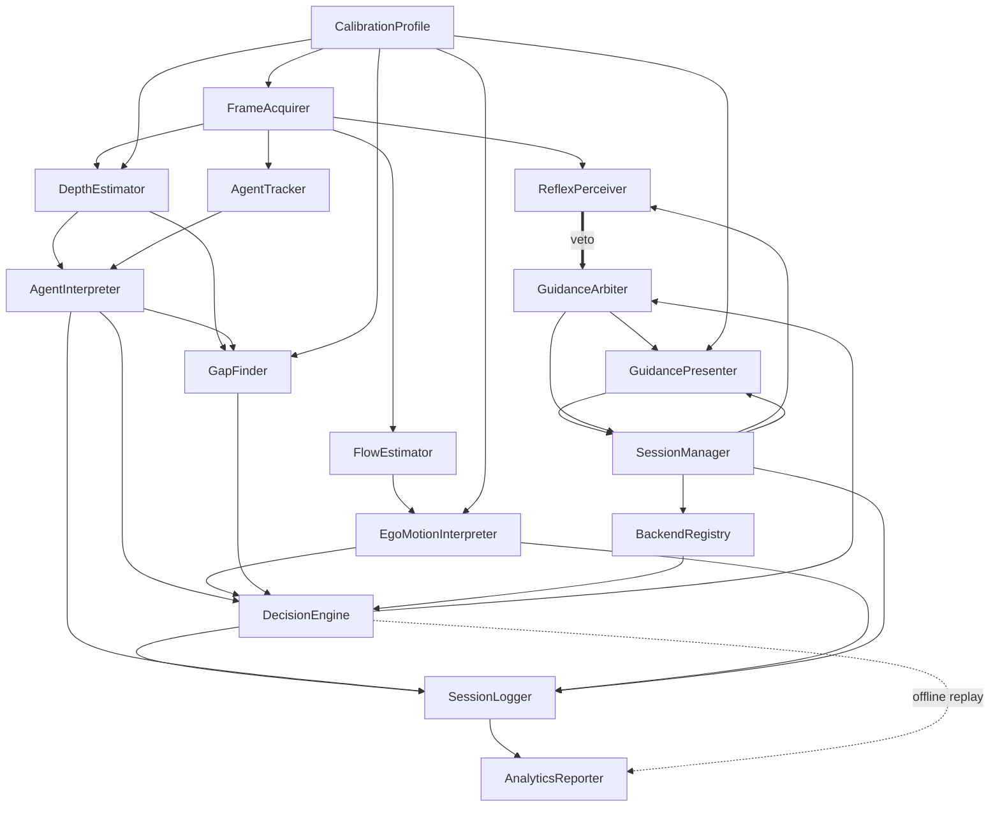

The heavy edge marks the veto path from `ReflexPerceiver` to `GuidanceArbiter`. It is drawn distinctly because it is the one collaboration in the model that must hold unconditionally: every other edge carries information to be weighed, while that one carries an assertion that cannot be outvoted.

---

# 6. Software Design Architecture

Architectural design outlines the high-level structure and organisation of a software system, defining its major components, their interactions, and the patterns on which they rest.

## 6.1 Architectural Context Diagram

At the architectural design level, a software architect uses an architectural context diagram to model the manner in which software interacts with entities external to its boundaries.

*Figure 10: Architectural Context Diagram of WalkSafe*

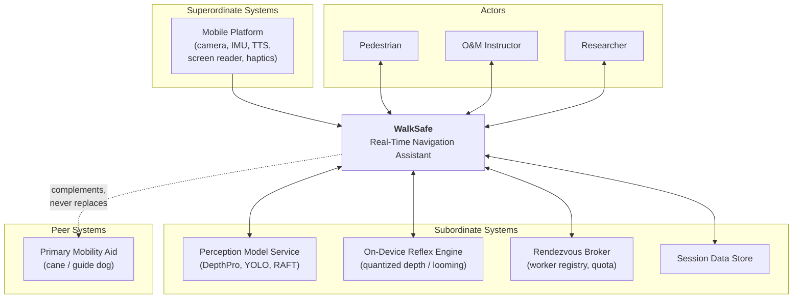

Three groups of external entities surround WalkSafe.

**Actors.** The pedestrian is both producer and consumer: they produce camera imagery, motion, and preferences, and consume spoken guidance. Although patients, instructors, and researchers might in another system be merged into one generic user, here they must not be — their access differs materially. The pedestrian never needs the visual interface; the instructor and researcher depend on it; and the analytics surface must not expose one user's data to another. They are therefore modelled as distinct actors.

**Superordinate system.** The mobile platform sits above WalkSafe, granting it camera, motion sensors, speech synthesis, screen-reader integration, and haptics. WalkSafe is a client of these rather than a peer, and platform decisions — audio focus, thermal policy, background execution — constrain it directly.

**Subordinate systems.** Four systems provide the processing WalkSafe orchestrates. The perception model service performs remote scene analysis. The on-device reflex engine performs local imminent-obstacle detection; it is deliberately a separate subordinate system rather than a module of the remote service, because its independence from the network is what makes the safety guarantee possible. The rendezvous broker resolves a stable address to a live worker and governs quota. The session data store holds derived metrics.

**Peer system.** The primary mobility aid is drawn as a peer, outside the software boundary and not communicating with it, because it is nonetheless part of the operational system. Every safety argument in this document assumes the cane is present and in use. Representing it in the context diagram keeps that assumption visible in the architecture rather than confining it to a disclaimer.

## 6.2 Define Archetypes

An archetype is a class or pattern representing a core abstraction critical to the design of an architecture for the target system. In general a relatively small set of archetypes is sufficient to design even complex systems. The target architecture is composed of these archetypes, which represent stable elements but may be instantiated in many different ways depending on the behaviour required. Archetypes can often be derived by examining the analysis classes defined in the requirements model.

In our case the archetypes are:

- Pipe and Filter Architecture
- Client–Server Architecture
- Hierarchical Safety Control Architecture
- Data-Centered Architecture

### Pipe and Filter Architecture

The Pipe and Filter architecture organises a system as a series of processing elements, called filters, connected by communication channels, called pipes. Each filter performs one transformation on the data it receives and passes the result onward, forming a data-flow pipeline. It suits systems that process streams of data through a sequence of independent stages.

- **Filter** — a stage containing a significant, self-contained algorithm that could be reused or reordered in another pipeline.
- **Pipe** — the channel carrying data between filters.

This archetype governs WalkSafe's perception path, where a frame is progressively transformed into depth, then into tracked agents, then into risk assessments. Two properties matter here beyond the usual ones. First, filters may be *substituted*: a different depth model must be replaceable without touching interpretation. Second, the pipe must be **newest-first and bounded** rather than first-in-first-out, because a queued older frame has no value once a newer one exists — the ordinary queueing discipline would actively harm this system by converting load into latency.

*Figure 11: Pipe and Filter Archetype*

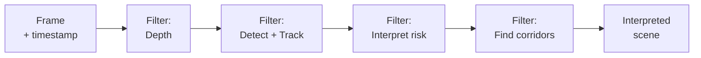

### Client–Server Architecture

Client–server architecture structures a system around clients that request services and a server that fulfils them, communicating by a request–response protocol. It is the natural fit wherever computation must be located away from the point of use.

WalkSafe uses it for the relationship between the smartphone client, the remote GPU worker, and the rendezvous broker. Its use here carries an unusual property: the server is **expected to disappear**. Free-tier notebook GPU allocations terminate at a platform session ceiling, time out when idle, and may be refused outright. The client is therefore designed not merely to tolerate server loss but to treat it as routine, degrading to on-device operation and re-resolving a new worker through the broker without ending the user's journey.

*Figure 12: Client–Server Archetype*

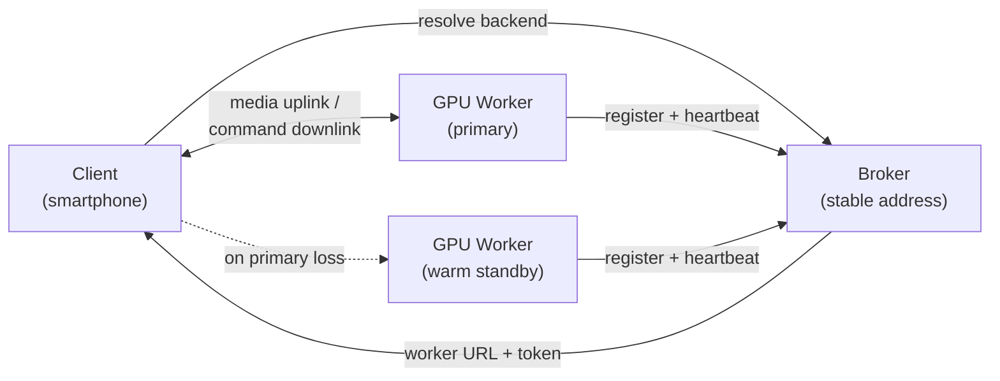

### Hierarchical Safety Control Architecture

This archetype places two controllers in a strict precedence relationship: a fast, simple controller with authority to override, and a slower, richer controller with authority only to advise. The fast controller's decisions are final within its narrow competence; the rich controller elaborates behaviour everywhere else. It is the standard shape of safety interlocks in control engineering, and it is the archetype that resolves WalkSafe's central tension.

The tension is this: the guidance the user most needs quickly — *stop* — is the guidance that a remote GPU can least quickly deliver, while the guidance that requires real scene understanding — which corridor to take — tolerates delay comfortably. A single-tier design must either fail the latency requirement or abandon the rich analysis. Splitting authority by *urgency* rather than by *capability* satisfies both.

The archetype's essential property is asymmetry. The reflex tier may only make the system more cautious, never less. A reflex false positive costs an unnecessary pause; a reflex false negative that the advisory tier was permitted to overrule costs a collision. The veto is therefore unconditional, and does not consult the advisory tier's confidence.

*Figure 13: Hierarchical Safety Control Archetype*

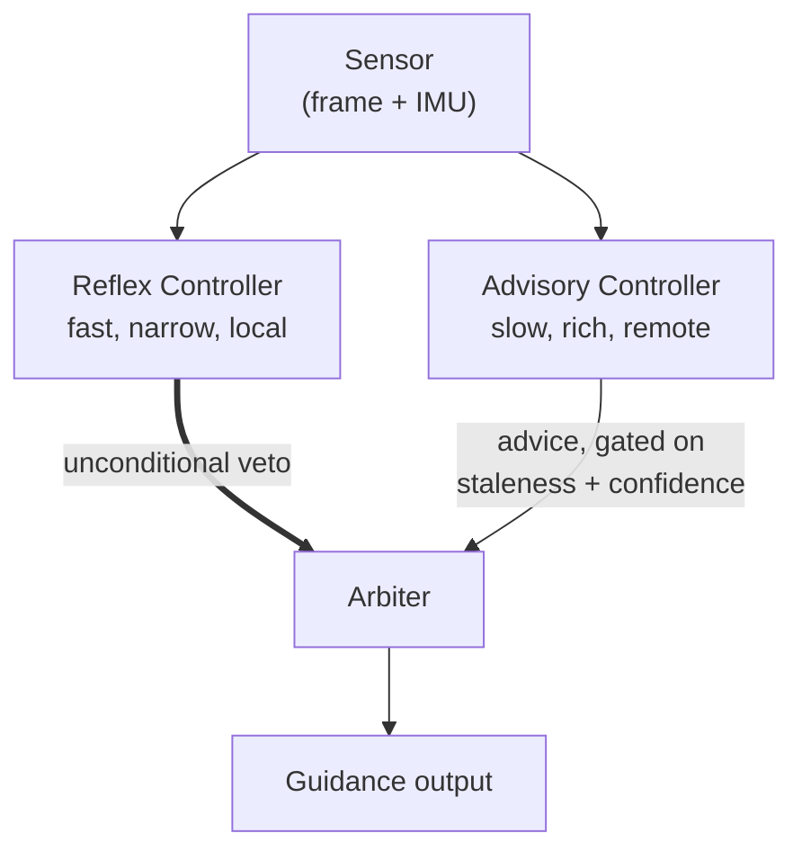

### Data-Centered Architecture

The Data-Centered architecture places a data store at the centre of the system, with components interacting through it rather than directly with one another. It suits systems where data integrity and shared access matter, and where producers and consumers should be decoupled.

In WalkSafe the session store decouples the guidance path from everything that examines it. Logging is a write into the store and nothing more; analytics, offline replay, and export read from it independently. The decoupling is a safety property as much as a design convenience: because no consumer can reach into the guidance path, no analytical or export operation can delay a spoken command.

*Figure 14: Data-Centered Archetype*

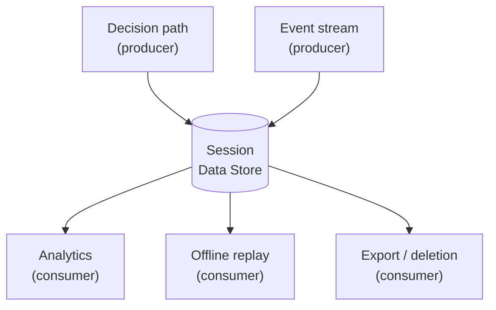

## 6.3 Refining the Architecture into Components

### 6.3.1 Top Level Components

The overall architectural structure with top level components is illustrated below. Top level component diagrams give a very high-level view of the system, refined into architecture in the following section. The references for this document keep such diagrams to three independent responsibilities for ease of understanding; WalkSafe uses four, because the session-and-infrastructure responsibility genuinely cannot be folded into either perception or guidance — it exists precisely to manage compute that outlives neither.

*Figure 15: Top Level Components of WalkSafe*

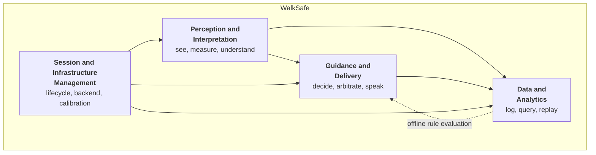

- **Perception and Interpretation** turns frames into an understood scene: depth, agents, corridors, risk, and the user's own motion. It spans both tiers.
- **Guidance and Delivery** turns the understood scene into one spoken instruction, enforcing tier precedence, staleness, hysteresis, and preemption.
- **Session and Infrastructure Management** owns the session lifecycle, the degradation ladder, backend resolution and handover, and calibration.
- **Data and Analytics** persists derived metrics and serves querying, drill-down, offline replay, and export.

### 6.3.2 Instantiation of the Architecture

The components identified in Section 6.3.1 are broad. They need to be refined into smaller components, and a mere collection of components does not constitute a meaningful design. I therefore apply an architecture to each component, with the intent of demonstrating that its structure and constituent parts are appropriate to its responsibility.

#### Component: Perception and Interpretation

The **Pipe and Filter** architecture applies. A frame passes through a sequence of independent transformations, each producing a richer representation than the last, with no stage needing knowledge of any other beyond its immediate input. Filters are individually substitutable — a different depth or detection model drops in without disturbing interpretation — and the pipeline is bounded and newest-first so that load becomes dropped frames rather than accumulated latency.

*Figure 16: Architecture Instantiation on Component Perception and Interpretation*

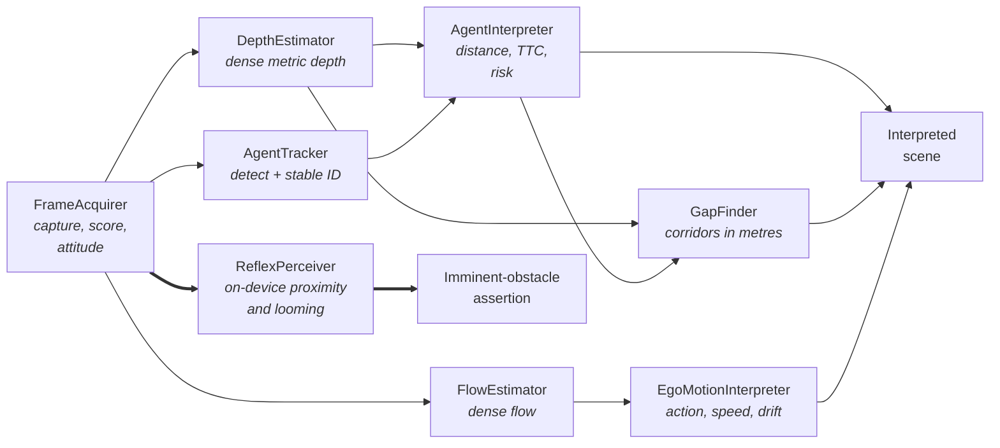

#### Component: Guidance and Delivery

The **Hierarchical Safety Control** architecture applies, with a *Main Program / Subprogram* structure inside the decision stage. The arbiter is the safety interlock: it receives an unconditional assertion from the reflex path and gated advice from the advisory path, and its precedence rules are fixed rather than data-dependent. Within the advisory path, the decision engine acts as a main program coordinating subprograms that evaluate each rule class in priority order — a structure chosen because it makes the priority order explicit and inspectable, which is a requirement rather than a preference for logic whose decisions must be auditable after the fact.

*Figure 17: Architecture Instantiation on Component Guidance and Delivery*

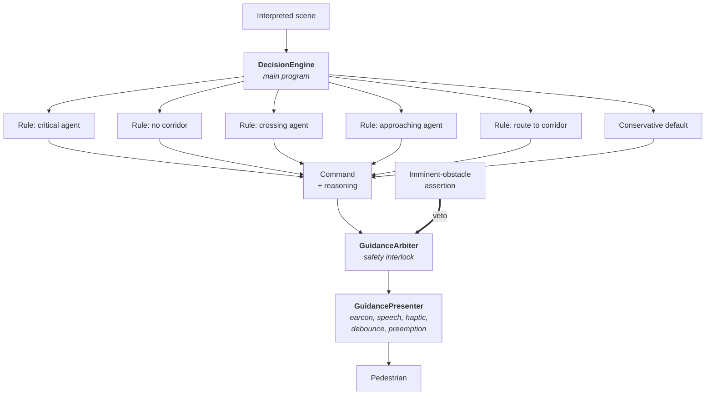

#### Component: Session and Infrastructure Management

The **Client–Server** architecture applies. The session manager acts as a client of the broker, which in turn maintains the worker registry. Handover, quota governance, and heartbeat monitoring are all request–response interactions against a stable address. Calibration sits within this component rather than within perception, because its outputs are configuration that perception consumes rather than a stage of perception itself.

*Figure 18: Architecture Instantiation on Component Session and Infrastructure Management*

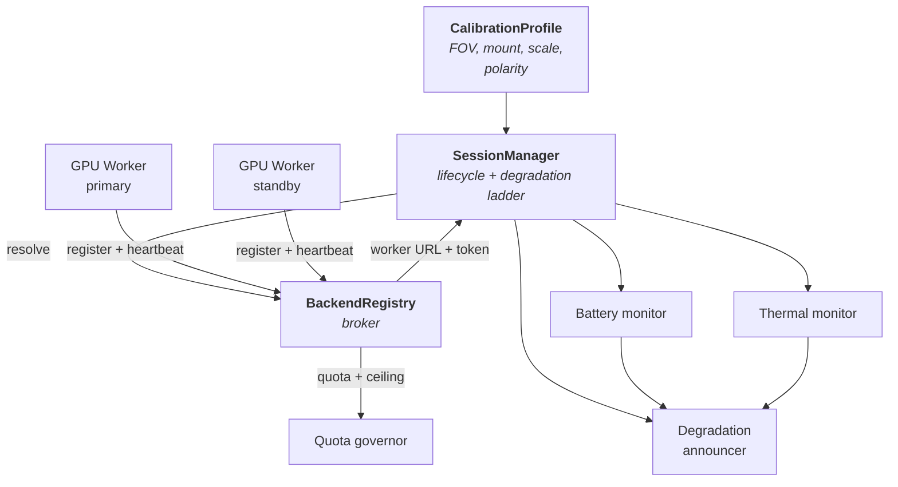

#### Component: Data and Analytics

The **Data-Centered** architecture applies. Producers write derived metrics into the store through a bounded asynchronous queue; consumers read from it independently. The queue is part of the architecture rather than an implementation detail, because the guarantee that persistence cannot delay guidance depends on it.

*Figure 19: Architecture Instantiation on Component Data and Analytics*

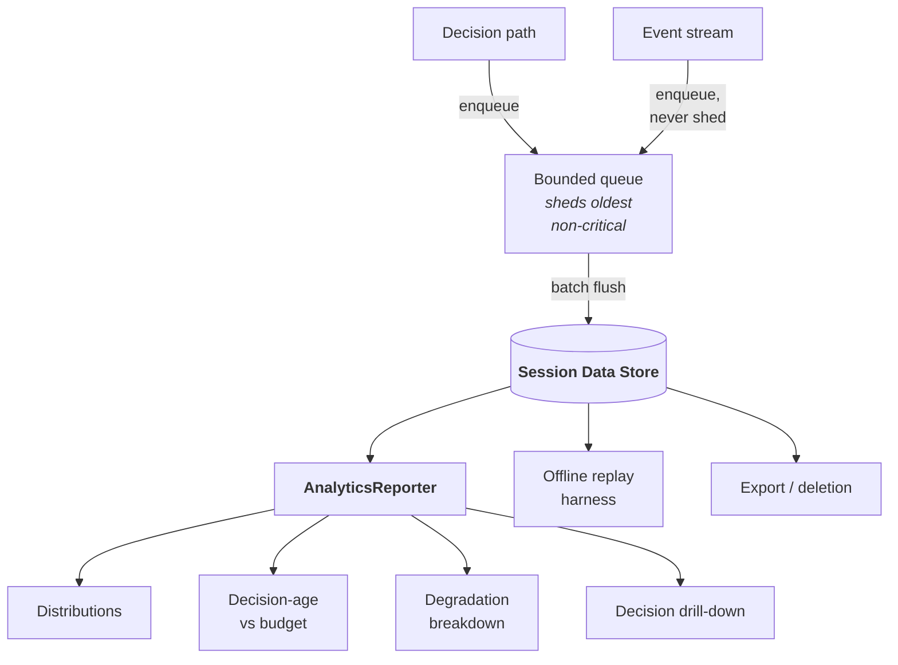

#### Combined Architecture of WalkSafe

Combining the four top level components, we obtain the overall architecture.

*Figure 20: Combined Architecture of WalkSafe*

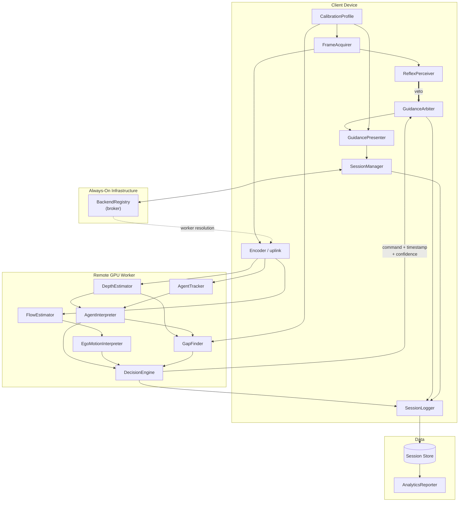

## 6.4 Mapping Requirements to Software Architecture

The mapping of the derived components to the requirements identified in Section 2.2 is shown below.

*Table 21: Mapping of Components with Requirements*

| Requirement | Component |
|---|---|
| NR-1 Live obstacle and agent perception | Perception and Interpretation |
| NR-2 Distance estimation | Perception and Interpretation |
| NR-3 Motion classification | Perception and Interpretation |
| NR-4 Time-to-collision and risk | Perception and Interpretation |
| NR-5 Traversable corridor detection | Perception and Interpretation |
| NR-6 Own-motion awareness | Perception and Interpretation |
| NR-7 Single navigation command | Guidance and Delivery |
| NR-8 Spoken guidance | Guidance and Delivery |
| NR-9 On-device imminent-stop | Perception and Interpretation; Guidance and Delivery |
| NR-10 Non-visual operation | Guidance and Delivery; Session and Infrastructure Management |
| NR-11 Guided calibration | Session and Infrastructure Management |
| NR-12 Session logging | Data and Analytics |
| NR-13 Analytics interface | Data and Analytics |
| NR-14 Session control | Session and Infrastructure Management |
| NR-15 Diagnostic view | Data and Analytics |
| ER-1 Guidance arrives in time | Guidance and Delivery; Perception and Interpretation |
| ER-2 No guidance from a stale scene | Guidance and Delivery |
| ER-3 Time is measured, not assumed | Perception and Interpretation |
| ER-4 Failure is audible | Session and Infrastructure Management; Guidance and Delivery |
| ER-5 Degradation is always toward caution | Session and Infrastructure Management; Guidance and Delivery |
| ER-6 Quiet when nothing changes | Guidance and Delivery |
| ER-7 Urgency preempts | Guidance and Delivery |
| ER-8 Left and right never reversed | Perception and Interpretation; Session and Infrastructure Management |
| ER-9 Hearing never occluded | Guidance and Delivery |
| ER-10 Guidance does not oscillate | Guidance and Delivery; Perception and Interpretation |
| ER-11 Camera state monitored | Perception and Interpretation |
| ER-12 Metric estimates use actual device | Session and Infrastructure Management; Perception and Interpretation |
| ER-13 Uncertainty carried, not discarded | Perception and Interpretation |
| ER-14 Backend invisible to the user | Session and Infrastructure Management |
| ER-15 Backend loss does not end journey | Session and Infrastructure Management |
| ER-16 Resource exhaustion anticipated | Session and Infrastructure Management |
| ER-17 Logging never delays guidance | Data and Analytics |
| ER-18 No imagery retained | Data and Analytics; Perception and Interpretation |
| ER-19 Consent informed and revocable | Session and Infrastructure Management |
| ER-20 Limits stated, not implied | Session and Infrastructure Management |
| ER-21 Precision is honest | Guidance and Delivery |
| ER-22 Sessions always closed | Data and Analytics; Session and Infrastructure Management |
| XR-1 Two-tier guidance with veto | Guidance and Delivery; Perception and Interpretation |
| XR-2 Guidance from free-tier GPU compute | Session and Infrastructure Management |
| XR-3 Navigation by earcon alone | Guidance and Delivery |
| XR-4 Explain-the-last-decision | Guidance and Delivery; Data and Analytics |
| XR-5 Offline replay and rule evaluation | Data and Analytics |
| XR-6 Practice mode | Session and Infrastructure Management |
| XR-7 Personal profiles | Session and Infrastructure Management |
| XR-8 Haptic urgency channel | Guidance and Delivery |
| XR-9 Research-grade decision corpus | Data and Analytics |
| XR-10 Decision-age telemetry | Data and Analytics |

---

# 7. Preliminary Test Plan

In this chapter I present a high-level description of the testing goals and a summary of the features to be tested for WalkSafe, followed by the validation programme required before the system may be used by the public.

A note on the shape of this plan. For most systems, testing confirms that features work. For WalkSafe, a substantial part of the plan confirms that *failures* behave correctly — that a lost backend announces itself, that stale guidance is discarded rather than spoken, that a reflex stop cannot be overruled. These are not negative tests appended for completeness; they are the tests that decide whether the system is safe to release, and they are weighted accordingly.

## 7.1 High-Level Description of Testing Goals

The testing goals for WalkSafe are outlined below:

- To verify that the system meets its functional requirements as specified in Section 2.2
- To verify that depth estimation produces distances accurate against known references, and that reliability is reported honestly
- To verify that agent detection and tracking maintain stable identity across frames
- To verify that motion classification, approach speed, and time-to-collision derive from measured timestamps and not from an assumed frame rate
- To verify that time-to-collision carries an uncertainty interval and that risk assignment uses its conservative bound
- To verify that traversable corridors are judged against absolute clearance in metres, and that the system can report the absence of any corridor
- To verify that corridor width is computed from the calibrated field of view of the actual device
- To verify that exactly one command is produced per decision cycle, that every rule branch is reachable, and that the conservative default is total
- To verify that left and right are never reversed, on every supported device
- To verify that reflex-tier guidance reaches the user within 250 ms and advisory guidance within 1200 ms, and that nothing older than 2000 ms is ever spoken
- To verify that a reflex stop cannot be overridden, suppressed, or delayed by advisory output at any confidence
- To verify that guidance is delivered on change of state and that the system is silent when nothing has changed
- To verify that urgent commands preempt speech in progress and that another application cannot silence guidance
- To verify that lateral guidance does not oscillate
- To verify that every fault, degradation, and disconnection is announced audibly with its cause, and that no failure is silent
- To verify that every degradation step is at least as conservative as the one before it
- To verify that backend loss degrades the session rather than ending it, and that recovery is automatic
- To verify that quota and session ceilings are respected without mid-journey interruption
- To verify that battery and thermal limits produce warnings with usable margin
- To verify that every end-user function is operable with a screen reader and without sight
- To verify that calibration determines device geometry and blocks use when the polarity test or scale check fails
- To verify that no imagery is persisted anywhere, and that consent is obtained before transmission
- To verify that logging never blocks guidance, that the queue is bounded, and that safety events are never shed
- To verify that sessions are finalised on every termination path including abnormal ones
- To verify that a recorded session can be replayed deterministically through the decision engine
- To evaluate battery, memory, and thermal behaviour over a continuous two-hour session
- To measure missed-hazard rate and false-stop rate against annotated ground truth

## 7.2 Test Cases

- **Test Case 1: Installation and First-Run Onboarding**
    - *Test Scenario:*
        - Install WalkSafe with a screen reader active
        - Complete onboarding without sighted assistance
    - *Expected Outcome:*
        - Onboarding is fully narrated and self-guided
        - System limits are stated and require positive acknowledgement
        - Consent for remote processing is requested, with an on-device-only alternative offered

- **Test Case 2: Calibration and Polarity Self-Test**
    - *Test Scenario:*
        - Run guided calibration on each supported device
        - Deliberately reverse the sign convention in a test build and re-run
    - *Expected Outcome:*
        - Field of view, mount geometry, shoulder width, and depth scale are recorded
        - The correct build passes the polarity test
        - The reversed build fails the polarity test and use is blocked

- **Test Case 3: Depth Accuracy Against Reference Distances**
    - *Test Scenario:*
        - Place obstacles at measured distances from 1 m to 8 m
        - Compare estimated distance against ground truth
    - *Expected Outcome:*
        - Estimates fall within the specified error band
        - Reliability measure degrades on low-texture and transparent surfaces rather than reporting false confidence

- **Test Case 4: Agent Detection and Track Stability**
    - *Test Scenario:*
        - Record pedestrians and cyclists crossing, approaching, and passing
        - Follow track identity across occlusion and re-entry
    - *Expected Outcome:*
        - Agents are detected above the confidence threshold
        - Track identity remains stable, and stale tracks are retired

- **Test Case 5: Time Base Correctness**
    - *Test Scenario:*
        - Run the pipeline at 1.5, 5, and 15 FPS on identical recorded input
        - Compare approach speed and time-to-collision across rates
    - *Expected Outcome:*
        - Derived speeds and times agree across frame rates within tolerance
        - No dependence on a nominal frame rate is observable

- **Test Case 6: Time-to-Collision Uncertainty and Undefined Values**
    - *Test Scenario:*
        - Present agents with static, marginal, and clearly closing motion
        - Inspect stored values
    - *Expected Outcome:*
        - Undefined time-to-collision persists as null, never as a sentinel number
        - An uncertainty interval accompanies every defined value, and risk uses its conservative bound

- **Test Case 7: Corridor Detection Against Absolute Clearance**
    - *Test Scenario:*
        - Face a blank wall, a fully blocked corridor, a narrow gap, and an open path
        - Vary the calibrated shoulder width between runs
    - *Expected Outcome:*
        - "No traversable corridor" is reported for the wall and blocked corridor
        - Corridor width in metres is consistent with physical measurement
        - Traversability changes appropriately with shoulder width

- **Test Case 8: Decision Engine Branch Coverage**
    - *Test Scenario:*
        - Drive the engine with recorded and synthetic fixtures covering every rule branch
        - Include states designed to fall through all rules
    - *Expected Outcome:*
        - Exactly one command per cycle
        - Every branch is exercised, and fall-through reaches the conservative default

- **Test Case 9: Reflex Tier Veto**
    - *Test Scenario:*
        - Assert an imminent obstacle from the reflex tier while the advisory tier emits `walk_forward` at maximum confidence
        - Repeat with the advisory command arriving before, during, and after the assertion
    - *Expected Outcome:*
        - `stop` is delivered in every case
        - The advisory command is never spoken, delayed, or blended

- **Test Case 10: Latency Measurement Against Budget**
    - *Test Scenario:*
        - Instrument photon-to-phoneme timing on target hardware over representative networks
        - Collect distributions per tier
    - *Expected Outcome:*
        - Reflex tier within 250 ms at p95 and 400 ms at p99
        - Advisory tier within 1200 ms at p95
        - Zero commands delivered beyond the 2000 ms cutoff

- **Test Case 11: Staleness Discard**
    - *Test Scenario:*
        - Inject artificial network delay exceeding the staleness budget
        - Deliver commands out of sequence
    - *Expected Outcome:*
        - Stale commands are discarded, not spoken late
        - Out-of-order commands are rejected

- **Test Case 12: Guidance Delivery Discipline**
    - *Test Scenario:*
        - Hold a static scene for sixty seconds
        - Then present a rapidly changing scene, including an urgent stop during an utterance in progress
        - Start audio playback in another application mid-session
    - *Expected Outcome:*
        - No repeated utterances during the static scene; the system is silent
        - Utterance rate stays within fifteen per minute at default verbosity
        - The stop preempts the utterance in progress, earcon first
        - Guidance is not silenced by the other application

- **Test Case 13: Lateral Hysteresis**
    - *Test Scenario:*
        - Present a scene with two corridors of nearly equal width on either side
    - *Expected Outcome:*
        - The system does not alternate between `step_left` and `step_right` faster than once every two seconds
        - Corridor identity persists across frames

- **Test Case 14: Degradation Ladder and Audible Failure**
    - *Test Scenario:*
        - Inject each fault in turn: network loss, high latency, worker crash, GPU unavailable, quota exhaustion, session ceiling, camera permission revoked, lens occlusion, mount displacement, thermal throttle, battery reserve, audio device disconnect, audio focus loss, Bluetooth latency spike, speech engine failure, implausible depth output, tracker identity collapse, logging queue saturation, clock discontinuity
    - *Expected Outcome:*
        - Each fault produces the specified degradation level
        - Each transition is announced audibly with its cause
        - Reduced capability is re-announced at least once a minute
        - No fault produces silence, and none produces more permissive guidance

- **Test Case 15: Backend Loss, Handover, and Recovery**
    - *Test Scenario:*
        - Kill the primary worker mid-session with a warm standby registered
        - Then kill all workers, and later restore one
    - *Expected Outcome:*
        - Handover completes within five seconds and the session continues
        - With no worker available, the session degrades to reflex-only with an announcement rather than terminating
        - Full guidance is restored automatically and announced when a worker returns

- **Test Case 16: Quota and Session Ceiling Governance**
    - *Test Scenario:*
        - Drive the quota ledger to the platform weekly limit
        - Approach a worker's platform session ceiling during an active session
    - *Expected Outcome:*
        - Registrations that would breach quota are refused
        - The approaching ceiling is warned about and standby promotion occurs pre-emptively
        - No mid-journey interruption results

- **Test Case 17: Accessibility Walkthrough**
    - *Test Scenario:*
        - Complete every end-user function using only a screen reader, screen off where applicable, on both platforms
        - Attempt one-handed operation while holding a cane
    - *Expected Outcome:*
        - All functions complete without sight
        - No function requires reading or entering a URL, code, or identifier
        - One-handed operation succeeds

- **Test Case 18: Privacy and Data Handling Audit**
    - *Test Scenario:*
        - Run a full session, then audit device storage, worker filesystem, and all logs
        - Exercise export and deletion
    - *Expected Outcome:*
        - No imagery is found in any persisted artefact
        - Only derived metrics are stored
        - Export and permanent deletion succeed non-visually

- **Test Case 19: Logging Under Saturation**
    - *Test Scenario:*
        - Saturate the logging queue while guidance continues
        - Include stop events and degradation transitions during saturation
    - *Expected Outcome:*
        - Guidance latency is unaffected
        - Oldest non-critical records are shed and the shedding is recorded
        - No stop or degradation event is lost

- **Test Case 20: Session Finalisation on Abnormal Termination**
    - *Test Scenario:*
        - Terminate sessions by user action, forced process kill, simulated battery death, and unhandled fault
    - *Expected Outcome:*
        - Every session is finalised with an end time, termination reason, and summary counts
        - No session remains marked incomplete

- **Test Case 21: Endurance and Resource Behaviour**
    - *Test Scenario:*
        - Run a continuous two-hour session on target hardware
    - *Expected Outcome:*
        - No crash, no memory growth trend, no unannounced degradation
        - Battery, memory, thermal, and data consumption within budget

- **Test Case 22: Deterministic Offline Replay**
    - *Test Scenario:*
        - Replay recorded sessions through the decision engine unchanged, then through a modified rule set
    - *Expected Outcome:*
        - Unchanged replay reproduces identical decisions
        - The modified rule set's effect is measurable against real recorded scenes before deployment

- **Test Case 23: Missed-Hazard and False-Stop Measurement**
    - *Test Scenario:*
        - Run the instrumented controlled course with annotated ground truth
        - Include static obstacles above 0.3 m within 3 m, and hazard-free passages
    - *Expected Outcome:*
        - Missed-hazard rate at or below 2%
        - False-stop rate at or below 10% of stop events

- **Test Case 24: Degraded Visibility Conditions**
    - *Test Scenario:*
        - Operate against direct low-sun glare, dusk, light rain, and low-texture surfaces
    - *Expected Outcome:*
        - Frame usability scoring detects the condition
        - The system announces reduced confidence and restricts itself to the conservative command subset

## 7.3 Validation Programme

Testing confirms that the system meets this specification. Validation confirms that the specification was right — and that cannot be established without the people the system is for.

**Stage 1 — Expert review.** An orientation-and-mobility professional reviews the command vocabulary, guidance phrasing, degradation announcements, and hazard analysis. Sign-off on all safety-critical requirements is required before Stage 2 begins.

**Stage 2 — Controlled course.** A closed course with known, instrumented obstacles. Sighted operators first, then blind participants with an instructor physically present. This is where missed-hazard rate, false-stop rate, and guidance timing are measured against ground truth.

**Stage 3 — Supervised field trial.** Familiar routes, participants using their normal primary aid, instructor accompanying. Measures utterance rate, degradation frequency, real decision-age distributions, and subjective trust and workload.

**Stage 4 — Extended trial.** Unfamiliar routes and adverse conditions — dusk, rain, crowds. This is the only route to validating the over-trust hazard and the degraded-perception hazard, neither of which is observable in a controlled setting.

**Ethics and consent.** Human-subject research requires institutional ethics approval before Stage 2, informed consent covering physical risk, and an unconditional right to withdraw. Free-tier GPU compute is acceptable through Stage 3, since trials are supervised; public release requires a persistent backend, for the reason given in Appendix F.

**Exit criterion.** Public release requires every acceptance criterion met, orientation-and-mobility sign-off, ethics closure, and no unmitigated Critical or Catastrophic hazard.

---

# 8. Conclusion

In this report I have presented the technical details necessary to develop WalkSafe: a real-time navigation assistant that helps blind and low-vision pedestrians move through the one-to-eight-metre band that neither a white cane nor a mapping application serves.

The requirements model, expressed through Quality Function Deployment, identifies fifteen normal, twenty-two expected, and ten exciting requirements. The distribution itself is informative: for a mobility aid, an unusually large share of requirements are *expected* rather than normal, because behaviours that would elsewhere be refinements — announcing one's own failure, discarding stale data, never reversing left and right — are here the difference between a useful tool and a dangerous one. Scenario-based modeling covers not only nominal walking but degraded operation, since how the system behaves when impaired is as much a part of its specification as how it behaves when healthy. Data-based modeling defines eight entities that record what the system measured and decided while storing no imagery at all. Class-based modeling identifies sixteen analysis classes with their responsibilities and collaborations. The architectural design rests on four archetypes and refines into four top level components, each instantiated with the architecture appropriate to its responsibility.

The central design finding is that guidance of this kind cannot come from one computational tier. The instruction the user needs most urgently is the one a remote GPU can least quickly supply, while the instruction requiring genuine scene understanding tolerates delay comfortably. Splitting authority by urgency rather than by capability — a fast local reflex tier with unconditional veto, a rich remote advisory tier that may only advise — resolves a requirement that no single-tier design could satisfy. It also yields a structural safety guarantee that no amount of testing could otherwise establish: the fast path can only ever make the system more cautious.

A second finding concerns the prototype. Building it was what revealed that its time base was assumed rather than measured, that its corridor criterion made "no corridor" logically unreachable, and that speech driven per frame is speech no one can use. None of these were visible from design review; each is now a requirement. That is the argument for prototyping before specifying rather than after.

I want to be clear about what this document does not establish. Every threshold in it is a placeholder until calibrated against field data. The missed-hazard and false-stop rates are targets, not measurements. The hazard analysis rests on a single load-bearing premise — that the user still carries a cane — and if that premise is ever relaxed, the analysis is void. And no amount of specification substitutes for the judgement of orientation-and-mobility professionals and blind travellers, whose review is built into Section 7 for that reason.

What the document does establish is a system whose failures are specified as carefully as its features, whose decisions can be reconstructed and audited after the fact, and whose limits are stated plainly to the person relying on it. For a tool that a blind pedestrian may come to trust while crossing a footpath, that seems the right place to begin.

---

# References

1. World Health Organization. *World Report on Vision*. Geneva: WHO, 2019.
2. Bochkovskii, A., Delaunoy, A., Germain, H., Santos, M., Zhou, Y., Richter, S. R., and Koltun, V. "Depth Pro: Sharp Monocular Metric Depth in Less Than a Second." Apple, 2024. `apple/DepthPro-hf`
3. Jocher, G., Chaurasia, A., and Qiu, J. *Ultralytics YOLO*. 2023. https://github.com/ultralytics/ultralytics
4. Zhang, Y., Sun, P., Jiang, Y., et al. "ByteTrack: Multi-Object Tracking by Associating Every Detection Box." *ECCV*, 2022.
5. Teed, Z., and Deng, J. "RAFT: Recurrent All-Pairs Field Transforms for Optical Flow." *ECCV*, 2020.
6. Yang, L., Kang, B., Huang, Z., et al. "Depth Anything V2." *NeurIPS*, 2024.
7. Pressman, R. S., and Maxim, B. R. *Software Engineering: A Practitioner's Approach*. 8th ed. McGraw-Hill, 2015.
8. ISO/IEC/IEEE 29148:2018. *Systems and software engineering — Life cycle processes — Requirements engineering*.
9. ISO 14971:2019. *Medical devices — Application of risk management to medical devices*. Referenced as a hazard-analysis method only; no medical device claim is made.
10. W3C. *Web Content Accessibility Guidelines (WCAG) 2.2*. 2023.
11. ETSI. *EN 301 549 — Accessibility requirements for ICT products and services*.
12. Google. *ARCore Depth API Documentation*; Apple, *ARKit Scene Depth Documentation*.
13. Google. *Colaboratory Terms of Service and Acceptable Use*; Kaggle, *Notebook Usage Limits*.
14. Leveson, N. G. *Engineering a Safer World: Systems Thinking Applied to Safety*. MIT Press, 2011.
15. Wiener, E. L., and Curry, R. E. "Flight-Deck Automation: Promises and Problems." *Ergonomics*, 23(10), 1980. Referenced for automation over-trust.
16. Gradio. *Gradio Documentation*. https://www.gradio.app/

---

# Appendix A — Hazard Analysis

The method is adapted from ISO 14971 for structure only; no medical device claim is made. Severity levels: **Catastrophic** — serious injury or death; **Critical** — injury requiring treatment; **Marginal** — minor injury or significant distress. Likelihood is assessed for the intended population under the premise that a primary mobility aid is in concurrent use.

*Table 22: Hazard Analysis of WalkSafe*

| ID | Hazard | Cause | Severity | Mitigation | Requirements |
|---|---|---|:--:|---|---|
| **H-01** | User walks into an undetected obstacle after a permissive command | Missed detection; relative corridor threshold making "no gap" unreachable; depth failure on thin or transparent objects | Critical | Reflex-tier veto; absolute traversability criteria; reachable no-corridor outcome; conservative default; cane in use | NR-5, NR-9, ER-5, XR-1 |
| **H-02** | User acts on guidance describing a scene that has already changed | Network latency; queue backlog; stale cached depth; late delivery | Critical | Capture timestamps on every command; staleness discard; bounded newest-first pipeline; depth reuse bound; decision-age telemetry | ER-1, ER-2, XR-10 |
| **H-03** | User steps off a kerb, stair, or drop-off the system did not detect | Monocular depth is unreliable at negative discontinuities; explicitly out of scope | Catastrophic | Declared non-goal; stated in onboarding and limitations; cane requirement reinforced; no guidance implying the ground is safe | §1.2, ER-20 |
| **H-04** | User is directed into a hazard by a reversed left/right instruction | Sign convention error in flow, ego derivation, corridor direction, or command mapping | Catastrophic | Documented conventions; automated test on reference sequences of known direction; per-device polarity self-test at calibration; zero tolerance | ER-8, NR-11 |
| **H-05** | User fails to hear a vehicle or verbal warning because audio output occludes hearing | Requiring or defaulting to occluding headphones | Catastrophic | Occluding audio never required; bone conduction supported and recommended; haptic urgency channel | ER-9, XR-8 |
| **H-06** | User over-trusts the system and reduces primary-aid use or attention | Confident presentation; sustained good performance; limits invisible in daily use | Critical | Supplementary-aid framing throughout; acknowledged onboarding; limitations re-presented on update; honest precision; degradation always announced | ER-20, ER-21, ER-4 |
| **H-07** | Guidance stops without the user realising, and they walk on as though guided | Silent crash; audio focus loss; battery death; thermal termination; backend loss | Critical | Audible fault announcement; minute-interval re-announcement of reduced capability; audio focus protection; battery and thermal warnings | ER-4, ER-15, ER-16 |
| **H-08** | Excessive false stops lead the user to disregard genuine stops | Collapsed time-to-collision from an assumed time base; uncalibrated thresholds; noisy depth | Critical | Measured timestamps mandated; uncertainty-aware risk; false-stop rate budget; hysteresis; field measurement | ER-3, ER-13, ER-10 |
| **H-09** | Degraded perception in glare, rain, dusk, or low texture yields confident wrong guidance | No confidence gating on input quality | Critical | Per-frame usability scoring; confidence propagation; restriction to conservative commands; plausibility validation | ER-5, ER-13, ER-11 |
| **H-10** | Guidance is wrong because the camera has shifted, is occluded, or is misaimed | Mount slippage; lens covered; incorrect pitch | Critical | Attitude monitoring; mounting alert; occlusion detection and degradation; pitch-corrected walkable region | ER-11 |
| **H-11** | Metric estimates are wrong because device geometry differs from assumed values | Hardcoded field of view or mount height; uncorrected depth scale | Critical | Calibrated field of view mandated; mount geometry calibration; depth scale sanity check; recalibration prompt on device change | ER-12, NR-11 |
| **H-12** | Continuous chatter masks a critical utterance, or trains the user to ignore audio | Frame-driven rather than event-driven delivery; no preemption | Critical | Change-driven delivery; silence when unchanged; utterance rate ceiling; urgent preemption with leading earcon | ER-6, ER-7 |
| **H-13** | Bystanders are recorded and transmitted without their consent | Continuous video of public space sent to third-party compute | Marginal | No imagery persisted anywhere; derived metrics only; buffers released after inference; minimum sufficient resolution; disclosure; on-device-only mode | ER-18, ER-19 |
| **H-14** | Guidance oscillates, destabilising the user's gait or causing a stumble | No hysteresis; unstable corridor identity | Marginal | Lateral command hysteresis; corridor continuity across frames; minimum inter-utterance interval | ER-10, ER-6 |
| **H-15** | Session ends abruptly mid-journey when free-tier quota or session ceiling is reached | Platform limits reached without warning | Marginal | Quota governance at the broker; session-ceiling warning; pre-emptive standby promotion; degradation instead of termination | XR-2, ER-15, ER-16 |

**Residual risk.** H-03 and the transparent-and-thin-obstacle portion of H-01 are not eliminated by design. They are bounded only by the concurrent use of a primary mobility aid and by explicit disclosure. Acceptance of this residual risk rests entirely on that premise holding. **If the premise is ever relaxed — if WalkSafe is positioned, marketed, or perceived as usable without a cane or guide dog — this hazard analysis is void and the system must not ship.**

---

# Appendix B — Latency Budget and Degradation Ladder

## B.1 Tier Latency Budgets

Figures are p95 at a walking speed of 1.4 m/s. The travel column states the distance the user covers during the interval, which is the figure that determines whether a budget is acceptable.

*Table 23: Tier Latency Budgets*

| Tier | Segment | Budget |
|---|---|---|
| **Reflex** | Capture to frame available | 30 ms |
| | Preprocess | 10 ms |
| | Inference (quantized depth or looming) | 60 ms |
| | Arbitration and decision | 5 ms |
| | Audio onset (pre-rendered earcon) | 80 ms |
| | **Total** | **≤ 250 ms — ≈ 0.35 m of travel** |
| **Advisory** | Capture and encode | 40 ms |
| | Uplink | 180 ms |
| | Queue wait at worker | 100 ms |
| | Inference (depth amortised, detection, flow) | 550 ms |
| | Downlink | 60 ms |
| | Speech onset | 120 ms |
| | **Total** | **≤ 1200 ms — ≈ 1.7 m of travel** |
| | **Hard staleness cutoff** | **2000 ms — discard, never speak late** |

The 1.7 m of travel on the advisory path is exactly why routing guidance may live there and imminent-stop guidance may not.

## B.2 Session Lifecycle

*Figure 21: Session Lifecycle State Diagram*

```mermaid
stateDiagram-v2
    [*] --> IDLE
    IDLE --> CALIBRATING : start
    CALIBRATING --> IDLE : calibration fails
    CALIBRATING --> ACTIVE_FULL : calibration valid
    ACTIVE_FULL --> ACTIVE_REFLEX_ONLY : advisory tier lost
    ACTIVE_REFLEX_ONLY --> ACTIVE_FULL : advisory tier restored
    ACTIVE_FULL --> SUSPENDED : reflex tier lost
    ACTIVE_REFLEX_ONLY --> SUSPENDED : reflex tier lost
    SUSPENDED --> ACTIVE_REFLEX_ONLY : reflex tier restored
    ACTIVE_FULL --> IDLE : user ends
    ACTIVE_REFLEX_ONLY --> IDLE : user ends
    SUSPENDED --> IDLE : user ends
    IDLE --> [*]
```

## B.3 Degradation Ladder

*Table 24: Degradation Ladder*

| Level | Condition | Behaviour |
|---|---|---|
| **L0 Full** | Both tiers healthy, confidence nominal | Full command vocabulary |
| **L1 Reduced confidence** | Low frame usability — glare, rain, motion blur, low texture | Conservative commands only; announce reduced confidence; suppress routing guidance |
| **L2 Reflex only** | Advisory tier unreachable, stale, or quota-exhausted | Obstacle stops only; announce loss of routing guidance; re-announce every 60 s |
| **L3 Suspended** | Reflex tier unavailable — camera occluded, thermal throttle, model load failure | Announce withdrawal explicitly and repeatedly; issue no guidance |
| **L4 Terminated** | Battery reserve exhausted, or user ends session | Announce shutdown with reason before power loss |

Each level is strictly more conservative than the one above it. No path through this ladder makes the system more permissive.

---

# Appendix C — Requirement Register

The Quality Function Deployment requirements in Section 2.2 are the specification of record. This register decomposes them into implementation-level requirements with stable identifiers, for use during development and verification. Identifiers are permanent; withdrawn requirements are marked obsolete rather than renumbered.

**Priority:** `M` Must have — no public release without it; `S` Should have; `C` Could have.
**`SC`** marks a safety-critical requirement, which is `M` by definition, may not be deferred by schedule pressure, and requires orientation-and-mobility sign-off.

## C.1 Frame Capture — `FR-CAP`

| ID | Requirement | QFD | Pri | SC |
|---|---|---|:--:|:--:|
| FR-CAP-01 | Capture frames continuously while active, tagging each with a monotonic timestamp and concurrent IMU sample | NR-1, ER-3 | M | SC |
| FR-CAP-02 | Resize frames to the active model's input geometry, preserving aspect ratio and alignment constraints | NR-1 | M | |
| FR-CAP-03 | Compute a per-frame usability score from exposure, motion blur, and texture density | ER-5 | M | SC |
| FR-CAP-04 | Reject unusable frames and degrade to L1 if rejection persists beyond 2 s | ER-5 | M | SC |
| FR-CAP-05 | Locate the walkable region using measured device attitude, not a fixed image fraction | ER-11 | M | SC |
| FR-CAP-06 | Raise a mounting alert when attitude leaves the calibrated envelope | ER-11 | M | SC |
| FR-CAP-07 | Detect lens occlusion and degrade to L3 | ER-11 | M | SC |

## C.2 Perception — `FR-PER`

| ID | Requirement | QFD | Pri | SC |
|---|---|---|:--:|:--:|
| FR-PER-01 | Reflex tier produces a proximity estimate at ≥ 10 FPS on target hardware, with no network dependency | NR-9, XR-1 | M | SC |
| FR-PER-02 | Advisory tier produces a dense metric depth map | NR-2 | M | SC |
| FR-PER-03 | Depth may be amortised across frames, bounded so no map older than 400 ms informs delivered guidance | ER-2 | M | SC |
| FR-PER-04 | Attach a per-estimate depth reliability measure and propagate it into risk and corridor confidence | ER-13 | M | SC |
| FR-PER-05 | Detect and track agents with stable identifiers and bounded trajectory history | NR-1, NR-3 | M | SC |
| FR-PER-06 | Estimate agent distance from the depth distribution near the ground-contact region | NR-2 | M | SC |
| FR-PER-07 | Estimate dense optical flow between consecutive frames | NR-6 | M | |
| FR-PER-08 | Bound the worker input queue and process the newest frame, discarding older queued frames | ER-1 | M | SC |
| FR-PER-09 | Validate depth output for physical plausibility and degrade to L1 on implausible results | ER-5 | M | SC |
| FR-PER-10 | Record which perception components executed and which reused cached results | NR-12 | S | |
| FR-PER-11 | Prefer the platform depth API where available, falling back cleanly where absent | NR-9 | S | |

## C.3 Interpretation — `FR-INT`

| ID | Requirement | QFD | Pri | SC |
|---|---|---|:--:|:--:|
| FR-INT-01 | Classify agent motion into the taxonomy in Appendix D | NR-3 | M | SC |
| FR-INT-02 | Derive displacement and velocity from measured timestamp deltas; nominal frame rate must not be assumed | ER-3 | M | SC |
| FR-INT-03 | Estimate approach speed from the distance time series, with outlier rejection | NR-4 | M | SC |
| FR-INT-04 | Compute time-to-collision where approach speed is positive and significant; report undefined otherwise, never a sentinel | ER-13 | M | SC |
| FR-INT-05 | Carry an uncertainty interval on time-to-collision; assign risk from its conservative bound | ER-13 | M | SC |
| FR-INT-06 | Assign each agent a risk level by documented deterministic rules | NR-4 | M | SC |
| FR-INT-07 | Classify the user's own action into the taxonomy in Appendix D | NR-6 | M | |
| FR-INT-08 | Estimate the user's forward speed, preferring IMU over flow where reliable | NR-6 | M | |
| FR-INT-09 | Document sign conventions and verify them by automated test on reference sequences of known direction | ER-8 | M | SC |
| FR-INT-10 | Do not present an action confidence unless empirically calibrated against labelled data | ER-21 | S | |

## C.4 Corridor Detection — `FR-GAP`

| ID | Requirement | QFD | Pri | SC |
|---|---|---|:--:|:--:|
| FR-GAP-01 | Identify laterally contiguous traversable corridors in the walkable region | NR-5 | M | SC |
| FR-GAP-02 | Determine traversability against absolute clearance in metres, never a relative threshold over the current frame | NR-5 | M | SC |
| FR-GAP-03 | Report corridor width in metres using the calibrated field of view | ER-12 | M | SC |
| FR-GAP-04 | Report direction, width, distance, and confidence per corridor | NR-5 | M | SC |
| FR-GAP-05 | Be capable of reporting no traversable corridor, reachable in the ordinary wall-or-crowd case | NR-5 | M | SC |
| FR-GAP-06 | Compare width against calibrated shoulder width plus clearance margin | ER-12 | M | SC |
| FR-GAP-07 | Exclude regions overlapping a tracked agent's projected near-term path | NR-5 | M | SC |
| FR-GAP-08 | Maintain corridor identity across frames to prevent oscillation | ER-10 | S | SC |

## C.5 Decision Logic — `FR-NAV`

| ID | Requirement | QFD | Pri | SC |
|---|---|---|:--:|:--:|
| FR-NAV-01 | Produce exactly one command per cycle from the nine-value vocabulary | NR-7 | M | SC |
| FR-NAV-02 | Be deterministic and total: every reachable state maps to a defined command with a conservative default | NR-7 | M | SC |
| FR-NAV-03 | Evaluate rules in documented priority order, hazard avoidance strictly before route optimisation | NR-7 | M | SC |
| FR-NAV-04 | Emit stop on critical agent risk, absence of a corridor, or reflex assertion | NR-7, NR-9 | M | SC |
| FR-NAV-05 | Emit yield when a crossing or approaching agent's conservative bound falls within the yield window and paths intersect | NR-7 | M | SC |
| FR-NAV-06 | Emit graded forward and lateral commands consistent with the selected corridor | NR-7 | M | SC |
| FR-NAV-07 | Attach a machine-readable reasoning record sufficient to reconstruct the decision from logs | XR-4, XR-9 | M | |
| FR-NAV-08 | Under reduced confidence, restrict output to the conservative subset | ER-5 | M | SC |
| FR-NAV-09 | Document the conservatism ordering as the basis for all downgrade behaviour | ER-5 | M | SC |
| FR-NAV-10 | Exercise every rule branch and the conservative default by unit test over recorded and synthetic fixtures | NR-7 | M | SC |
| FR-NAV-11 | Apply hysteresis preventing lateral alternation faster than once per 2 s | ER-10 | M | SC |

## C.6 Guidance Delivery — `FR-OUT`

| ID | Requirement | QFD | Pri | SC |
|---|---|---|:--:|:--:|
| FR-OUT-01 | Deliver on change of state, not once per frame; suppress unchanged commands | ER-6 | M | SC |
| FR-OUT-02 | Preempt any utterance in progress for stop, preceded by a distinct urgent earcon | ER-7 | M | SC |
| FR-OUT-03 | Observe a user-adjustable minimum inter-utterance interval, default 2.5 s | ER-6 | M | |
| FR-OUT-04 | Give each command a distinct earcon, permitting speech to be disabled entirely | XR-3 | S | |
| FR-OUT-05 | Provide user-adjustable speech rate to at least 2× nominal | NR-8 | M | |
| FR-OUT-06 | Remain silent when the scene is unchanged; never narrate continuously | ER-6 | M | SC |
| FR-OUT-07 | Hold audio focus while active; never be silenced by another application | ER-7 | M | SC |
| FR-OUT-08 | Pre-render or cache utterances so speech onset meets budget | ER-1 | S | SC |
| FR-OUT-09 | Deliver a haptic pulse concurrently with stop where hardware permits | XR-8 | S | SC |
| FR-OUT-10 | Explain the most recent decision on request, in plain language | XR-4 | C | |
| FR-OUT-11 | Provide an immediate non-visual mute that announces itself | NR-10 | M | SC |
| FR-OUT-12 | Localise command vocabulary without code change | NR-8 | S | |

## C.7 Session and Backend — `FR-SES`

| ID | Requirement | QFD | Pri | SC |
|---|---|---|:--:|:--:|
| FR-SES-01 | Implement the session lifecycle of Appendix B.2, announcing all transitions | ER-4 | M | SC |
| FR-SES-02 | Workers register with the broker on startup and heartbeat at ≤ 5 s intervals | XR-2 | M | |
| FR-SES-03 | Deregister a worker after 3 missed heartbeats and direct clients to a live one | ER-15 | M | SC |
| FR-SES-04 | Survive worker loss without ending the session, degrading to L2 and recovering to L0 | ER-15 | M | SC |
| FR-SES-05 | Keep the backend interface transport- and host-agnostic, so free-tier and persistent workers are interchangeable by configuration | XR-2 | M | |
| FR-SES-06 | Track cumulative GPU hours per account and refuse registrations that would breach quota | XR-2 | M | |
| FR-SES-07 | Warn when a worker approaches its session ceiling and hand over pre-emptively | XR-2 | S | SC |
| FR-SES-08 | Maintain a warm standby with models pre-loaded so handover avoids cold start | XR-2 | S | |
| FR-SES-09 | Finalise every session with an end time, reason, and summary counts on all paths including abnormal ones | ER-22 | M | |
| FR-SES-10 | Start and end sessions by a single non-visual action, resetting all tracking state | NR-14 | M | |
| FR-SES-11 | Obtain the backend address automatically; never require the user to handle a URL or code | ER-14 | M | SC |

## C.8 Safety and Degradation — `FR-SAF`

| ID | Requirement | QFD | Pri | SC |
|---|---|---|:--:|:--:|
| FR-SAF-01 | Implement the degradation ladder of Appendix B.3 | ER-5 | M | SC |
| FR-SAF-02 | Stamp every command with source capture time and discard rather than deliver beyond the staleness budget | ER-2 | M | SC |
| FR-SAF-03 | A reflex stop is never overridable, suppressible, or delayable by advisory output under any condition | XR-1 | M | SC |
| FR-SAF-04 | Announce every degradation transition audibly with its cause in plain language | ER-4 | M | SC |
| FR-SAF-05 | Re-announce reduced capability at least once per 60 s while degraded | ER-4 | M | SC |
| FR-SAF-06 | Warn of battery reserve with margin to complete or abandon a journey, default 15 minutes projected | ER-16 | M | SC |
| FR-SAF-07 | Degrade frame rate then tier availability on thermal pressure, announcing each step | ER-16 | M | SC |
| FR-SAF-08 | Announce that guidance has stopped on any unhandled fault; never fail silently | ER-4 | M | SC |
| FR-SAF-09 | State in onboarding that WalkSafe supplements and does not replace a cane or guide dog, requiring acknowledgement | ER-20 | M | SC |
| FR-SAF-10 | Re-present the limitations statement after any model or threshold change | ER-20 | M | SC |
| FR-SAF-11 | Reject any command arriving out of sequence | ER-2 | M | SC |
| FR-SAF-12 | Never present values with more precision than the estimate supports | ER-21 | S | SC |

## C.9 Accessibility — `FR-ACC`

| ID | Requirement | QFD | Pri | SC |
|---|---|---|:--:|:--:|
| FR-ACC-01 | Be fully operable with TalkBack and VoiceOver, with no sighted-only functionality | NR-10 | M | SC |
| FR-ACC-02 | Deliver first-run onboarding entirely spoken and self-guided | NR-10 | M | SC |
| FR-ACC-03 | Cover mounting, audio setup, calibration, vocabulary rehearsal, and limits in onboarding | ER-20 | M | SC |
| FR-ACC-04 | Provide practice mode over recorded scenarios | XR-6 | S | |
| FR-ACC-05 | Make all settings adjustable non-visually, safety-relevant ones mid-session | NR-10 | M | SC |
| FR-ACC-06 | Meet WCAG 2.2 AA and applicable EN 301 549 provisions | NR-10 | M | |
| FR-ACC-07 | Never require reading, transcribing, or entering a URL, code, or identifier | ER-14 | M | SC |
| FR-ACC-08 | Phrase errors as actionable plain language, never codes or stack traces | ER-4 | M | |
| FR-ACC-09 | Operate with the screen off, defaulting to screen-off after 30 s | NR-10 | M | |
| FR-ACC-10 | Support one-handed operation while holding a cane or harness | NR-10 | M | SC |
| FR-ACC-11 | Never require audio hardware that occludes the ear canal | ER-9 | M | SC |
| FR-ACC-12 | Provide verbosity levels adjustable mid-session | NR-8 | M | |

## C.10 Calibration — `FR-CAL`

| ID | Requirement | QFD | Pri | SC |
|---|---|---|:--:|:--:|
| FR-CAL-01 | Provide guided non-visual calibration before first use, repeatable on demand | NR-11 | M | SC |
| FR-CAL-02 | Determine camera field of view from platform characteristics or measurement; never hardcode | ER-12 | M | SC |
| FR-CAL-03 | Determine mounting height and nominal pitch | ER-12 | M | SC |
| FR-CAL-04 | Capture shoulder width and preferred clearance margin | ER-12 | M | SC |
| FR-CAL-05 | Verify depth scale against a known reference and refuse to proceed on gross error | ER-12 | M | SC |
| FR-CAL-06 | Run a left/right polarity self-test on the user's own device and block use on failure | ER-8 | M | SC |
| FR-CAL-07 | Persist verbosity, speech rate, earcon set, interval, and risk thresholds per user | XR-7 | M | |
| FR-CAL-08 | Offer named profiles for different travel contexts | XR-7 | C | |
| FR-CAL-09 | Detect a changed device or mount and prompt for recalibration | ER-12 | S | SC |

## C.11 Privacy — `FR-PRIV`

| ID | Requirement | QFD | Pri | SC |
|---|---|---|:--:|:--:|
| FR-PRIV-01 | Persist no raw imagery at any point, on device or worker | ER-18 | M | |
| FR-PRIV-02 | Persist only derived metrics; no pixels, crops, or biometric identifiers | ER-18 | M | |
| FR-PRIV-03 | Release worker frame buffers immediately after inference; never write to disk or log | ER-18 | M | |
| FR-PRIV-04 | Obtain spoken acknowledged consent before transmission, naming the hosting arrangement | ER-19 | M | |
| FR-PRIV-05 | Offer a reflex-only mode with no transmission | ER-19 | M | |
| FR-PRIV-06 | Allow non-visual review, export, and permanent deletion of session data | ER-19 | M | |
| FR-PRIV-07 | Default to a bounded retention window with automatic deletion | ER-19 | S | |
| FR-PRIV-08 | Require separate revocable opt-in for research use of session data | ER-19 | M | |
| FR-PRIV-09 | Transmit and persist no location data | ER-19 | M | |
| FR-PRIV-10 | Disclose bystander presence and transmit the lowest sufficient resolution | ER-18 | M | |

## C.12 Logging and Analytics — `FR-LOG`, `FR-DASH`

| ID | Requirement | QFD | Pri | SC |
|---|---|---|:--:|:--:|
| FR-LOG-01 | Log per cycle the command, reasoning, ego state, agents, corridors, confidence, degradation level, and decision age | NR-12 | M | |
| FR-LOG-02 | Persist asynchronously; never block or delay the guidance path | ER-17 | M | SC |
| FR-LOG-03 | Bound the queue; shed the oldest non-critical records on saturation and record that shedding occurred | ER-17 | M | |
| FR-LOG-04 | Never shed a stop, degradation transition, or safety-relevant event | ER-17 | M | SC |
| FR-LOG-05 | Record both capture and decision timestamps so decision age is recoverable | XR-10 | M | |
| FR-LOG-06 | Version the schema and handle multiple versions in analysis tooling | XR-9 | S | |
| FR-LOG-07 | Support reconstruction of any decision's rationale without imagery | XR-9 | M | |
| FR-DASH-01 | Provide a session browser with start time, duration, decision count, and completion status | NR-13 | M | |
| FR-DASH-02 | Report command, risk, and action distributions per session and in aggregate | NR-13 | M | |
| FR-DASH-03 | Report decision-age distributions per tier against budget as the primary safety indicator | XR-10 | M | SC |
| FR-DASH-04 | Report time at each degradation level and the cause of each transition | XR-10 | M | SC |
| FR-DASH-05 | Provide a timeline of speed, commands, and events | NR-13 | S | |
| FR-DASH-06 | Support drill-down from any command to its reasoning record | XR-4 | S | |
| FR-DASH-07 | Report false-stop and missed-hazard rates against annotated ground truth | NR-13 | S | SC |
| FR-DASH-08 | Access-control the analytics surface; never expose one user's data to another | ER-19 | M | |
| FR-DASH-09 | Remain unnecessary for end-user operation | NR-13 | M | |
| FR-DASH-10 | Support deterministic offline replay of a recorded session through the decision engine | XR-5 | S | |
| FR-DASH-11 | Provide the visual diagnostic view, disabled by default | NR-15 | S | |

## C.13 Non-Functional Requirements

| ID | Requirement | QFD | Pri | SC |
|---|---|---|:--:|:--:|
| NFR-PERF-01 | Reflex decision age ≤ 250 ms p95, ≤ 400 ms p99 | ER-1 | M | SC |
| NFR-PERF-02 | Advisory decision age ≤ 1200 ms p95, hard discard at 2000 ms | ER-1 | M | SC |
| NFR-PERF-03 | Reflex tier sustains ≥ 10 FPS; degrade to L3 below 8 FPS | NR-9 | M | SC |
| NFR-PERF-04 | Advisory tier sustains ≥ 2 decision cycles per second on a T4-class GPU | ER-1 | M | |
| NFR-PERF-05 | Command-to-speech onset ≤ 120 ms p95 | ER-1 | M | SC |
| NFR-PERF-06 | Session start to first guidance ≤ 10 s with a warm backend | NR-14 | S | |
| NFR-PERF-07 | Degrade by defined steps under load, never by unbounded queue growth | ER-5 | M | SC |
| NFR-SAFE-01 | Every failure mode resolves at least as conservatively as the preceding state | ER-5 | M | SC |
| NFR-SAFE-02 | Missed-hazard rate ≤ 2% for static obstacles above 0.3 m within 3 m, nominal conditions | NR-1 | M | SC |
| NFR-SAFE-03 | False-stop rate ≤ 10% of stop events, nominal conditions | ER-6 | M | SC |
| NFR-SAFE-04 | Left/right polarity correctness 100% on all supported devices; no tolerance | ER-8 | M | SC |
| NFR-SAFE-05 | Never deliver guidance from a frame older than the staleness cutoff | ER-2 | M | SC |
| NFR-SAFE-06 | Silence is never the sole indication of a fault | ER-4 | M | SC |
| NFR-SAFE-07 | Every safety-critical requirement has an automated regression test that fails on regression | — | M | SC |
| NFR-REL-01 | Sustain a 2-hour continuous session without crash, leak, or unannounced degradation | ER-16 | M | SC |
| NFR-REL-02 | Client crash rate below 1 per 50 session-hours | — | M | |
| NFR-REL-03 | Reflex tier availability ≥ 99.5% during an active session | NR-9 | M | SC |
| NFR-REL-04 | Advisory availability ≥ 90% on free-tier compute; loss degrades, never terminates | ER-15 | S | SC |
| NFR-REL-05 | Backend handover completes within 5 s with a warm standby | XR-2 | S | |
| NFR-REL-06 | No single component failure leaves the system guiding while unable to perceive | ER-5 | M | SC |
| NFR-REL-07 | Session data survives abnormal termination to within 5 s of the last flush | ER-22 | M | |
| NFR-ACCS-01 | Conform to WCAG 2.2 AA and applicable EN 301 549 provisions | NR-10 | M | SC |
| NFR-ACCS-02 | 100% of end-user functionality reachable non-visually, verified screen-reader-only | NR-10 | M | SC |
| NFR-ACCS-03 | Operable one-handed while holding a cane or harness | NR-10 | M | SC |
| NFR-ACCS-04 | No interaction occludes the user's hearing | ER-9 | M | SC |
| NFR-ACCS-05 | Onboarding completable independently by a blind first-time user in ≤ 15 minutes | NR-10 | S | |
| NFR-SEC-01 | Encrypt all media and control transport | ER-19 | M | |
| NFR-SEC-02 | Session tokens short-lived, single-session, non-reusable | ER-14 | M | |
| NFR-SEC-03 | Workers accept media only from clients holding a valid broker-issued token | ER-14 | M | |
| NFR-SEC-04 | Write no imagery to persistent storage or logs at any point | ER-18 | M | |
| NFR-SEC-05 | Encrypt session data at rest using platform facilities | ER-19 | S | |
| NFR-SEC-06 | Collect no analytics beyond specification without separate opt-in | ER-19 | M | |
| NFR-SEC-07 | Pin dependencies and scan for known vulnerabilities at release | — | S | |
| NFR-USE-01 | Utterance rate ≤ 15 per minute at default verbosity in ordinary conditions | ER-6 | M | SC |
| NFR-USE-02 | Trained users identify any command from its earcon with ≥ 95% accuracy after rehearsal | XR-3 | S | |
| NFR-USE-03 | Session startable in ≤ 3 non-visual actions from launch | NR-14 | M | |
| NFR-USE-04 | Guidance vocabulary consistent; identical situations produce identical wording | NR-8 | M | |
| NFR-USE-05 | Usable without attending to the screen at any point during a journey | NR-10 | M | SC |
| NFR-MAINT-01 | Keep perception, interpretation, decision, and delivery separable; decision logic free of rendering and transport dependencies | XR-5 | M | |
| NFR-MAINT-02 | Hold all tunable thresholds in one versioned configuration surface; no hardcoded numeric thresholds at call sites | ER-12 | M | |
| NFR-MAINT-03 | Validate the configuration surface at startup against parameters actually consumed | — | S | |
| NFR-MAINT-04 | Execute decision logic offline against recorded sessions | XR-5 | S | |
| NFR-MAINT-05 | Replace perception models without modifying interpretation or decision code | — | M | |
| NFR-MAINT-06 | Deploy the advisory tier to Colab, Kaggle, and a persistent Linux GPU host from one codebase and procedure | XR-2 | M | |
| NFR-MAINT-07 | Pin model artefacts by version and checksum; no silent upstream model change reaches production | — | M | SC |
| NFR-RES-01 | Consume ≤ 25% of a nominal 4000 mAh battery per hour | ER-16 | M | SC |
| NFR-RES-02 | Consume ≤ 250 MB mobile data per hour at default settings | — | S | |
| NFR-RES-03 | Keep client memory under 500 MB steady-state with no growth trend over 2 hours | NFR-REL-01 | M | |
| NFR-RES-04 | Keep on-device model artefacts ≤ 100 MB total | NR-9 | S | |
| NFR-RES-05 | Manage thermal load to avoid platform-initiated termination | ER-16 | M | SC |

---

# Appendix D — Taxonomies

## D.1 Command Taxonomy

Ordered from most to least conservative. This ordering is normative and is the basis for all confidence-based downgrade behaviour.

| # | Command | Meaning | Urgency | Permitted at L1 |
|:--:|---|---|---|:--:|
| 1 | `stop` | Cease forward movement immediately | Critical | Yes |
| 2 | `yield` | Halt and allow a moving agent to pass | High | Yes |
| 3 | `slow_down` | Reduce pace; a hazard is developing | Moderate | Yes |
| 4 | `walk_forward_slow` | Proceed ahead with caution; corridor tight or agent nearby | Low | Yes |
| 5 | `step_left` | Lateral adjustment left, maintaining heading | Low | No |
| 6 | `step_right` | Lateral adjustment right, maintaining heading | Low | No |
| 7 | `turn_left` | Change heading left | Low | No |
| 8 | `turn_right` | Change heading right | Low | No |
| 9 | `walk_forward` | Proceed ahead; corridor clear | Informational | No |

Each command carries a distinct earcon. Commands 1 and 2 preempt any utterance in progress.

## D.2 Agent Motion Taxonomy

`static`, `approaching`, `receding`, `crossing-left`, `crossing-right`, `parallel-same`, `parallel-counter`, `starting`, `stopping`, `erratic`, `new`.

`erratic` denotes unstable heading and is treated as elevated risk regardless of time-to-collision, because trajectory prediction is unreliable for such agents.

## D.3 Ego Action Taxonomy

`standing_still`, `stopping`, `walking_very_slow`, `walking_slow`, `walking_forward`, `walking_fast`, `stepping_left`, `stepping_right`, `turning_left`, `turning_right`.

---

# Appendix E — Configuration Parameters

All parameters below reside in a single versioned configuration surface, validated at startup against the set actually consumed. Values are initial defaults subject to calibration during validation, not fixed constants.

| Group | Parameters |
|---|---|
| **Models** | Model identifiers, versions, checksums, input geometry, quantisation mode |
| **Perception** | Detection confidence threshold, depth reuse bound, tracker parameters, trajectory history length |
| **Timing** | Per-tier staleness budgets, hard discard cutoffs, depth staleness bound, queue depth |
| **Risk** | Time-to-collision thresholds per risk level, close-distance threshold, depth reliability thresholds, uncertainty margins |
| **Corridors** | Minimum traversable width, clearance margin, walkable-region geometry, agent-path exclusion margin |
| **Delivery** | Minimum inter-utterance interval, hysteresis windows, utterance rate ceiling, verbosity profiles, speech rate, earcon set |
| **Degradation** | Usability score thresholds, frame-rate floors, confidence gates, re-announcement interval |
| **Resources** | Battery reserve threshold, thermal steps, bitrate ladder, data budget |
| **Calibration** | Field of view, mount height and pitch, shoulder width, clearance margin, depth scale factor |

---

# Appendix F — Open Issues

| # | Issue | Impact | Needed by |
|:--:|---|---|---|
| 1 | Selection of the on-device reflex model, and whether flow-based looming alone suffices where platform depth APIs are absent | Determines whether the reflex latency budget and the on-device artefact size limit are jointly achievable | Architecture baseline |
| 2 | Whether DepthPro's cost is justified at the advisory tier versus a lighter model at higher frame rate | Trades metric accuracy against decision age | Architecture baseline |
| 3 | Empirical calibration of every risk and corridor threshold; current values are unvalidated placeholders | All safety rate targets depend on this | Stage 2 validation |
| 4 | Earcon set design and confusability testing | Earcon-only navigation and the identification-accuracy target | Before Stage 2 |
| 5 | Persistent backend choice and cost model for public release. Free-tier notebook platforms do not permit hosting a service for third parties, so free compute is valid for development and supervised trials but not for public release. The host-agnostic backend interface exists so this substitution costs configuration rather than redesign. | Gates public release | Before Stage 4 |
| 6 | Whether reflex-only mode is sufficiently useful to be a supported mode or is a privacy fallback only | Scope of the on-device tier | Architecture baseline |
| 7 | Jurisdictional review of assistive-technology and accessibility obligations in target markets | Release readiness | Before Stage 4 |
| 8 | Ground-truth annotation method and tooling for missed-hazard and false-stop measurement | Both rate targets are unverifiable without it | Before Stage 2 |

---

<div align="center">

*End of document.*

</div>
