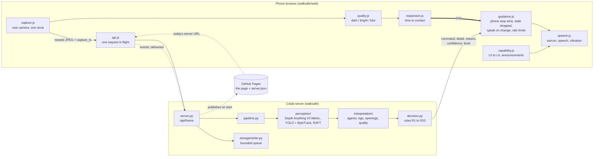

# WalkSafe architecture

This describes the system as built: where each part runs, how a frame becomes a spoken
command, and why it is shaped this way. It follows SRS §5 to §7, and the last section lists
where the build differs from the SRS's design.

## 1. Two places, split by urgency

A round trip to a shared Colab GPU takes about a second, which is fine for choosing a way
through and far too slow for "stop". So:

- **The phone** runs one cheap question, *is something closing in?*, on every frame, with no
  model and no network. It also arbitrates, speaks, and tracks how much of the system is working.
- **The server** runs the three models and the decision rules on the newest frame only.

A stop from the phone is never overridden or delayed by the server (FR-16). A wrong stop
costs a pause; a wrong "walk forward" the phone could not veto costs a collision.

## 2. One frame, end to end

1. **Capture.** About 12 times a second, the page takes a 96×72 grey copy of the camera frame
   and stamps it with `performance.timeOrigin + performance.now()`. The same clock stamps
   every frame and every comparison with it.
2. **On-phone checks.** `quality.js` rejects frames that are too dark, too bright or blurred.
   `expansion.js` matches blocks with the previous frame, removes the mean motion, fits the
   remaining radial growth in the centre, and turns it into a time to contact. Three frames
   under 1.5 s mean `stop`, which goes straight to guidance.
3. **Upload.** When the previous request has finished, the page grabs the newest frame as a
   518 px JPEG and posts it with its sequence number and capture time. Unusable frames are
   not sent.
4. **Server.** `server.py` checks the size before parsing, refuses an out-of-order or
   concurrent frame, and runs `pipeline.process` under a GPU lock:
   - the quality check again (a rejected frame gives `slow_down` at L1 without running the models)
   - depth, if the session's depth map is older than 0.4 s
   - detection and the session's own ByteTrack, then agents: distance from the lower part of
     each box, speeds fitted against capture times, time to collision, risk, side
   - flow against the previous frame, then ego motion from the motion-field equations with
     metric depth
   - openings at body height against the user's width, then confidence
   - the rules, giving one command with its reason
5. **Back on the phone.** `guidance.js` drops the result if it is out of order, older than 2 s,
   or overridden by a phone stop (including results captured while the stop was active). It
   downgrades the result at L1 and suppresses it at L3 or L4. Otherwise it speaks only if the
   command changed, within 15 messages a minute and one step every 2 s. A stop interrupts speech.
6. **Logging.** The server queues the decision, its agents and its openings. The phone later
   reports whether and when it spoke the decision, and the writer fills in `spoken_at` and
   `delay_ms`.

## 3. Failure handling

Every fault ends in an announced capability change (FR-18, FR-19, NFR-7):

| Fault | Where it is seen | Level |
|---|---|---|
| Frames too dark, bright or blurred | phone quality check | L1 |
| Server unsure of the view (low confidence) | `level` in the response | L1 |
| No answer to a sent frame for 2 s (network, tunnel, crash, Colab gone) | phone, timed from the oldest unanswered request | L2 |
| Pipeline exception | server logs it as an event and returns 500; the phone then sees no answer | L2 |
| Camera covered, view too plain to check | expansion check unavailable | L3 |
| On-phone check stopped running or threw | separate timer watches it | L3 |
| Battery at 5 %, or session ended | battery API, stop button | L4 |

A fault must persist for 1 s before the level drops, and be gone for 3 s before it recovers.
This stops one bad frame from causing a stream of announcements. Losing the server never
ends the session (NFR-10): the page keeps retrying and re-reads `server.json` in case the
server came back at a new address.

## 4. Design decisions

- **Pure functions after the models.** Everything in `interpretation/` and `decision.py` takes
  dataclasses and returns dataclasses, with no I/O and no globals. Time comes in as capture
  timestamps. That is what makes T4 to T6 and the property tests possible on a CPU.
- **Models behind Protocols.** `perception/__init__.py` defines `DepthEstimator`, `Detector` and
  `FlowEstimator`, and the tests pass small fakes. Replacing a model touches only `perception/`
  (NFR-16).
- **All per-user state in a `Session`**, including its own ByteTrack instance. The only shared
  objects are the loaded models, guarded by one lock.
- **One configuration file.** `config.py` holds every threshold, and its `phone` section is served
  to the page as `/js/config.js`, so the browser has no values of its own.
- **Ego motion from physics.** The prototype read left and right from where the flow was
  concentrated, which is unreliable. The server fits the motion-field equations with the
  depth map. The translation terms are exact for large steps, which matters at 1 to 2 fps,
  and left and right come from the sign of the motion (NFR-6).
- **Absolute openings.** A column is open only if nothing at body height is nearer than the
  look-ahead, so a wall really does produce "no opening" (FR-8).
- **Newest frame only, never a queue.** Queues turn load into delay, and late guidance is worse
  than none (FR-17).

## 5. Differences from the SRS design

| SRS | As built | Why |
|---|---|---|
| A smartphone application (D3, §5.1 "Phone App") | A web page in the phone's browser | Platform decision: no native app. The phone components are ES modules. |
| Server Lookup: an always-on lookup service | GitHub Pages hosts the page and a `server.json` the server publishes | No always-on server is available; Pages is free, fixed and always up. |
| Log Writer on the phone | The phone queues events and delivery reports and posts them; the server writes the database | The database lives with the server and the dashboard. The phone's queue survives outages. |
| Screen-off operation (§1.4) | The screen is kept on with a wake lock | Browsers suspend the camera and timers when the screen is off (platform limitation). |
| Overheating warnings (FR-20) | Not available | Browsers do not report temperature (platform limitation). |
| ER schema (§4) | Adds `user.shoulder_width_m`; `decision` keyed by `(session_id, source, sequence)` | FR-8 needs the width; phone and server decisions can share a frame number. Both approved, and the SRS table is updated. |
| Agent motion classes | `crossing` carries its direction: `crossing_left` / `crossing_right` | So the spoken detail can say which way. Approved. |
| Depth model DepthPro (§7.2) | Depth Anything V2 Metric Small (outdoor) by default; DepthPro still selectable | DepthPro measured about 6.6 s a frame on a Colab T4, so every server answer would be too old to speak. Approved. |
